# J50 — Archive, restore and delete (tombstone) with history

[Audit index](../INDEX.md) · [Findings](../findings.md) · [Independent review](../review.md)

**Pass 3 result: PASS for history preservation; findings on language/IA.** Source `677bb61e8e9d659db95123871bb2e011cf663a79` (`v2-hardening-followups`), Linux headless Chromium, 1440×900, light theme, disposable synthetic source authority. Synthetic means generated non-biometric patterns, not ONNX inference.

**Starting state / role:** Custodian.

## Interaction sequence and outcomes

1. From the Person Graph, top People tab does not leave the graph (step 1).
2. Archive confirmation (“0 photos, 1 sightings, and 1 relationships”), Escape cancels, Archive succeeds after a database backup; search “Bravo” then says “No people match” (steps 2–3).
3. Archived collection and profile keep sightings, associations, activity and Restore (steps 4–7).
4. Restore confirmation and success (steps 8–9).
5. Delete confirmation “Delete entire profile permanently?”, lowercase “delete” stays disabled, uppercase arms it; toast exposes raw backup id (steps 10–12).
6. Encounter shows “Audit Bravo (deleted)” and keeps the relation; People lists the deleted Person under Archived; the graph keeps a DELETED · HISTORICAL node whose click does nothing (steps 13–16).

**Limits and findings:** Archive and delete preserve history as AGENTS.md requires (PASS). F31, F32. Restore by Administrator and delete refusal for Operator were observed only as disabled controls.

## Step 01 — Where am i

[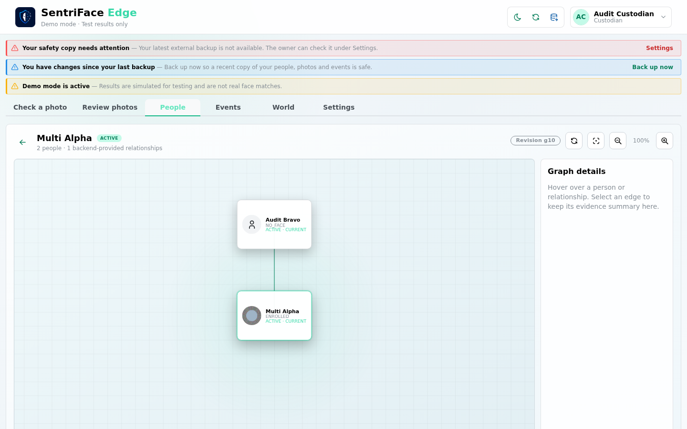](../screenshots/UX-06/UX-06_J50_Step-01_Where-am-i.png)

Capture: CAP-0816 · UX-06 · Custodian · light · 1440×900 CSS · DPR 1 · `2026-11-22T18:39:10.581422+00:00` · synthetic.

## Step 02 — Archive confirmation

[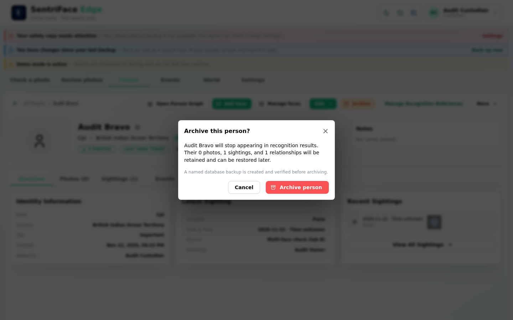](../screenshots/UX-08/UX-08_J50_Step-02_Archive-confirmation.png)

Capture: CAP-0817 · UX-08 · Custodian · light · 1440×900 CSS · DPR 1 · `2026-11-22T18:39:33.885722+00:00` · synthetic.

## Step 03 — Archived profile

[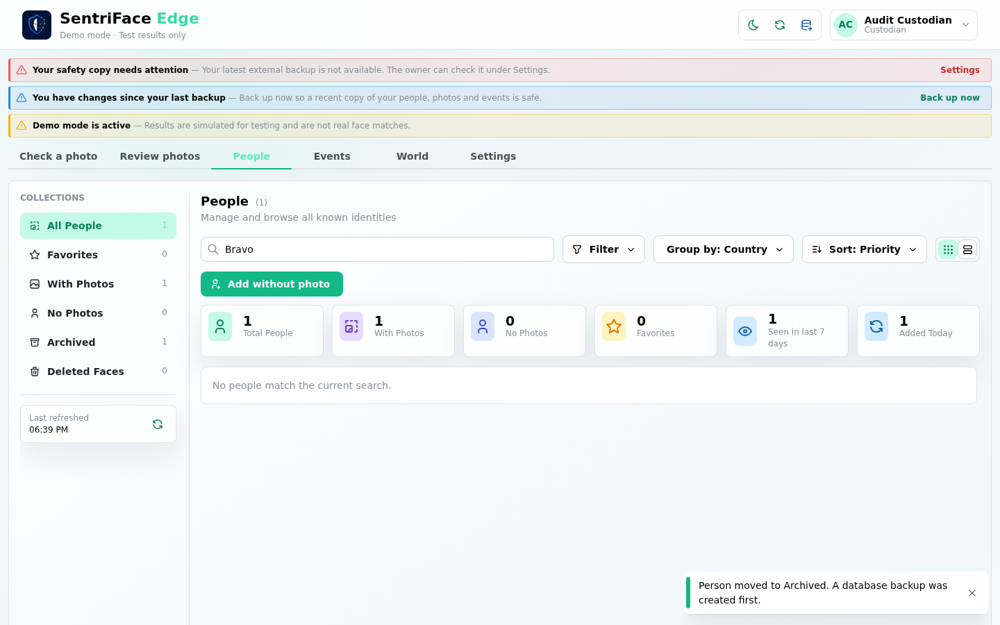](../screenshots/UX-08/UX-08_J50_Step-03_Archived-profile.png)

Capture: CAP-0818 · UX-08 · Custodian · light · 1440×900 CSS · DPR 1 · `2026-11-22T18:39:56.801799+00:00` · synthetic.

## Step 04 — Archived collection

[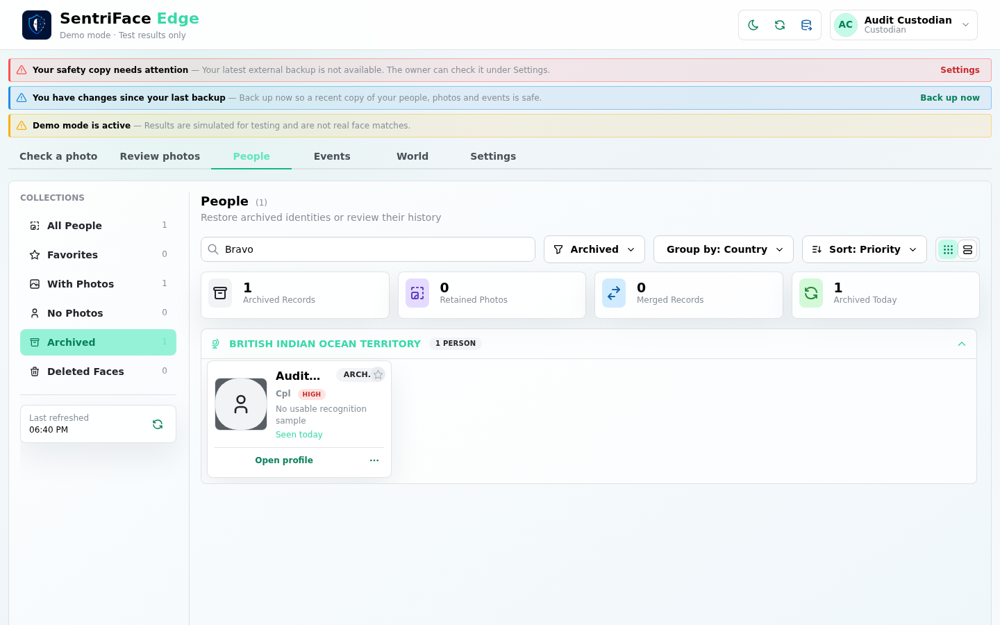](../screenshots/UX-05/UX-05_J50_Step-04_Archived-collection.png)

Capture: CAP-0819 · UX-05 · Custodian · light · 1440×900 CSS · DPR 1 · `2026-11-22T18:40:14.267363+00:00` · synthetic.

## Step 05 — Archived person profile

[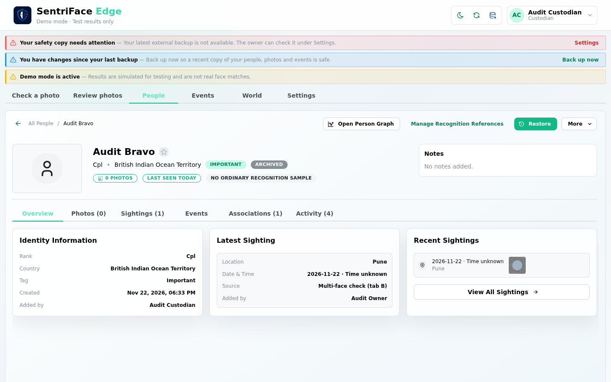](../screenshots/UX-08/UX-08_J50_Step-05_Archived-person-profile.png)

Capture: CAP-0820 · UX-08 · Custodian · light · 1440×900 CSS · DPR 1 · `2026-11-22T18:40:16.408701+00:00` · synthetic.

## Step 06 — Archived activity

[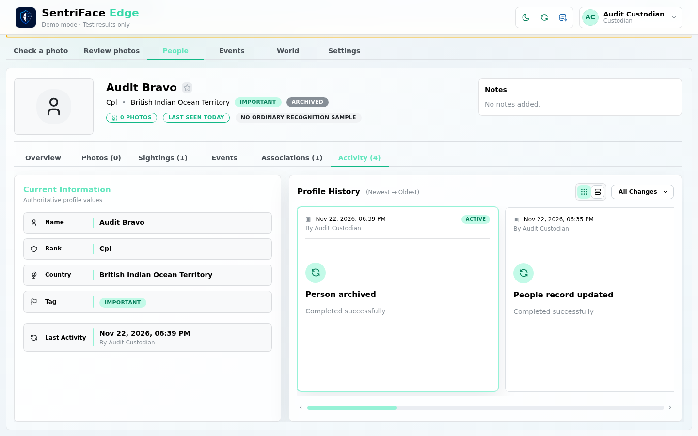](../screenshots/UX-08/UX-08_J50_Step-06_Archived-activity.png)

Capture: CAP-0821 · UX-08 · Custodian · light · 1440×900 CSS · DPR 1 · `2026-11-22T18:40:37.746944+00:00` · synthetic.

## Step 07 — Archived sightings

[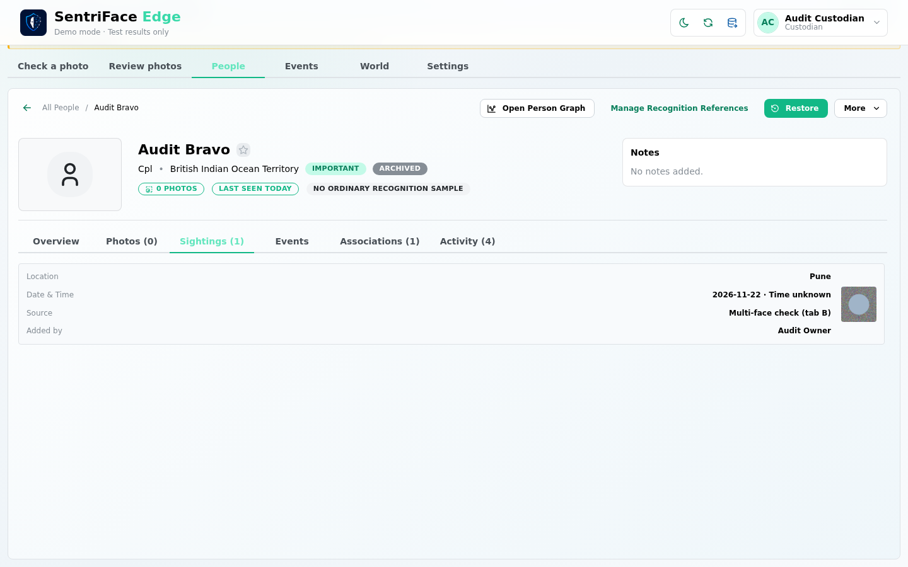](../screenshots/UX-08/UX-08_J50_Step-07_Archived-sightings.png)

Capture: CAP-0822 · UX-08 · Custodian · light · 1440×900 CSS · DPR 1 · `2026-11-22T18:40:39.237213+00:00` · synthetic.

## Step 08 — Restore confirmation

[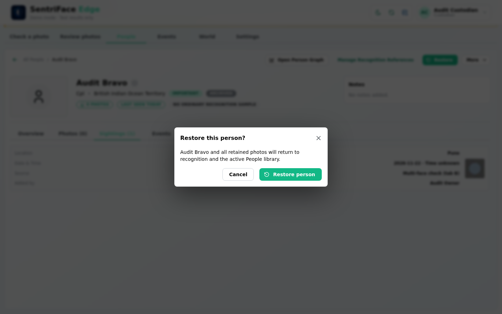](../screenshots/UX-08/UX-08_J50_Step-08_Restore-confirmation.png)

Capture: CAP-0823 · UX-08 · Custodian · light · 1440×900 CSS · DPR 1 · `2026-11-22T18:41:02.533943+00:00` · synthetic.

## Step 09 — Restored profile

[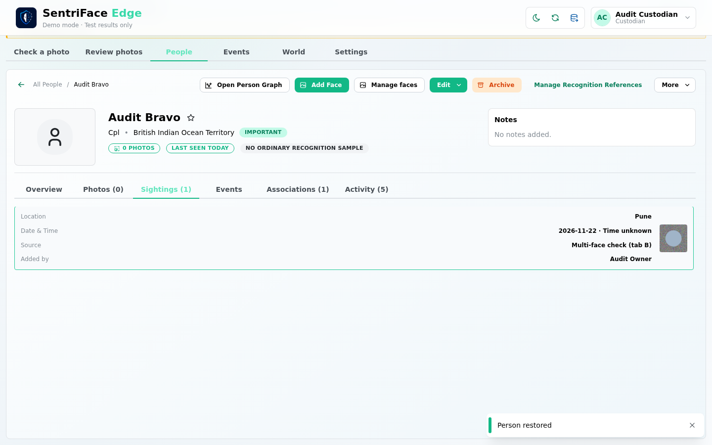](../screenshots/UX-08/UX-08_J50_Step-09_Restored-profile.png)

Capture: CAP-0824 · UX-08 · Custodian · light · 1440×900 CSS · DPR 1 · `2026-11-22T18:41:06.117566+00:00` · synthetic.

## Step 10 — Delete confirmation

[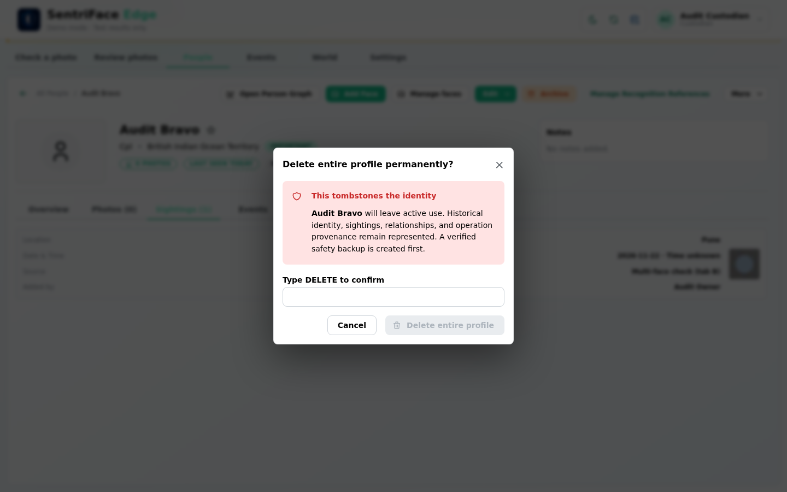](../screenshots/UX-08/UX-08_J50_Step-10_Delete-confirmation.png)

Capture: CAP-0825 · UX-08 · Custodian · light · 1440×900 CSS · DPR 1 · `2026-11-22T18:41:25.583411+00:00` · synthetic.

## Step 11 — Delete armed

[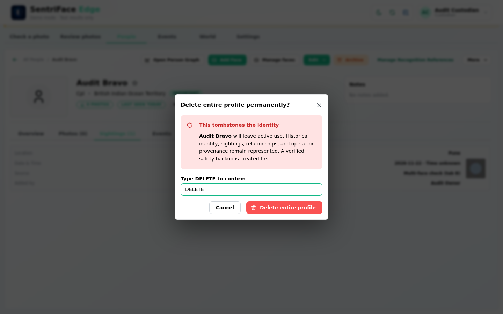](../screenshots/UX-08/UX-08_J50_Step-11_Delete-armed.png)

Capture: CAP-0826 · UX-08 · Custodian · light · 1440×900 CSS · DPR 1 · `2026-11-22T18:41:26.507457+00:00` · synthetic.

## Step 12 — After delete

[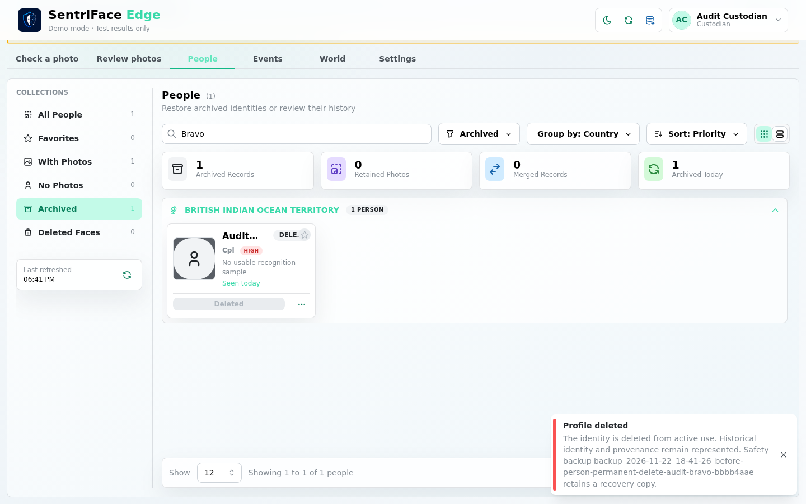](../screenshots/UX-08/UX-08_J50_Step-12_After-delete.png)

Capture: CAP-0827 · UX-08 · Custodian · light · 1440×900 CSS · DPR 1 · `2026-11-22T18:41:30.545447+00:00` · synthetic.

## Step 13 — Encounter after delete

[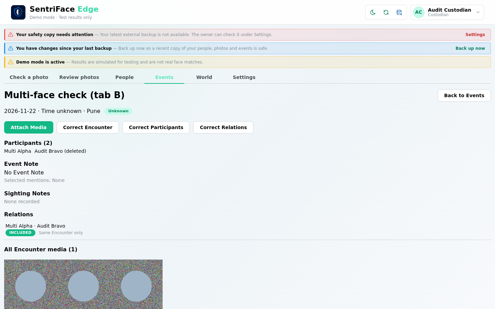](../screenshots/UX-09/UX-09_J50_Step-13_Encounter-after-delete.png)

Capture: CAP-0828 · UX-09 · Custodian · light · 1440×900 CSS · DPR 1 · `2026-11-22T18:41:56.375379+00:00` · synthetic.

## Step 14 — Archived collection after delete

[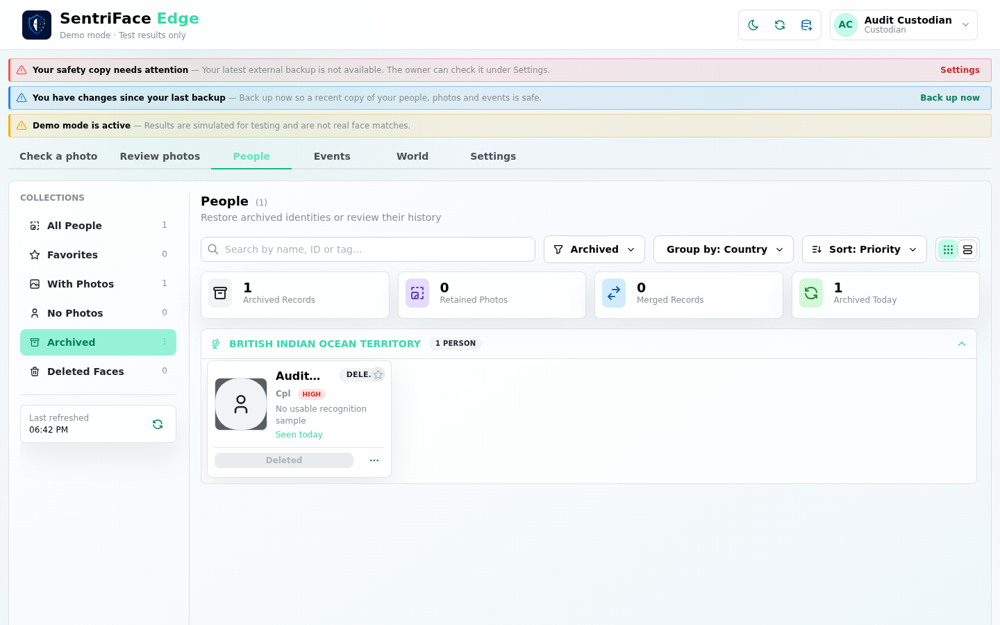](../screenshots/UX-05/UX-05_J50_Step-14_Archived-collection-after-delete.png)

Capture: CAP-0829 · UX-05 · Custodian · light · 1440×900 CSS · DPR 1 · `2026-11-22T18:42:20.008266+00:00` · synthetic.

## Step 15 — Graph with deleted node

[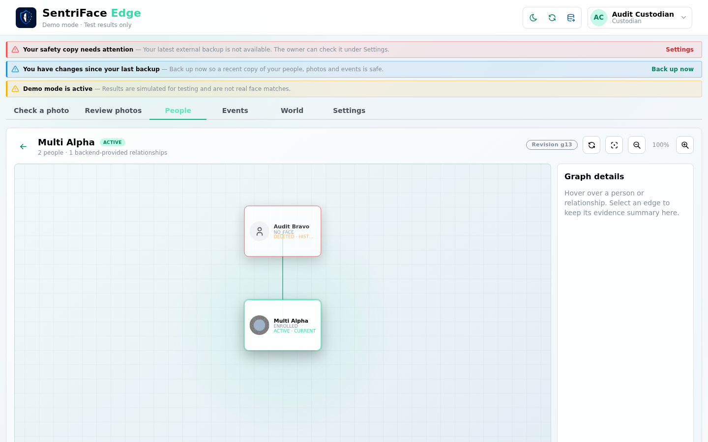](../screenshots/UX-06/UX-06_J50_Step-15_Graph-with-deleted-node.png)

Capture: CAP-0830 · UX-06 · Custodian · light · 1440×900 CSS · DPR 1 · `2026-11-22T18:42:48.941358+00:00` · synthetic.

## Step 16 — Deleted node click

[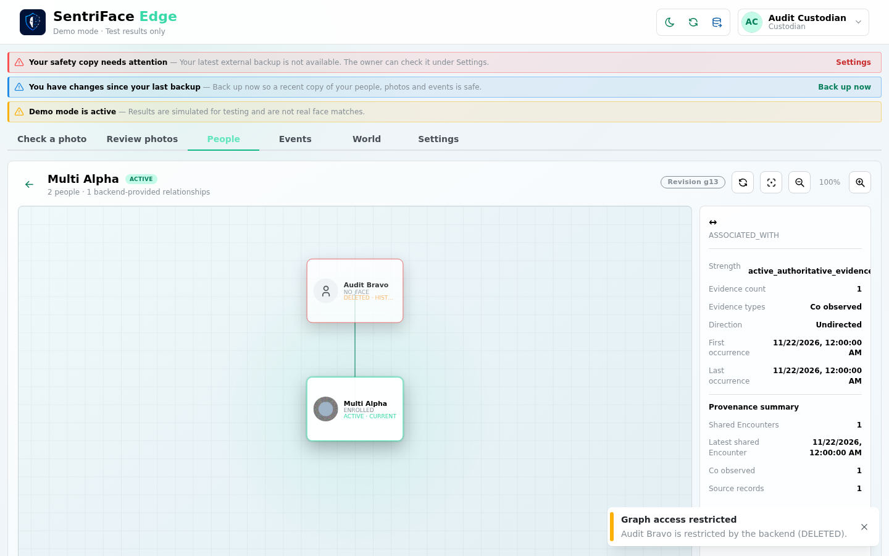](../screenshots/UX-06/UX-06_J50_Step-16_Deleted-node-click.png)

Capture: CAP-0831 · UX-06 · Custodian · light · 1440×900 CSS · DPR 1 · `2026-11-22T18:43:31.803392+00:00` · synthetic.
