# J51 — Account disable, role change and administrator password reset with open sessions

[Audit index](../INDEX.md) · [Findings](../findings.md) · [Independent review](../review.md)

**Pass 3 result: PASS for server revocation; FAIL for user feedback (F34).** Source `677bb61e8e9d659db95123871bb2e011cf663a79` (`v2-hardening-followups`), Linux headless Chromium, 1440×900, light theme, disposable synthetic source authority. Synthetic means generated non-biometric patterns, not ONNX inference.

**Starting state / role:** Administrator plus a separate browser context for the affected user.

## Interaction sequence and outcomes

1. Accounts list and Manage dialog (“Save roles” also saves name and disable state) (steps 2–4; step 1 rejected, step 7 private).
2. Disable Viewer → DISABLED; the Viewer session still shows cached People; Refresh → sign-in with generic error; sign-in → “This account is disabled” (steps 5, 9–10).
3. Change Operator to Viewer: open session keeps Operator navigation until Refresh, then generic error; re-login shows Viewer tabs (steps 6, 11–13).
4. Administrator password reset → “Password reset; existing sessions were signed out”; affected session gets the generic error (steps 8, 14).

**Limits and findings:** Accounts were restored to Operator/enabled afterwards. Not run: lockout after repeated failures, emergency administrator reset.

## Step 01 — Accounts list

*Private original only.* Withheld: mis-capture superseded by the next step.

Capture: CAP-0832 · UX-13 · Administrator · light · 1440×900 CSS · DPR 1 · `2026-11-22T18:47:56.171825+00:00` · synthetic.

## Step 02 — Accounts list

[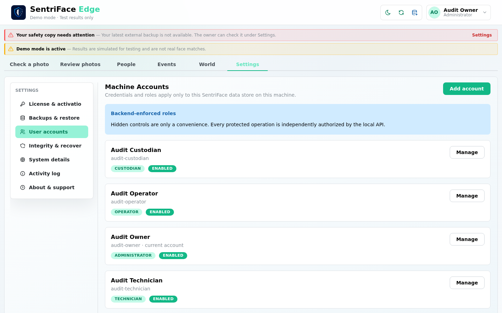](../screenshots/UX-13/UX-13_J51_Step-02_Accounts-list.png)

Capture: CAP-0833 · UX-13 · Administrator · light · 1440×900 CSS · DPR 1 · `2026-11-22T18:48:10.390097+00:00` · synthetic.

## Step 03 — Manage viewer

[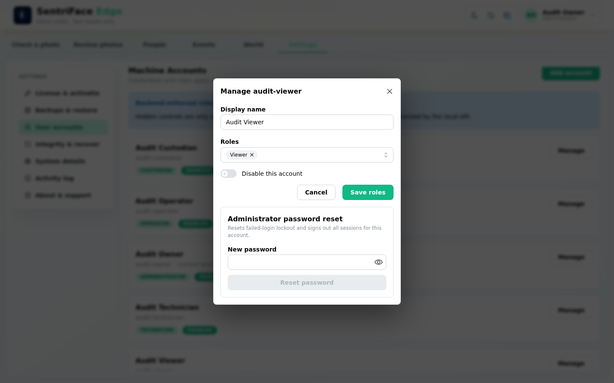](../screenshots/UX-13/UX-13_J51_Step-03_Manage-viewer.png)

Capture: CAP-0834 · UX-13 · Administrator · light · 1440×900 CSS · DPR 1 · `2026-11-22T18:48:27.687300+00:00` · synthetic.

## Step 04 — Disable toggled

[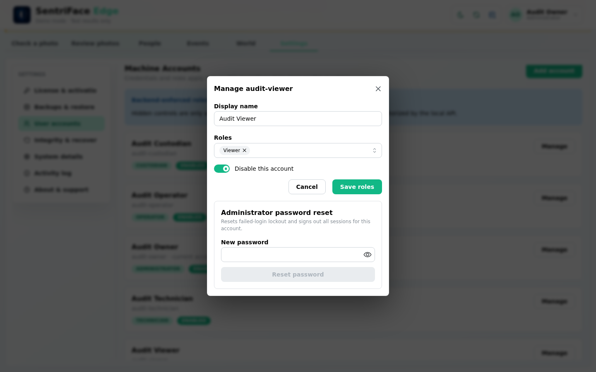](../screenshots/UX-13/UX-13_J51_Step-04_Disable-toggled.png)

Capture: CAP-0835 · UX-13 · Administrator · light · 1440×900 CSS · DPR 1 · `2026-11-22T18:48:28.538749+00:00` · synthetic.

## Step 05 — Viewer disabled

[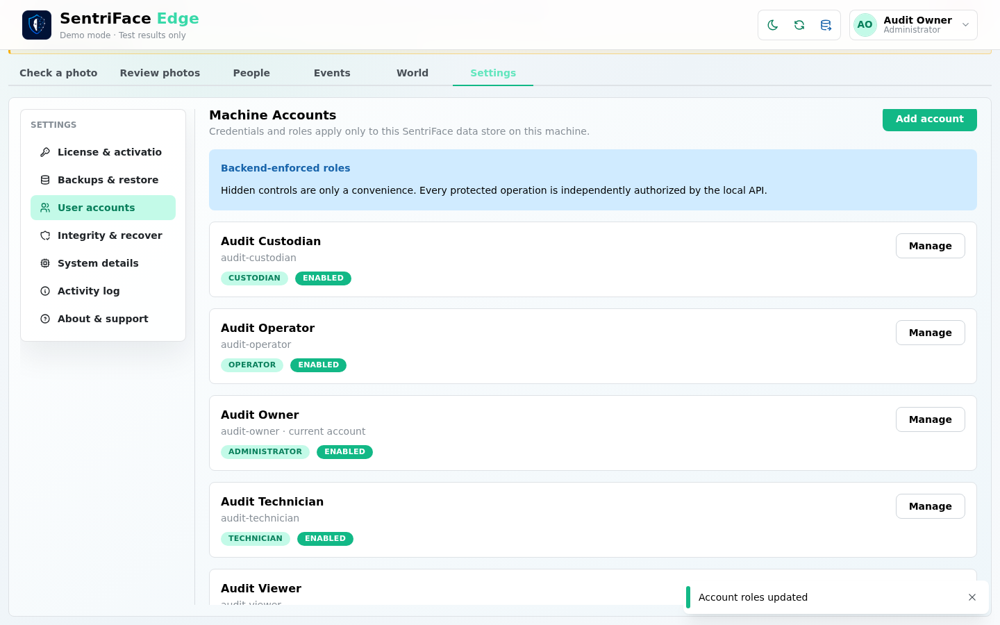](../screenshots/UX-13/UX-13_J51_Step-05_Viewer-disabled.png)

Capture: CAP-0836 · UX-13 · Administrator · light · 1440×900 CSS · DPR 1 · `2026-11-22T18:48:30.555868+00:00` · synthetic.

## Step 06 — Operator role change pending

[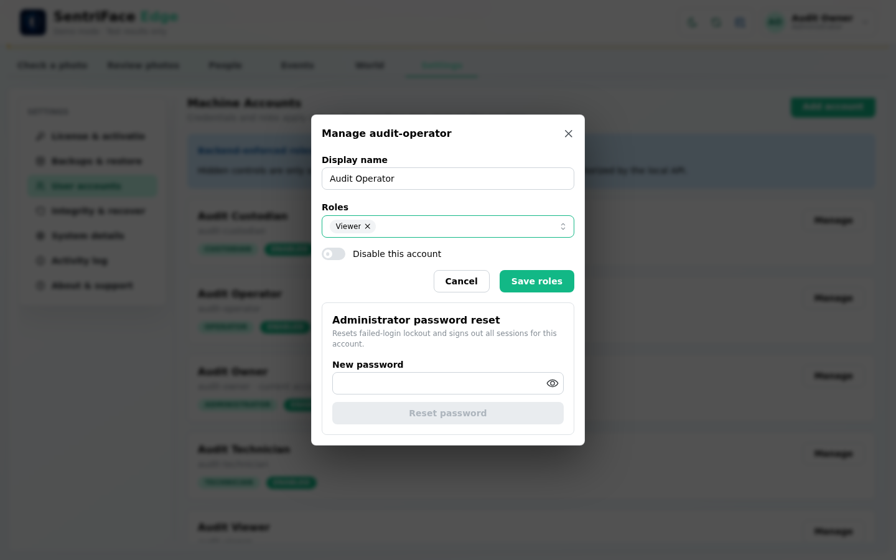](../screenshots/UX-13/UX-13_J51_Step-06_Operator-role-change-pending.png)

Capture: CAP-0837 · UX-13 · Administrator · light · 1440×900 CSS · DPR 1 · `2026-11-22T18:49:56.742021+00:00` · synthetic.

## Step 07 — Admin password reset armed

*Private original only.* Withheld: credential-bearing form with a filled password/passphrase field.

Capture: CAP-0838 · UX-13 · Administrator · light · 1440×900 CSS · DPR 1 · `2026-11-22T18:50:50.017985+00:00` · synthetic.

## Step 08 — Admin password reset done

[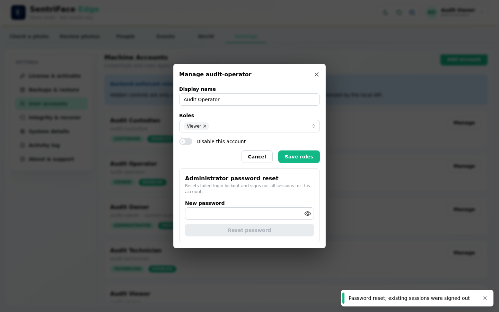](../screenshots/UX-13/UX-13_J51_Step-08_Admin-password-reset-done.png)

Capture: CAP-0839 · UX-13 · Administrator · light · 1440×900 CSS · DPR 1 · `2026-11-22T18:50:52.216938+00:00` · synthetic.

## Step 09 — Disabled viewer stale session

[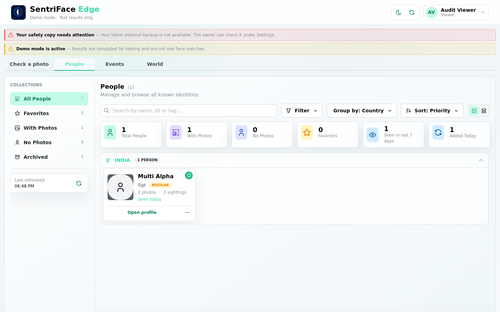](../screenshots/UX-01/UX-01_J51_Step-09_Disabled-viewer-stale-session.png)

Capture: CAP-0840 · UX-01 · Viewer · light · 1440×900 CSS · DPR 1 · `2026-11-22T18:51:46.170424+00:00` · synthetic.

## Step 10 — Disabled viewer signin

[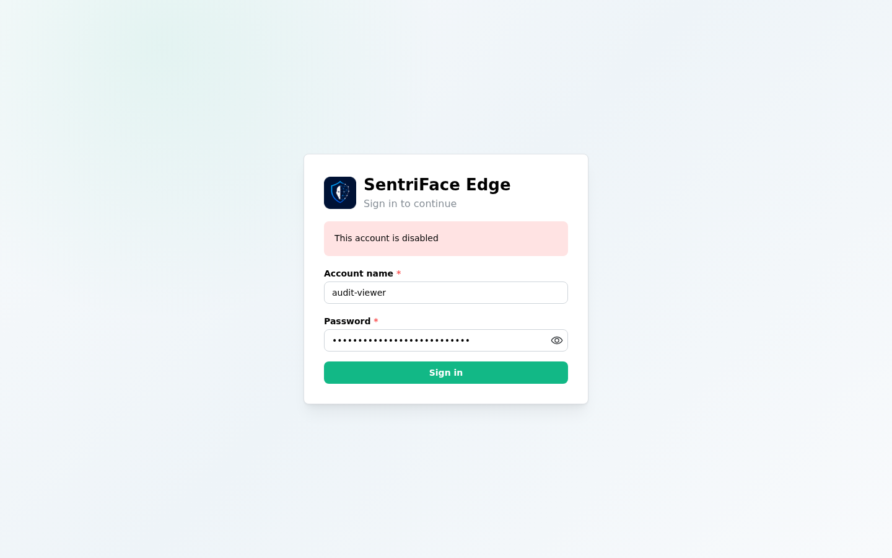](../screenshots/UX-01/UX-01_J51_Step-10_Disabled-viewer-signin.png)

Capture: CAP-0841 · UX-01 · Signed out (disabled Viewer) · light · 1440×900 CSS · DPR 1 · `2026-11-22T18:51:46.172251+00:00` · synthetic.

## Step 11 — Operator session after role change

[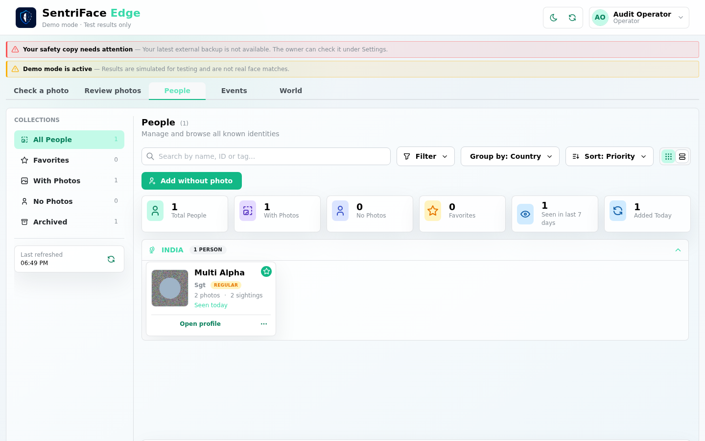](../screenshots/UX-01/UX-01_J51_Step-11_Operator-session-after-role-change.png)

Capture: CAP-0842 · UX-01 · Operator (demoted server-side) · light · 1440×900 CSS · DPR 1 · `2026-11-22T18:51:46.174002+00:00` · synthetic.

## Step 12 — Operator session after refresh

[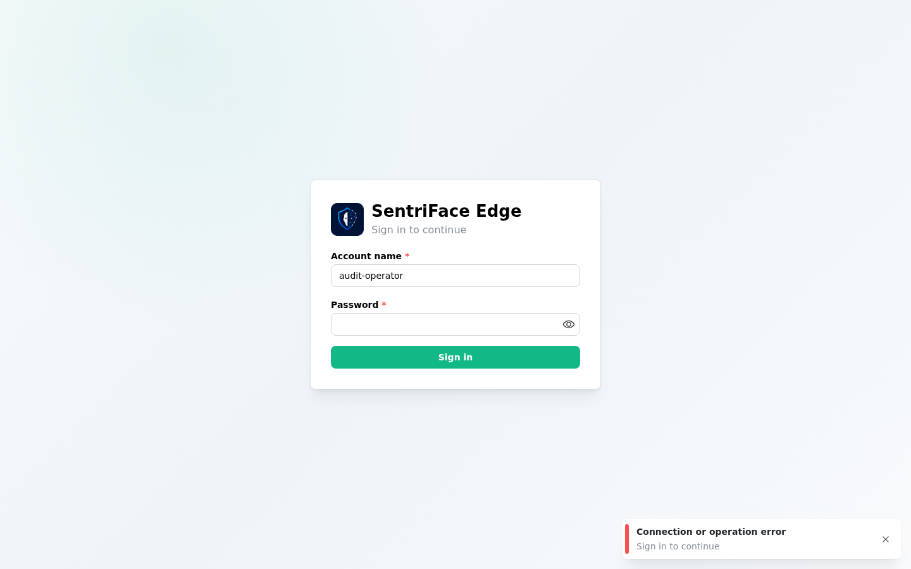](../screenshots/UX-01/UX-01_J51_Step-12_Operator-session-after-refresh.png)

Capture: CAP-0843 · UX-01 · Signed out · light · 1440×900 CSS · DPR 1 · `2026-11-22T18:51:46.175726+00:00` · synthetic.

## Step 13 — Demoted operator signin

[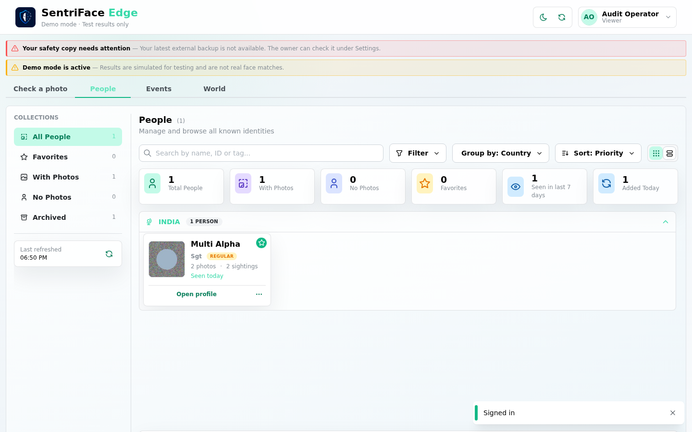](../screenshots/UX-01/UX-01_J51_Step-13_Demoted-operator-signin.png)

Capture: CAP-0844 · UX-01 · Viewer (demoted Operator) · light · 1440×900 CSS · DPR 1 · `2026-11-22T18:51:46.177590+00:00` · synthetic.

## Step 14 — Operator after admin reset

Capture: CAP-0845 · UX-01 · Signed out · light · 1440×900 CSS · DPR 1 · `2026-11-22T18:51:46.179282+00:00` · synthetic.
