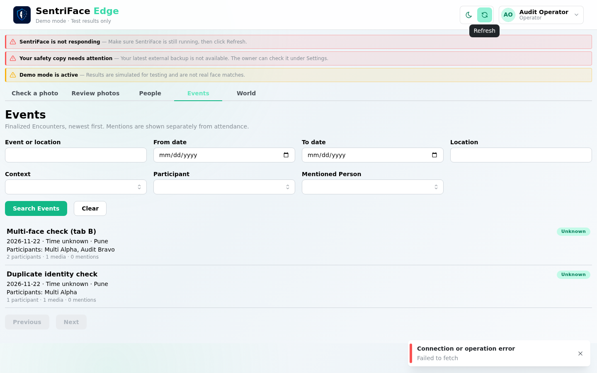
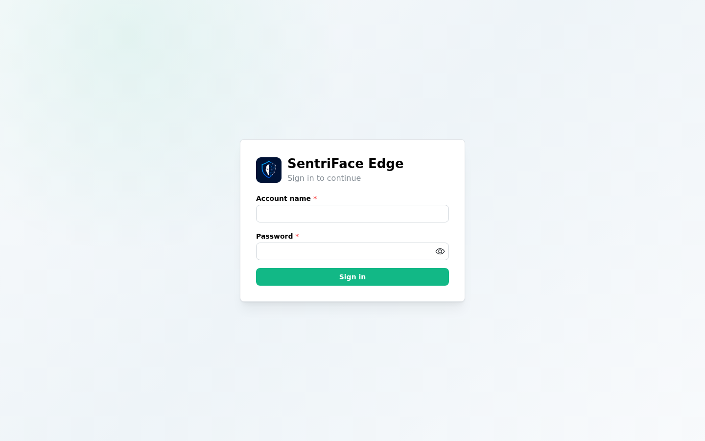
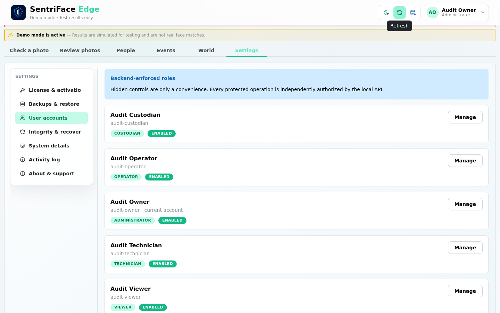

# J52 — Service restart with open sessions (F30 revalidation)

[Audit index](../INDEX.md) · [Findings](../findings.md) · [Independent review](../review.md)

**Pass 3 result: FAIL for feedback (F30/F34); PASS for recovery by reload.** Source `677bb61e8e9d659db95123871bb2e011cf663a79` (`v2-hardening-followups`), Linux headless Chromium, 1440×900, light theme, disposable synthetic source authority. Synthetic means generated non-biometric patterns, not ONNX inference.

**Starting state / role:** Operator (separate context) and Administrator.

## Interaction sequence and outcomes

1. Stop the server; Refresh shows “SentriFace is not responding … then click Refresh” over stale data (step 1).
2. Restart; Refresh still shows “not responding” (step 2). Full reload reaches sign-in (step 3). Administrator session behaves the same (step 4).

**Limits and findings:** The Administrator context used a harness header pinned to the old session token after restart; its later sign-in failure was an automation artifact and is not reported.

## Step 01 — Server stopped open session

Capture: CAP-0846 · UX-01 · Operator · light · 1440×900 CSS · DPR 1 · `2026-11-22T18:52:38.107278+00:00` · synthetic.

## Step 02 — After restart refresh

Capture: CAP-0847 · UX-01 · Operator · light · 1440×900 CSS · DPR 1 · `2026-11-22T18:53:19.163665+00:00` · synthetic.

## Step 03 — After restart reload

Capture: CAP-0848 · UX-01 · Signed out · light · 1440×900 CSS · DPR 1 · `2026-11-22T18:53:22.189022+00:00` · synthetic.

## Step 04 — Admin after restart refresh

Capture: CAP-0849 · UX-01 · Administrator · light · 1440×900 CSS · DPR 1 · `2026-11-22T18:53:50.306048+00:00` · synthetic.
