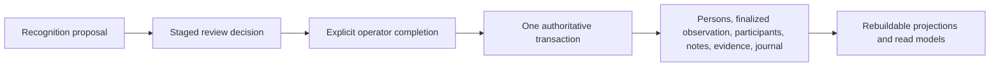
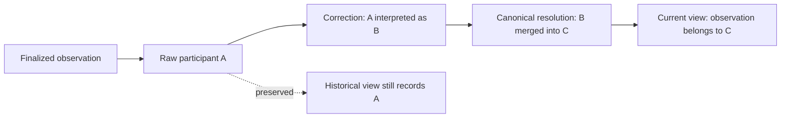

# SentriFace Edge architecture explanation

## Why Batch 3 uses revisions and the existing review

A finalized observation is intentionally immutable. Editing that row would erase what was originally accepted. Metadata correction therefore appends an `encounter_metadata_revisions` row and existing readers use `effective_observations`; the original row and journal history remain inspectable. Face corrections alone cannot express adding a known person without a face or removing accepted participation while retaining the face's provenance. `encounter_participant_revisions` supplies that missing interpretation. REMOVED rows name the raw component present at correction time, preventing a subsequent merge into another participant from erasing the survivor's independent contribution.

Attach Media needs a durable target and a stale-state precondition, which ordinary Batch 2 creation drafts lack. Two fields on existing `photo_reviews` and one active-target index provide those guarantees. The existing scan, identity decisions, Relations review, encrypted managed asset paths and finalization transaction are reused. An attachment increases media/history within the same Encounter, retains old pair choices, and asks only for new pairs. It refreshes shared-frame support and rebuilds one CO_OBSERVED occurrence per included canonical pair. No alternate asset store or transient recognition authority is created.

For example, Alice and Bob attend one meeting. A later image of Alice, Bob and Charlie attaches to that meeting. Alice–Bob remains settled; Alice–Charlie and Bob–Charlie need explicit choices. The image improves Alice–Bob's support but does not make a second meeting. Removing Bob from accepted participation retires only relevant Encounter evidence; an independent Person Note reference or Manual Association can still support the relationship. Mentioning Bob in Event Notes remains searchable history without claiming attendance.

Merge preview refuses contradictory INCLUDE/EXCLUDE collapse and names the affected Encounter. Correct its Relations deliberately, then retry the merge; equal pairs and self-pairs are normalized within the merge transaction. Such authority-changing merges remain outside the frozen safe-revert subset; no recovery whitelist is expanded. Profile Photos deduplicates physical media while retaining face count/origin; Events and Sightings are separate effective reads. Historical summary resolution permits tombstone reads while active selectors still exclude them. All mutation authority stays behind storage/FaceEngine and existing authenticated capabilities. World scoring and cluster algorithms remain unchanged. Older dated read-only Events descriptions below document the preceding checkpoint.


## Purpose and scope

This document is the long-term architectural memory for SentriFace Edge. It explains not merely what the system contains, but why its boundaries exist, what simpler designs would have broken, and how the design behaves when history becomes complicated.

Use it with, rather than instead of, the other architecture documents:

- `DOMAIN_MODEL.md` defines the formal entities, relationships, and current normative contracts.
- `ARCHITECTURE_STATE.md` records the concise implementation checkpoint.
- `IMPLEMENTATION_PLAN.md` records phase order, completion, and remaining gates.

This explanation covers source architecture implemented through P14, with P10 through P13 frozen. P14 Windows/signing release acceptance remains pending. P11-A1 corrected note occurrence history after the first R02 safety stop; P11-C2A corrected and refroze the dependent note-evidence-graph lifecycle after the second. R01 restores a proven archived canonical terminal. R02 reconciles only diagnosed current note-reference drift through append/retire history. P11-D permits only a proven no-survivor-mutation/no-dependency normalized merge revert. P11-E exposes these existing capabilities without adding repair authority. P12 adds authority-aware portable backup closure and staged restore while consuming P11-A/P11-B unchanged. P13 hardens operational model authority, activation, lifecycle, logging, and managed-storage readiness without changing recognition or domain authority. P14 adds only operational licensing and Windows release boundaries.

The 2026-09-27 Encounter stabilization preserves that authority line: the existing observation owns occurrence metadata once after explicit review completion, and face detail rows only mirror it for compatibility. General Person Notes use `PERSON`; Sighting Notes use `RECOGNITION_DETAIL`; Event Notes and selected IDs remain on observation context. Event-selected IDs encode Encounter→Person reference provenance, not Person relationship evidence: there is no source Person to put into `NOTE_REFERENCE` without fabricating one. The review UI asks Event details once, then presents Person/Sighting fields with read-only inherited Event context. Schema v29 adds recognition eligibility to existing embeddings and the search preference to Queue sessions. The existing managed upload reduces inputs above about 1 MB before persistence; that reduced object is historical media, and CPU detector letterboxing is transient. No giant original or parallel event/media service is retained.

Batch 2 keeps those boundaries while moving Queue from immediate group confirmation to a durable serial Encounter review. Existing `init_sessions`, `init_faces` and `photo_reviews` stage grouping, one Event payload, face decisions, and multiple media references. No Person, participant, graph evidence or Encounter is committed until `review.complete`. The existing SQLite/journal transaction remains the authoritative boundary. One small `encounter_relation_decisions` table is necessary because positive evidence cannot represent intentional `EXCLUDE`: a missing row is also consistent with undecided or uncommitted. Every candidate pair must be decided, with `SHARED_FRAME` or `SAME_ENCOUNTER_ONLY` support. Corrections append/retire this decision history and regenerate only included evidence; merge refuses ambiguous effective pair collapse. The global index stays committed-only. A transient Queue candidate view may score accepted draft faces with the existing cosine and quality policy, never `PROOF_ONLY`. Exact content identity and the existing encrypted content-addressed upload objects prevent repeated physical or Encounter media authority. World scoring and read-only Events remain unchanged.

The post-Batch-2 Queue pass uses the same draft records and phase boundary. Media membership reads mark and automatically exclude each photo whose retained bytes already belong to a finalized observation, while valid siblings proceed. The plan accepts only selected staged media and splits an existing scan identity group only when its faces cross confirmed Encounter boundaries. Scan-time groups are not shown before that confirmation. Existing group status records temporary Skip deferral; no face decision is saved for Skip, all-deferred drafts are requeued, and the store rejects `SKIP` as a final decision in planned Encounter reviews. Final `EXCLUDE` stays separate. The UI uses folder paths already preserved by local upload staging as optional grouping hints and still requires confirmation. Existing detector face boxes, authenticated media reads, and the Person Graph evidence projection supply the current-face highlight and association details. Distinct Encounter counts deduplicate observation IDs after canonical endpoint resolution; directed note counts come from active `NOTE_REFERENCE` rows. No new table, transaction framework, media path, or World score was added.

### Current pre-Batch-2 integration

The 2026-10-01 correction extends these existing boundaries rather than adding another index or duplicate system. Accepted faces of both draft-created and committed Persons join committed embeddings in a transient active-Encounter candidate view. Canonical ownership is resolved first; GOOD preference/fallback is evaluated over that combined Person set. A proof-only-only Person is excluded from normal recognition but may appear in the shared exceptional pre-creation check, including a draft-only Person. Draft identity reuse retains the same new-person key. Selected-face draft writes use one SQLite transaction through the existing face-decision implementation. Schema v31 adds only an exclusion field to scan media membership because an omitted local UI selection cannot survive restart. Grouping locks media selection; authoritative history and physical objects remain intact. The page refreshes group IDs/membership after regrouping instead of acting on a scan snapshot. Peek In renders an existing crop or stored box coordinates transiently without detection, enrollment or media writes.

Browse preserves the existing ranked biometric list and percentages by default. The explicit alternate list selects ACTIVE Persons whose actual `biometric_status` is `NO_FACE`, without a fabricated match score. Add Face remains standalone enrollment; observation face assignments and biometric enrollment history already provide durable ENCOUNTER/STANDALONE_ENROLLMENT origin, including review and operation IDs. An embedding without either history is honestly UNKNOWN_LEGACY. The origin is independent of GOOD/POOR_ACCEPTED/PROOF_ONLY and survives canonical ownership changes because the raw provenance rows remain.

Recognition's preference is **Prefer quality photos for recognition**. For a Person with GOOD references, ON uses GOOD and OFF adds POOR_ACCEPTED. Where GOOD is absent, an explicitly accepted POOR_ACCEPTED reference is a fallback under either preference. PROOF_ONLY never enters normal index search, including stale-index defensive resolution and rebuild. A distinct check before new Person creation compares only otherwise unsearchable proof-only-only profiles; it presents possible existing identity or explicit create-anyway. It cannot itself create graph authority. The transaction rechecks the choice before Person creation, so bypassing the UI cannot silently create a likely duplicate.

The bounded Events read API projects only finalized observations. It uses current correction/canonical participant resolution and separately resolves Event Note selected IDs; it never turns a mention into participation. Global Events is read-only with server-side filters and keyset pages; Person Profile Events reuses the same query and reports PRESENT, MENTIONED or BOTH. Mention-only history exposes no claimed sighting media. GET requires existing `view` permission and no Event mutation route exists. World remains Person-to-Person intelligence; this new read projection and Event Note mentions contribute no evidence, graph edge, recurrence or cluster membership. `FEATURES_BY_TAB.md` owns the complete current UI and permission map.

**Current World:** evidence-count relationship strength and deterministic connected components of qualifying evidence relationships. One co-observation evidence row per finalized event/pair is already inserted by review finalization, but current analytics do not yet have a distinct-Encounter recurrence tier or frame-support breakdown. **Locked future direction:** count distinct `(Encounter ID, effective canonical Person pair)` after correction/merge, so many media and raw pre-merge pairs in one Encounter count once. Split support into shared-frame and same-Encounter/no-shared-frame; those counts must add to independent Encounters. Public/group context explains the distribution, without undocumented weighting. Recurrence asks repeated independent co-presence; activity asks how recent/ongoing it is; evidence types describe why an edge exists. Future group-forming eligibility must avoid a weak bridge welding two recurring groups, but no threshold is chosen now. Do not introduce arbitrary place/mention bonuses or public-event multipliers without explicit design. Events are not World nodes.

The central question throughout is:

> What does the system know, why is it allowed to know it, and can it explain how that knowledge changed?

SentriFace is not primarily a collection of face files. It is a historical identity system in which biometric recognition proposes an interpretation, an operator accepts or rejects that proposal, authoritative records preserve what was accepted at the time, and canonical read models express the current interpretation without destroying the past.

---

## 1. Core philosophy

### Evidence over assumption

The first architectural problem was that face recognition output looks deceptively authoritative. A high similarity score can be useful for ranking candidates, but it does not prove identity, participation in an event, or a relationship between people. Treating model output as fact would let model changes, threshold changes, or stale indexes silently rewrite the meaning of the database.

The decision is that recognition owns proposals only. The authoritative transition occurs only after explicit operator finalisation. A recognition result may populate a review choice, but it may not directly create a person, accepted participant, sighting, relationship, cluster, or World node.

This produces a deliberate pipeline:



If the model later improves, existing authoritative history does not change. New recognition can generate better proposals; correcting old history still requires an explainable operator mutation.

### History preservation over destructive mutation

Identity data accumulates provenance. A face may have been accepted as A, corrected to B, and later interpreted under canonical survivor C. Rewriting the original row to C would make the current screen look simple, but it would erase the fact that A and B ever existed and make earlier decisions impossible to audit.

The decision is to preserve raw historical ownership and layer current interpretation on top. Corrections append records. Merges add canonical mappings and manifests. Notes add revisions. Evidence becomes inactive rather than being silently replaced. Archive and delete are lifecycle states, not routine erasure.

This is the system's most important distinction:

- **Historical truth:** what identifier, decision, owner, participant, note revision, or evidence source was recorded at the time.
- **Current interpretation:** what those historical records mean after corrections and terminal canonical resolution.

Both are needed. Historical truth without current interpretation produces fragmented identities. Current interpretation without historical truth produces an unauditable system.

### Backend authority over frontend inference

The React application sees enough display data that it could calculate counts, relationships, identity ownership, and graph membership. That would be convenient initially, but it would create a second domain engine with different timing, filtering, and correction behavior.

The decision is that the frontend sends operator intent and renders versioned backend read contracts. It may decide coordinates, animation, selection, and camera state. It may not decide that two people are related, that two aliases are the same identity, that a node is actionable, that a sighting exists, or that two paged results form one edge.

This boundary is not just code organization. It ensures that the same answer is used by the People list, profile, Person Graph, World, exports, and future integrity tooling.

### Derived state must be replaceable

Graph connections, vector indexes, sightings, analytics, clusters, layouts, rankings, and World explanations are useful, but none is allowed to become irreplaceable truth. Every durable projection must either be rebuilt from authoritative records or be treated as a disposable cache.

The reason is operational as well as conceptual. Offline installations can survive partial upgrades, corrected history, index failure, and projection drift only if the system can distinguish the record of truth from an acceleration structure.

### Offline-first deterministic behavior

SentriFace Edge is completely offline. The loopback API, in-process socket guard, OS network policy checks, encrypted SQLite storage, local model onboarding, and filesystem media model are product invariants, not deployment details.

Offline operation reinforces the architectural preference for deterministic local reads. There is no remote identity service to reconcile ambiguous state and no external event stream to repair local history. Important commands therefore require local operation IDs, actor snapshots, SQLite transaction boundaries, and reproducible projections.

P13 applies the same bounded-local-authority rule to model onboarding. Browser-selected filenames are descriptive metadata only: the server generates an expiring single-use upload identity, chooses the storage target, verifies content, and creates a fixed-shape immutable candidate. Its strict manifest contains fixed component names, sizes, hashes, format/compatibility versions, a server bundle identity, and bounded creation facts; it cannot name a filesystem path, table, or domain record. Candidate and active bundle state remains operational filesystem state outside SQLite, the domain operation journal, identity authority, evidence, and graph state.

P14 applies bounded operational authority to licensing and packaging without moving it into the domain. A canonical SFE2 payload is verified offline against an embedded Ed25519 public-key registry and the shortened versioned Windows machine fingerprint; verified signed state persists per user in HKCU. No private issuance key, activation server, online call, database table, or operation-journal entry exists. Packaged Windows starts unlicensed and applies one backend route policy: product work refuses, while authentication, licensing, P13 model prerequisites, P12 backup/restore, P11 recovery, and support remain usable.

Packaging preserves the same authority split. Program Files contains immutable standalone code; the existing LocalAppData hierarchy remains the only per-user mutable application authority. The installer does not migrate SQLite, relocate media, import keys, or bundle model weights. Upgrade delegates to P13 graceful shutdown, replaces code, and refreshes the exact-executable firewall rule. Downgrade refuses; uninstall preserves data, recovery material, model bundles, HKCU license, and keyring state. Signing credentials remain external release inputs, and unsigned CI artifacts are never production releases.

Activation is an explicit two-step operational command. Both UI-server startup and direct ONNX CLI startup resolve the same server-owned active-bundle state; legacy loose startup-path flags no longer bypass that authority. Preparation loads and validates the immutable candidate, its calibration and usage bindings, the CPU ONNX provider, detector/recognizer interfaces, and the 512-dimensional embedding contract, then returns a signed expiring token bound to both candidate and current active fingerprints. Confirmation revalidates the token and content under the exclusive operation gate, constructs the runtime, atomically publishes active state, and swaps only recognition components within the existing `FaceEngine`. The identity store, P11 recovery application, P12 backup/restore coordinator, authorization service, indexes, and graph authority remain the same objects. The prior bundle is retained for an explicit token-bound rollback. Filesystem receipts make retries deterministic without creating domain history.

Runtime lifecycle is independent of browser presence. One OS-level instance lock owns a data directory; startup fails closed on unavailable keys, unsafe/symlinked or unwritable managed roots, inadequate free space, incompatible recovered keys, invalid model state, or unavailable runtime contracts. SIGINT and SIGTERM stop admission, reject new long operations, cancel queued work, drain bounded in-flight operations, stop maintenance/network-policy monitoring, close HTTP and the store, and release the lock. Startup performs no repair or graph rebuild. Production logging uses bounded authenticated encrypted records with rotation/retention and centralized redaction. SQLite retains schema v28 while enforcing foreign keys, WAL, a bounded busy timeout, and full synchronous durability.

### Explainability is a write-time obligation

“Explainability” is not added later by generating prose about a result. Every important mutation must preserve enough structure to answer who initiated it, what changed, which records were affected, what evidence supports the current result, and what previous state matters for a future guarded revert.

This is why the operation journal, correction history, merge manifests, note revisions, evidence provenance, and structured World explanations all exist. They are different views of the same principle: every mutation is an event that must be explainable.

---

## 2. Persistence and migration foundation

### What problem existed?

All later architectural work depended on changing the schema of databases that may live for years on disconnected machines. An ad hoc series of `if version < n` changes would make upgrade paths hard to test and would risk a partially migrated database becoming the only copy of an installation's identity history.

### Design decision

The schema uses a contiguous, explicit migration registry through schema version 28. Each supported version advances one version at a time, old databases receive a verified pre-migration backup, and the migration chain runs inside an immediate SQLite transaction. A database newer than the application is rejected rather than guessed at.

This was chosen instead of broad schema replacement or best-effort migration. Additive versioned migrations preserve compatibility records and make every supported upgrade path testable. A destructive “recreate current tables and copy what fits” approach was rejected because it could lose legacy history precisely when new authority rules are being introduced.

### How it works internally

The migration registry is validated for contiguity before use. Foreign keys are enabled on storage connections. Before an old database is changed, SentriFace creates or re-verifies a named safety backup. The migration transaction updates schema, data, and `user_version` together. Validation runs before commit; any failure rolls the schema version and data changes back together.

Fresh databases and upgraded databases are expected to converge on the same schema. Compatibility data is preserved even when it is no longer allowed to determine current truth.

### Example scenario

An offline installation starts with schema v17. It must reach v28 through every registered intermediate migration. If migration v23 to v24 fails after creating one table, the entire chain rolls back to the original schema and data. The verified pre-migration backup remains available for recovery. Restarting does not assume that the half-created table is valid progress.

### Edge cases

- A current-schema database does not create an unnecessary migration backup or rerun migrations.
- A failed backup prevents migration from starting.
- A failed migration cannot leave `user_version` ahead of the actual schema.
- Repeated startup is idempotent.
- Foreign-key checks protect historical links from accidental physical deletion.
- A newer database is not opened under older semantics.

The broader lesson is that domain invariants are only credible if the migration system can establish them for every supported existing database.

---

## 3. Identity architecture

### 3.1 Person, identity, and embedding are different concepts

#### What problem existed?

A simple face gallery tends to equate three things:

1. the human being represented by the system;
2. a database record and its historical ID;
3. one or more biometric embeddings used to propose matches.

That equivalence fails as soon as a person has no face enrollment, a face is moved, two records are merged, or an identity is archived while historical events remain visible.

#### Design decision

A `Person` is a stable historical identity node. An embedding is biometric enrollment provenance owned by a raw person record. “Current identity” is the result of corrections and canonical resolution, not a property inferred from the embedding alone.

There is no second durable `Identity` object that supersedes `Person`. In architectural discussion, “identity” means the person record together with its identity/lifecycle/biometric state and its current canonical interpretation. Keeping that term conceptual avoids introducing a competing owner for observations or embeddings.

The person model separates three independent dimensions:

- `lifecycle_status`: `ACTIVE`, `ARCHIVED`, `DELETED`, or `MERGED`;
- `identity_status`: for example, an explicitly created `IDENTIFIED` or `UNIDENTIFIED` person;
- `biometric_status`: `ENROLLED` or `NO_FACE`.

This was chosen instead of encoding all states in `deleted_at`, enrollment count, or display-name conventions. A no-face person can still own notes, participate in finalized observations, and appear in graph history. An unidentified person is still an intentionally tracked identity; an unknown detection is not.

#### How it works internally

Raw records keep their original `person_id`. Embeddings keep raw enrollment ownership. Read methods expose both raw ownership and effective canonical ownership. Vector indexes are derived caches rebuilt from active embeddings and their current canonical owners.

Recognition search is defensive even when an index is stale: candidate embeddings are regrouped through the storage layer's current effective owner before person matches are returned. This prevents a moved face from continuing to propose its former owner merely because an older index generation is still in memory.

#### Example scenario

Priya is created as a known person with background context but no usable image. She is `ACTIVE`, `IDENTIFIED`, and `NO_FACE`. She may be mentioned in notes and accepted as a participant through an operator workflow. Later, Add Face enrolls a biometric embedding and changes only her biometric state to `ENROLLED`. It does not create a second identity or invent an observation.

#### Edge cases

- Zero embeddings does not mean the person does not exist.
- Deleting an embedding does not delete observations in which the person participated.
- A stale vector index is corrected at result grouping by current storage ownership.
- A merged source may still own raw embeddings while searches return the survivor.
- An archived or deleted terminal identity remains historical, but is excluded from active recognition enrollment and action paths.

### 3.2 Why canonical identity exists

#### What problem existed?

Duplicate person records are unavoidable. Physically moving every embedding, participant, note, evidence row, and operation to one ID would appear to solve the duplicate, but it would erase the identity under which each fact was originally recorded. It would also make merges expensive, fragile, and difficult to reverse safely.

#### Design decision

Physical consolidation of historical records was rejected. Instead, raw ownership remains unchanged and canonical resolution provides the current interpretation.

A merged source points to a canonical target. Resolution is transitive and always ends at a terminal canonical identity. Current reads collapse aliases to that terminal person; historical reads can still show each raw ID and each merge step.



The resolution order is significant:

1. start from raw observation participant or face assignment;
2. apply the applicable correction chain;
3. resolve the resulting person through the canonical merge chain;
4. deduplicate the terminal person within the observation or projection.

#### How it works internally

Only `MERGED` people may carry a canonical target. The resolver walks the mapping transitively and detects cycles, dangling targets, and malformed non-merged mappings. A merge target must resolve to a terminal active person. Current embedding ownership follows the latest face-ownership correction and then the same terminal canonical resolution.

Raw state therefore looks like:

```text
Observation O1 -> participant A
Embedding E1   -> original owner A
Evidence V1    -> raw endpoints A and B
```

The current interpretation may be:

```text
O1 -> Canonical(Corrected(A))
E1 -> Canonical(CurrentOwner(E1))
V1 -> Canonical(A) and Canonical(B), unless they collapse to one person
```

#### Example scenario

Day 1: an observation is finalized with raw participant A.

Day 30: an operator corrects that participation from A to B.

Day 60: B is merged into C.

The current sighting and World event show C. The raw participant row still says A. The correction still says A to B. The merge history still says B to C. An explanation can therefore show the complete interpretation chain rather than pretending the observation always belonged to C.

#### Edge cases

- **Merge chains:** A merged to B and B later merged to C resolves A and B to C. Each manifest retains its original source and target.
- **Self-map or cycle:** rejected before commit and also guarded by schema/state validation.
- **Deleted survivor:** rejected. A survivor must be terminal and active.
- **Archived source:** may be merged into an active survivor; its archived history is preserved.
- **Deleted source:** cannot be merged.
- **Correction followed by merge:** correction remains raw history; its target resolves through the later merge.
- **Merge followed by correction:** a merged ID supplied to a current command resolves to its terminal survivor; the correction must still name different effective people.

### 3.3 Lifecycle is visibility and action policy, not erasure

#### What problem existed?

Using deletion as the only lifecycle operation conflates “not currently active,” “historically removed,” and “merged into another identity.” Physical deletion also destroys graph provenance, audit history, and the ability to explain past events.

#### Design decision

Lifecycle states are explicit:

- `ACTIVE`: participates in current action paths and active recognition ownership.
- `ARCHIVED`: inactive but restorable and historically visible.
- `DELETED`: tombstoned and historically represented, not ordinarily restorable through the archive path.
- `MERGED`: a historical alias whose current interpretation is another active person.

The compatibility operation named `permanently_delete_person` now tombstones rather than physically erasing. A separate storage-only physical purge capability remains exceptional and is not normal identity lifecycle behavior.

#### How it works internally

Archive, restore, and delete are journaled state transitions. The person row and linked historical records remain. Active lists exclude inactive people; historical and graph projections can retain them with backend-provided restrictions. Recognition indexes are rebuilt after lifecycle transitions so inactive identities do not remain normal proposal targets.

#### Example scenario

An operator archives Arun because he should not appear in current matching workflows. Old finalized events and relationship evidence still refer to Arun, and historical graph views may show him as inactive. Restoring Arun returns him to `ACTIVE` without recreating his history. If Arun is instead tombstoned as `DELETED`, his events remain, but active operations remain restricted.

#### Edge cases

- Re-archiving an archived identity is idempotent and records whether state actually changed.
- Only archived identities can be restored.
- A merged source cannot be independently deleted; its lifecycle meaning is already the canonical mapping.
- Archived and deleted graph nodes remain explainable even when navigation is disabled.
- Lifecycle change and journal commit share the same transaction.

---

## 4. Evidence and observation architecture

### 4.1 Why sightings are not stored as counters

#### What problem existed?

A counter such as `person.sighting_count += 1` cannot answer which event produced the count, whether duplicate faces in one photo were counted twice, what happens after a correction, or how two merged identities should combine. A counter also becomes stale when an observation changes interpretation.

#### Design decision

The finalized `Observation` is the authoritative presence unit. A current sighting is a derived pair:

```text
(finalized observation, effective terminal canonical person)
```

Sightings, first/last seen values, monthly trends, location counts, and frequency labels are rebuilt from observations. They are not independent authority.

#### How it works internally

An observation carries event time, location, context, source, status, and one or more references to existing media. Raw participants preserve accepted person IDs. Immutable face assignments preserve which accepted face and embedding contributed to the event. Effective participants apply corrections, then canonical resolution, then set-based deduplication.

Only `FINALIZED` observations contribute to sightings and co-observation evidence. Draft observations and staged reviews do not. Media is referenced rather than copied into the event model, so deleting one biometric enrollment does not erase the historical event.

#### Example scenario

One event contains two photos and three detected faces. Two faces are accepted as the same person and one as another person. The finalized event has two effective participants, not three sightings. It contributes one sighting to each person and one co-observation relationship evidence record for the pair.

#### Edge cases

- Duplicate faces or duplicate photos do not multiply a person's sighting within one observation.
- If two participants later merge, the effective participant set collapses to one; the event remains, but no self-relationship is projected.
- Missing location is retained as missing, not replaced with an invented place.
- Invalid timestamps use documented fallbacks in current analytics rather than changing stored history.
- Photo or embedding deletion cannot remove finalized participation.

### 4.2 Why finalisation is one atomic command

#### What problem existed?

The earlier UI shape naturally encouraged one request per detected face: accept A, create B, skip C, then create relationships. In a multi-face event, any failure between requests could leave half an observation authoritative. That violates the meaning of co-observation and makes graph evidence depend on request ordering.

#### Design decision

Review decisions are non-authoritative staging. Every detected face must have a final decision, and the operator must explicitly complete the review. One backend command then commits every authoritative consequence or none.

This was chosen instead of compensating transactions across frontend request loops. SQLite can provide a stronger and simpler guarantee when the entire final write crosses one backend transaction boundary.

#### How it works internally

`photo_reviews` and `photo_review_faces` store staged decisions such as accept existing, accept new, exclude, or skip. Completion performs one transaction that may:

- create accepted people;
- create embeddings and immutable face assignments;
- finalize the observation and attach media;
- insert deduplicated raw participants;
- save normalized Person/Sighting Note revisions and explicit mentions, plus Event Note selected IDs on the observation;
- create co-observation and Person/Sighting Note mention evidence;
- replace and validate the graph projection;
- commit the `review.complete` journal operation;
- mark the review completed and remove staging.

The Queue uses the same completion boundary for the selected group subset. Check Photo also sends one completion intent after all faces have decisions. React does not assemble durable participant or evidence state.

#### Example scenario

A photo contains Meera, Nikhil, and one poor-quality face. The operator accepts Meera, creates Nikhil as a new person, and explicitly excludes the poor-quality face. Completion succeeds as one unit. If creating Nikhil's embedding fails, Meera is not partially recorded as a participant and no co-observation edge appears.

#### Edge cases

- A review with any undecided face cannot complete.
- `EXCLUDE` is the final negative face decision and creates no participant. Legacy review history may contain `SKIP`; planned Encounter reviews now use group status to defer instead, and cannot finalize while a face is skipped.
- Retrying the same committed operation ID returns the committed result without duplicating evidence or advancing graph revision again.
- A failure inside the transaction removes its started journal row along with all partial authoritative changes. Some service-level commands then record a separate durable failed attempt; failure semantics are command-specific and must not be generalized blindly.
- A cancelled review cannot later be treated as finalized identity history.

### 4.3 Corrections preserve the accepted-at-the-time record

#### What problem existed?

Operators will discover mistakes after finalisation. Updating `observation_participants.person_id` in place would make current results look correct, but would destroy the original accepted decision and make it impossible to distinguish human correction from initial recognition.

#### Design decision

Corrections are append-only authoritative history. Raw participants, original face assignments, and original review decisions remain unchanged. Effective participant reads apply the correction chain before canonical resolution.

Only the affected observation's current co-observation evidence is revised: existing evidence becomes inactive, a new evidence revision is created from the new effective participant set, and the graph projection is rebuilt in the same transaction.

#### How it works internally

An identity correction records its type, from/to people, operation ID, time, and the applicable observation, face assignment, or embedding. Observation correction identifies all raw/effective records that currently resolve to the source in that observation. It appends face-assignment corrections where assignments exist and observation-identity corrections for remaining participant provenance.

The recalculation step deduplicates effective participants, retires only active `CO_OBSERVED` evidence sourced from that observation, creates a new revision for current pairs, rebuilds the graph, validates it, and commits the journal entry.

#### Example scenario

Event O1 and O2 both contain A and B. O1 was misidentified: its B is actually C. Correcting O1 leaves the O2 A-B evidence active, retires only O1's A-B evidence, and creates O1 A-C evidence. Historical inspection can still show that O1 originally named B.

#### Edge cases

- The source must be an effective participant in a finalized observation.
- Source and target must resolve to different terminal identities.
- The target must be active.
- Correcting B to A in an event that already contains A collapses the effective participants; no self-edge is created.
- A later merge of the correction target is handled by canonical resolution without editing the correction row.
- Projection failure rolls back the correction, evidence revision, and committed mutation; the correction service records a durable failed operation attempt when possible.

### 4.4 Move Face changes interpretation, not raw enrollment history

#### What problem existed?

Moving an embedding by updating `embeddings.person_id` would erase who originally enrolled it. It would also leave any completed event's face assignment and relationship evidence inconsistent unless every dependent row were destructively rewritten.

#### Design decision

Move Face appends a `FACE_OWNERSHIP` correction and corresponding `FACE_ASSIGNMENT` corrections for observations that used the embedding. Raw embedding ownership, review decisions, recognition details, and immutable assignments remain unchanged.

Current ownership is:

```text
terminal canonical(latest face-ownership correction, otherwise raw embedding owner)
```

#### How it works internally

The command resolves the destination to an active canonical person, rejects no-op moves, finds observations containing the embedding, appends ownership and assignment corrections, updates derived biometric state, recalculates evidence only for affected observations, validates the graph, and journals the entire operation atomically.

If the moved embedding was the source person's representative face, that derived preference is cleared. If no effective active embeddings remain for the source, the source becomes `NO_FACE`; the target becomes `ENROLLED`.

#### Example scenario

An event has A and two faces accepted as B. One B face is later found to be C. Moving that embedding adds C to the effective event but keeps B because another B face still supports B's participation. If the moved face had been B's only face in the event, B would disappear from the effective participant set for that event.

#### Edge cases

- Moving a face to its current effective owner is rejected.
- A deleted embedding cannot be moved.
- An archived or deleted target cannot receive the face.
- A face may affect multiple finalized observations; all affected evidence recalculations share the transaction.
- A stale vector index cannot override current ownership because result grouping asks storage for effective owners.
- If graph recalculation fails, ownership corrections and biometric-state changes roll back together.

### 4.5 Add Face is enrollment, not an event

#### What problem existed?

The same staged face machinery is useful both for reviewing an encounter and for adding a reference photo to an existing person. Treating every Add Face as an observation would invent a sighting, location, participant, and relationship from what may be only a profile-enrollment action.

#### Design decision

Add Face is a distinct atomic enrollment command. It may create one or more embeddings and immutable enrollment-history rows for one active existing person. It does not create a person, observation, participant, sighting, or graph evidence.

#### How it works internally

Every staged face must have a final decision, every accepted face must target the same active canonical person, and no accepted-new-person decision is allowed. Duplicate vectors for the same raw target reuse the embedding rather than creating another. The review completes, enrollment history is journaled, biometric state becomes `ENROLLED`, and staging is removed in one transaction.

#### Example scenario

Raj already exists as a `NO_FACE` identity with notes and relationships. An operator opens Add Face and accepts two crops as Raj. The operation enrolls those references and changes Raj to `ENROLLED`. His observation count and graph remain exactly as before.

#### Edge cases

- Add Face to an archived identity is rejected.
- A review containing a “create new person” decision is rejected for this command.
- An enrollment failure leaves the review in progress and creates no embedding.
- Existing notes, mentions, and graph evidence are untouched.

### 4.6 Selected mentions preserve their note scope

#### What problem existed?

Plain text such as “Met @Alex” is ambiguous. Names are not stable IDs, two people can share a name, spelling can change, and parsing historical free text would fabricate intent that was never explicitly saved.

#### Design decision

Person and Sighting Notes are normalized, revisioned records. Their mentions are explicit saved occurrences referencing person IDs. Display text helps the operator, but it is not the source of relationship truth. A Sighting Note's source Person is the sighted Person. Event Notes instead belong once to the observation: their selected person IDs are structured Encounter→Person provenance and do not produce `relationship_evidence`, `NOTE_REFERENCE`, `CO_OBSERVED`, or any World/cluster/recurrence effect. All three scopes require a selected person ID; literal unselected `@Name` is inert.

An active Person/Sighting Note mention occurrence requires exactly one current directed `NOTE_REFERENCE` evidence row from the note owner to the referenced person. Editing such a note diffs exact mention IDs: removed occurrences retire only their active evidence; unchanged occurrences remain; new occurrences create new evidence. A later evidence replacement for an unchanged current occurrence retires the old evidence revision and appends a new one; it never reactivates or deletes the old row.

#### How it works internally

Each note has immutable revisions containing content, actor/author, operation ID, and the mention snapshot. Active mention rows point to the revisions that created and retired them. Profile note saves use optimistic concurrency through `expected_previous_notes`. The latest normalized revision is current truth; `persons.notes` is refreshed afterward only as a compatibility mirror.

Merge note conflict resolution also appends a normalized revision before updating the compatibility mirror. Existing raw mentions may remain editable after the referenced identity is merged, while new mentions must resolve through permitted active identity rules.

Legacy profile and recognition-detail text migrates into note history without parsing `@` strings. Legacy `automatic_mention` associations are not promoted when the exact note occurrence cannot be proven.

#### Historical rows versus current note-reference truth

Two R02 safety stops made an implicit lifecycle rule explicit. The first checker treated every old occurrence as though it had to match the latest revision. The second checker and shared graph builder treated every old evidence revision as though it had to match its occurrence's current active state. Both assumptions contradicted the one-way append/retire schema.

The consolidated model is:

```text
immutable note revisions and mention snapshots
    -> append-only occurrence identities; active rows are current occurrence truth
    -> append-only evidence revision identities; active rows are current support truth
    -> correction/canonical effective endpoints
    -> active-only graph projection
```

Historical occurrence and evidence rows answer what happened. They can remain retired forever, including when the same raw person is mentioned again in a later occurrence or when the same occurrence receives a newer evidence revision. They are not required to become active again or mirror the newest row. Current cardinality is enforced separately: one active occurrence per required existing note/person group, then one matching active `NOTE_REFERENCE` per active non-self occurrence on an active note.

P11C-R02 is the only recovery command that may reconcile this layer. Preparation starts from actual P11-A findings for one existing note/person group and fixes one deterministic plan. Execution re-reads revision authority, occurrence/evidence history, canonical paths, graph projection/revision, and relevant journal state under `BEGIN IMMEDIATE`. It appends new current rows or retires inappropriate active rows; duplicate active evidence is entirely retired before one new current revision is appended. It never reactivates or deletes history and never parses note text. Shared graph authority validates the result, only the affected directed aggregate is maintained, and revision advances once for any active-evidence change—even a canonically collapsed self-edge. A full P11-A post-check follows commit.

Retirement is not accepted from `active = 0` alone. An occurrence additionally needs its same-note retirement revision at or after its creation revision, retirement operation ID, timestamp, foreign-key linkage, and legal journal result. Evidence needs deactivation operation ID, timestamp, foreign-key linkage, and legal journal result. Schema v28 has no replacement-link field, so integrity logic cannot invent or require one.

The shared graph authority validates every evidence row's immutable source/endpoints/type/direction and lifecycle shape. For active note evidence it also requires a current active occurrence on an active note. For retired evidence it validates historical provenance without comparing the row to current source state. It then verifies current active evidence cardinality per occurrence and aggregates only active rows. This retains the normal safety property that a generic deactivation cannot commit while leaving an active occurrence unsupported.

`CO_OBSERVED` and `MANUAL_ASSOCIATION` did not share the history/current contradiction. Their source, direction, correction, participant, canonical, lifecycle, and projection rules remain unchanged. Retiring note evidence never removes their independent support. Canonical collapse suppresses a current self-edge without deleting raw note evidence. Correction continues to transform observation evidence before canonical resolution; it does not rewrite note endpoints.

#### Example scenario

Anita's note explicitly mentions person ID B. That creates directed Anita-to-B evidence. The note is later edited to mention C instead. B's mention evidence becomes inactive, C's becomes active, and an independent Anita-B co-observation remains untouched.

#### Edge cases

- Duplicate display names are safe because the saved reference is an ID.
- Mentioning oneself does not create self-evidence.
- If another editor changed the note, the expected-text mismatch rejects the save and requires a refresh rather than silently overwriting the newer revision.
- During merge, `KEEP_SOURCE`, `KEEP_TARGET`, `COMBINE`, or `USER_SELECTED` determines the survivor's note content; the resulting revision and selected strategy remain explainable.
- `USER_SELECTED` free text cannot safely invent parsed mention provenance; existing target mention provenance is retained rather than guessed.

---

## 5. Mutation architecture

### What problem existed?

Without a common mutation discipline, archive, note save, review completion, correction, and merge could each leave a different audit trail and a different partial-failure shape. Request retries could duplicate evidence, and an activity feed built from UI events would not prove that a database change committed.

### Design decision

Every important normalized mutation is identified by a stable operation/idempotency ID and an authenticated actor snapshot. Graph-affecting authoritative changes, their evidence changes, graph projection replacement, graph revision advancement, and successful journal transition share one SQLite transaction.

`operation_journal` is the current operation/activity authority. `person_operations` remains only for historical compatibility and old idempotency paths; it is not merged into the current activity feed because legacy rows lack reliable actor and lifecycle semantics.

### How it works internally

A journal entry records:

- operation ID and type;
- status and immutable status-transition history;
- actor and actor user ID;
- source boundary and optional context;
- affected entities;
- initial details and committed/failed result details;
- creation and completion times.

The normal success path is `STARTED` to `COMMITTED`. The schema also supports `FAILED`, `ROLLED_BACK`, and `REVERTED`, but general operation revert is deliberately deferred to P11.

The API requires operation IDs for important writes and derives the actor from the authenticated local session. The engine rejects mutation calls that lack both a usable operation ID and actor identity. SQL writes remain behind storage/service boundaries.

### Transaction boundaries and rollback philosophy

The architectural unit is the domain command, not an individual table update. For example, merge includes its manifest, conflict choices, canonical mapping, graph rebuild, index publication coordination, validation, and journal commit. Review completion includes every accepted face and its event consequences.

If any in-transaction step fails, authoritative state rolls back. Failure-attempt recording is intentionally separate where durability is useful:

- correction service commands can record a new `FAILED` journal state after the failed transaction rolls back;
- merge records a durable failed attempt and prohibits reuse of that operation ID;
- lower-level transaction tests may correctly leave no journal row because the started row was part of the rolled-back transaction.

This is not inconsistency; it distinguishes “no authoritative operation committed” from “an explainable attempt failed.” Callers must not assume every exception produces a durable failure row unless the command boundary promises it.

### Example scenario

The frontend submits merge operation ID M1 as operator U. The database begins M1, writes the manifest and profile selection, updates canonical state, rebuilds the graph, and prepares the canonical index generation. If graph validation fails, none of the manifest, profile, canonical, or graph changes remains. M1 is recorded as failed and cannot be reused. A corrected retry uses M2.

### Edge cases

- Retrying a committed operation ID with the same request returns the prior result.
- Reusing an operation ID for a different entity or operation type is rejected.
- Failed merge IDs are non-reusable so a later success cannot rewrite the meaning of the failed attempt.
- Journal identity fields and status history are protected against mutation or deletion.
- File cleanup may occur outside SQLite, but database intent must remain recoverable; file failure cannot justify corrupting identity history.
- Some older workflows remain compatibility paths and are not automatically granted the atomicity of newer phase-owned commands.

---

## 6. Merge architecture

### What problem existed?

Two person records can represent one real identity while each owns valuable history: different embeddings, observations, notes, corrections, evidence, profile edits, and operation records. A naive merge must choose between duplication and destruction.

### What merge is not

Merge is not deleting one person and copying its data into another.

It is not bulk-updating every foreign key to the survivor.

It is not treating a legacy `metadata.merged_into` snapshot as sufficient normalized truth.

It is not an undoable UI convenience. It is a graph-affecting historical interpretation command with explicit conflicts and a guarded future-revert requirement.

### Design decision

The source remains a historical person and becomes `MERGED`. The target resolves to a terminal active survivor. Raw records remain with their original IDs; current reads union or reinterpret them through canonical resolution.

Before execution, a read-only preview inventories affected items and proposes typed conflict strategies. Execution writes an immutable manifest, affected-item records, conflict resolutions with inverse data, the canonical mapping, selected survivor profile values, the rebuilt graph projection, and the operation journal in one transaction.

### Merge preview

Preview exists because the consequences of a merge are wider than the visible profile fields. It resolves a requested target through any existing merge chain and returns:

- source and terminal target identities;
- the source canonical component;
- source and target lifecycle state;
- conflicting profile fields and proposed strategies;
- a manifest-like inventory of embeddings, photos, observations, participants, assignments, notes, revisions, mentions, corrections, evidence, profile history, operation history, merge history, and compatibility history;
- `will_mutate: false`.

Preview is deliberately read-only. It lets the caller make conflict choices without reserving a stale long-lived transaction or partially applying a merge.

### Survivor selection and conflict strategies

The caller chooses the source and requested target. The backend resolves the target to its terminal survivor and validates that it is active, undeleted, and not itself mapped onward. Self-merge, cycles, deleted targets, inactive survivors, and deleted sources are rejected.

Profile conflicts use one of:

- `KEEP_SOURCE`;
- `KEEP_TARGET`;
- `COMBINE`;
- `USER_SELECTED`.

Tags combine as a normalized union. Favorite combines truthfully if either side is favorite. Notes can combine as a new survivor revision. Other fields default conservatively, commonly retaining an existing target value unless it is empty. The selected value and inverse data are stored; no strategy is inferred after the fact.

### Manifest and affected items

The merge manifest is the durable explanation of scope. Each affected item states whether it is:

- `PRESERVE` — remain unchanged as historical provenance;
- `REINTERPRET_CANONICAL_OWNER` — retain raw owner but resolve currently to the survivor;
- `UNION_IN_CURRENT_VIEW` — appear in the survivor's current combined collection;
- `SELECT_VALUE` — participate in an explicit conflict choice.

This taxonomy avoids the misleading idea that every affected row was “moved.” Most were not.

### How merge works internally

Within the execution transaction:

1. validate or create the `identity.merge` journal attempt;
2. recompute preview against current database state;
3. validate supplied conflict resolutions;
4. write immutable merge manifest, affected items, conflicts, and inverse data;
5. append normalized survivor note revision when notes change;
6. apply selected survivor profile fields;
7. set the source lifecycle to `MERGED` and canonical target to the terminal survivor;
8. synchronize survivor biometric state from preserved effective embeddings;
9. rebuild and validate the canonical graph projection and foreign keys;
10. build/publish the index generation using canonical effective owners;
11. commit the journal operation and transaction.

Index publication is coordinated before SQLite commit so readers are not shown committed canonical state paired with an older index generation. If publication or commit fails, the database rolls back and the merge service attempts to reconcile the index from authoritative storage. The database, not the in-memory index, remains the authority.

### Example scenario

A and B are duplicates. A has three embeddings, two events, and a note mentioning D. B has one embedding, five events, and a profile name the operator wants to keep.

The operator previews A into B and selects `KEEP_TARGET` for name and `COMBINE` for notes. Execution leaves A's embeddings and events raw-owned by A, marks A as merged into B, appends the combined note as a normalized B revision, and rebuilds the graph. Current profile and recognition reads for either A or B resolve to B and show the unioned history. Historical inspection still explains which records belonged to A.

### Merge chains

Suppose A is merged into B, then B into C. A resolves transitively to C. The A-to-B manifest remains truthful: its target at that operation was B. The later B-to-C manifest explains the subsequent change. Flattening old manifests to point at C was rejected because it would rewrite operation history.

### Merge and graph behavior

Evidence rows are never rewritten during merge. Projection rebuild resolves their raw endpoints canonically:

- A-C evidence and B-C evidence can aggregate into one B-C current edge after A merges into B.
- A-B evidence collapses to B-B and is suppressed from the projection.
- Suppression does not deactivate or delete the raw evidence.

This is essential for future undo and historical explanation.

### Merge and recognition behavior

Source-owned embeddings stay source-owned in raw storage. Effective embedding reads, vector-index records, browse ranking, representative-photo decisions, and recognition results resolve them to the survivor. This avoids bulk ownership rewrites while keeping current matching behavior coherent.

### Guarded merge revert

P11-D confirms that inverse data alone is not authorization to undo. The operation audit found one safe subset: a normalized merge whose source was active and unmapped, whose survivor profile, note history, and biometric current state were not changed by the merge, whose complete manifest and `STARTED → COMMITTED` journal still match the exact current post-state, and for which no later non-failed operation touches any manifest-affected entity. A merge outside that shape remains non-revertible.

Preparation returns a typed immutable token binding the original operation ID/type/status/history, complete affected-entity set, lifecycle and graph revisions, source/target post-state, merge and projection fingerprints, and the empty dependency state. Execution repeats the proof under `BEGIN IMMEDIATE`; a stale token, changed entity, later dependency, malformed journal, unsupported operation, prior revert, or ambiguous inverse refuses before mutation.

The successful command restores only the source's current lifecycle/canonical state to a new active transition, replaces the graph projection from authoritative evidence, validates graph equality and foreign keys, appends a new `identity.merge.revert` operation, and appends `COMMITTED → REVERTED` to the original merge status history. It never deletes the manifest, affected items, conflicts, raw records, evidence, corrections, note history, or old journal details/transitions. The lifecycle/canonical update and normal projection replacement advance the graph revision under the existing rules. A full P11-A check follows commit and the recognition index is refreshed as a derived cache.

This is not a generic undo framework. Profile/note/biometric-changing merges, archived-source merges, dependent merges, corrections, repairs, note/evidence retirement, finalisation, and rebuild are not dynamically inverted. Where the domain already has an opposite forward command—archive/restore, face delete/restore, profile/note updates—that command is compensating history, not a revert of the original journal entry. Physical purges require verified backup/restore.

### Integrity and recovery application boundary

P11-E is a presentation and orchestration boundary, not a fifth repair engine. The versioned `/api/integrity/*` routes are all explicitly authorized by the existing administrator-only `recovery` capability. They remain callable when recognition models are unavailable because integrity and recovery authority is the local normalized database, not the recognition runtime. The existing `/api/recovery` namespace remains reserved for disaster-recovery configuration.

The application layer converts P11-A reports into bounded UI DTOs rather than serializing checker dataclasses. It exposes status, timestamps, schema and graph revisions, severity counts, invariant/domain/message, bounded entity/evidence facts, and server-owned action hints. Filesystem/database paths, SQLite diagnostics, SQL, stack traces, note content, embeddings, raw actors, and raw journal payloads are removed. `future_handling` is never sufficient action authority: exact `P11-IDENTITY-003` terminal groups may point to R01 preparation, exact existing note/person `P11-NOTE-002/003` groups may point to R02 preparation, isolated `P11-GRAPH-001` drift may point to P11-B, and every other finding remains manual or backup/restore-only.

Report action references and prepared domain preconditions are wrapped in server-secret HMAC tokens that expire safely on process restart. The UI can submit only the signed report action reference or prepared token, fresh operation UUID, and bounded reason; unknown fields are rejected. R01/R02/revert execution reconstructs the existing typed immutable precondition and delegates unchanged. P11-B execution requires its prepared token and still repeats its own full P11-A preflight. Stale or changed tokens return a typed conflict with zero P11-E mutation. A committed post-check failure remains explicitly `committed: true` and never becomes a rollback claim.

The Debug/System **Integrity & recovery** panel is manually driven: check, select, prepare, display the exact server plan, enter a reason and confirmation phrase, execute once, and replace the report with the returned post-operation P11-A result. Recent normalized merges are labelled `PREPARATION_REQUIRED`, never “revertible,” until P11-D preparation proves the exact operation. There is no automatic report load, optimistic identity/graph update, polling, worker, scheduler, startup repair, repair-all, or arbitrary action payload.

### Authority-aware backup and guarded restore

P12 treats backup as a proof of recoverable closure, not file copying. Portable format v3 records a database checksum/schema, a non-secret storage-key fingerprint, bounded journal and P11-A fingerprints, and content-addressed media objects. Each media binding names only a server-defined registry ID and stable row identity. The registry owns the table, identity columns, path column, media class, protection expectation, and rewrite behavior for enrollment sources/crops, initialization face files, historical recognition images, observation media, and persisted photo-review media. The manifest cannot select SQL, tables, columns, or filesystem destinations, and it omits original local paths and all secrets/content payloads. Initialization-session root paths are provenance containers rather than media objects and are server-derived from restored initialization-face paths.

The exclusive backup boundary first completes an encrypted SQLite snapshot, then enumerates durable media from that snapshot. Every file is copied into protected storage, hashed, authenticated to plaintext when protected, and compared to its pre-copy device/inode/size/mtime facts. Missing or concurrently changed content makes closure incomplete; such a backup can remain diagnostic evidence but cannot restore. Format v2 is accepted only when its legacy path list exactly proves closure against the current registry. A future manifest version, ambiguous binding, unknown registry ID, unsafe archive path, extra archive member, wrong key fingerprint, invalid database/journal/P11-A fingerprint, or unauthenticated media refuses.

Restore is one administrator-only `database_restore` operation and never accepts a path, actor, `allow_incomplete`, table/column selection, or arbitrary option. It validates eligibility/free space, writes bounded live intent, and creates a complete verified safety backup before staging. Migration touches only a disposable staged database through the contiguous registered chain. Registry-bound paths are rewritten to a unique staged media set; every protected object is authenticated. The imported graph rows and revision are untrusted, so P11-B deterministically rebuilds them and full P11-A must pass before installation and after engine reload. No R01/R02/revert or unrelated authoritative repair runs automatically.

The source backup journal remains byte-for-byte historical input. The staged restored timeline appends its own P11-B operation and the new `backup.restore` operation; it does not merge the displaced live journal heuristically. The safety backup preserves that displaced timeline, including the live STARTED intent. Media is installed first at a unique unreferenced destination, then the fully committed database is atomically swapped. A durable sidecar lets restart distinguish an old STARTED timeline from an installed COMMITTED timeline, and a receipt is published only after final verification. Handled failures restore the verified safety database when necessary, reload the engine, remove newly installed media, and transition the surviving attempt to FAILED. Thus the authoritative result is either the old complete database/media pair or the fully validated restored pair.

### Edge cases

- **Source archived:** allowed; historical state is captured in the manifest.
- **Source deleted:** rejected.
- **Target merged:** request resolves to its terminal active survivor.
- **Target archived/deleted:** rejected.
- **Correction before merge:** effective current observations collapse correctly while raw correction endpoints remain unchanged.
- **Two participants collapse after merge:** one effective participant remains and self-edges are suppressed.
- **Conflicting notes:** selected strategy creates a normalized survivor revision; `persons.notes` follows only as a mirror.
- **Failure after canonical update or graph rebuild:** manifest, profile, canonical state, and graph roll back; the failed attempt remains journaled.
- **Successful retry:** same operation ID returns the original result.
- **Failed retry:** same failed operation ID is rejected; a new ID is required.

---

## 7. Graph architecture

### What problem existed?

A single relationship row such as `A associated_with B` cannot express why the relationship exists. If a note mention, a manual assertion, and ten co-observations all support it, deleting any one reason should not erase the others. Directly editing an edge also makes graph rebuild and integrity checking impossible.

### Design decision

Relationships use a two-layer architecture:

```text
authoritative source record
        -> relationship_evidence
        -> canonical graph projection
        -> Person Graph / World / profile read models
```

Evidence is authoritative. `graph_connections` is a replaceable projection grouped from active evidence after canonical resolution. UI graph objects are read models only.

### Evidence types

#### `CO_OBSERVED`

Created from each unordered pair of effective accepted participants in one finalized observation. The source is the observation and the evidence revision identifies the finalisation or correction operation. It is undirected.

#### `NOTE_REFERENCE`

Created from one exact active selected mention occurrence in a Person or Sighting Note. The source is that occurrence, not merely the note text. It is directed from the note owner (the sighted Person for a Sighting Note) to the referenced person. Event Note selections are Encounter provenance and never enter this evidence type.

#### `MANUAL_ASSOCIATION`

Represents an operator-created authoritative assertion with `MANUAL_ASSERTION` provenance. Its evidence type, schema constraints, directionality handling, projection behavior, and tests are present.

**Production workflow boundary:** the current code proves storage/domain semantics and graph-projection support. No verified normalized production-facing service/API or UI workflow for creating or editing manual assertions is claimed; that workflow must be verified or added before the UI presents manual associations as fully operator-editable.

### How projection works internally

For every evidence row, rebuild:

1. validates source provenance, including finalized observation and saved mention rules;
2. validates active/deactivation provenance, preserves valid inactive rows as history, and skips them for current projection;
3. resolves both raw endpoints through terminal canonical identity;
4. suppresses the row if both endpoints become the same person;
5. normalizes endpoint order for undirected evidence while preserving direction for directed evidence;
6. groups by canonical endpoints, relationship type, and directionality;
7. records evidence count, evidence types, and last occurrence;
8. replaces `graph_connections` and advances graph revision in the same transaction.

Incremental mutation paths, P11-A comparison, validation, and P11-B all call the same expected-projection semantics. For note evidence that shared authority validates active-source compatibility and current per-occurrence cardinality rather than requiring each retired revision to mirror current state. The projection can therefore be discarded and recreated from evidence without recognition inference or frontend state.

P11-B makes exceptional replacement explicit. The service runs the P11-A checker first and permits only projection-only `P11-GRAPH-001` drift. Authoritative error/critical findings or truncated diagnostics produce a bounded failed journal attempt and no graph/revision write. Inside `BEGIN IMMEDIATE`, it recomputes authority, compares normalized signatures, replaces the full derived table only when different, validates exact equality, advances revision once only on change, and commits the bounded journal result. Insert, validation, or revision failures roll the old projection back. A second read-only integrity report follows commit; no automatic second repair is attempted.

A healthy explicit invocation is a journaled committed no-op with a stable graph revision and idempotent operation result. Current-schema startup is validation-only and refuses drift with instructions to invoke P11-B; it never silently repairs. The one-time v26→v27 migration backfill remains because that upgrade introduced graph revision state and must normalize the older derived representation inside the migration transaction. No authoritative evidence, identity, correction, observation, note, merge, or pre-existing journal row is rewritten by P11-B.

### Example scenario

A and B have:

- two finalized co-observations;
- one note from A mentioning B;
- one manual assertion.

The projection may show one or more typed directional relationship aggregates, depending on the contract, but the four evidence records remain independent. Removing the note mention retires only its `NOTE_REFERENCE`. The co-observations and manual assertion continue to support the relationship.

### Canonical collapse and self-edge suppression

If A later merges into B, evidence between A and B resolves to B-B. The projection suppresses that self-edge. Evidence from A to C and B to C aggregates under B-C. Raw evidence stays intact so history can explain both the suppressed relationship and the combined edge.

### Edge cases

- Duplicate co-observation command retries are idempotent because evidence IDs are deterministic for source, revision, endpoints, type, and direction.
- Reversed undirected endpoints normalize to the same evidence identity and are constrained to ordered storage.
- Directed note evidence preserves direction; reading B-to-A does not silently turn A-to-B into the reverse assertion.
- Retiring one evidence record cannot remove another evidence type.
- Archived and deleted people remain graph nodes with inactive presentation policy.
- Compatibility `person_associations` rows are not promoted into current evidence without provable provenance.
- The legacy current-association removal path can delete an entire compatibility row and therefore must not be mistaken for evidence-aware normalized removal.

---

## 8. Intelligence and read-model architecture

### What problem existed?

Once authoritative observations and evidence existed, older UI logic still derived sightings, frequency, associations, and activity from compatibility tables and client-side calculations. That risked showing different answers for the same person depending on screen and could let a deleted photo erase apparent presence.

### Design decision

P9 introduced read-only backend intelligence models with no new authoritative tables. They calculate current answers from finalized observations, corrections, canonical identity, active evidence, embeddings, and the operation journal.

This was chosen instead of materializing counters or letting every UI consumer recompute them. Read models remain replaceable and inherit one set of correction, merge, lifecycle, and evidence semantics.

### Sightings and presence

A sighting is one finalized observation plus one effective canonical person. It retains raw participant IDs, effective participant IDs, correction operation IDs, original event time, location, context, source, finalisation time, and media references.

Presence analytics derives:

- observation count;
- first and last seen;
- month buckets;
- observed location counts;
- appearances per 30 days over the observed span, with a one-period minimum;
- descriptive labels such as Never Seen, Rare, Occasional, Frequent, and Very Frequent.

These labels describe count rate. They are not recognition probability, identity confidence, risk, or importance.

### Relationship analytics

Relationship analytics reads active `relationship_evidence` directly rather than trusting the projection as its only source. It reports canonical endpoints, directionality, counts by evidence type, co-observation count, first/last evidence time, raw provenance, and evidence-count strength.

The graph projection is useful for navigation, but analytics can explain the evidence underneath it. Neither layer invents probabilistic confidence.

### Profile intelligence and activity

Profile intelligence combines lifecycle/canonical state, effective embeddings, presence, evidence-derived relationships, and canonically resolved operation-journal activity. The journal is the only current activity authority. Legacy `person_operations` is not blended in because missing actors and ambiguous lifecycle semantics would make the feed look more complete than it really is.

### Example scenario

A has two finalized events. B has three. A is merged into B after one of A's events is corrected to C. B's current presence contains B's three events plus only the remaining event that still resolves from A to B. The corrected event appears under C. No stored counter needs manual decrementing or unioning.

### Edge cases

- A person with no sightings returns explicit zero/never-seen analytics.
- A no-face person can still have complete presence and relationship intelligence.
- Duplicate faces collapse before metrics.
- Merge unions history by current canonical identity without rewriting timestamps.
- Missing location contributes no invented location label; World may expose it as explicit data-quality state.
- Recognition details remain available for historical photo presentation but cannot determine current sightings, presence, strength, or identity.

---

## 9. Frontend architecture philosophy

### What problem existed?

Client state is fast to manipulate and naturally close to user interaction. That makes it tempting to patch a graph after a merge, calculate counts from loaded photos, or infer that nodes placed near each other are related. The result would be a second, incomplete truth that breaks on refresh, pagination, correction, or another mutation path.

### Design decision

React is a rendering and interaction layer over explicit backend contracts.

The frontend is allowed to own:

- rendering and formatting;
- deterministic layout coordinates;
- animation and visual styling;
- pan, zoom, camera, hover, selection, and focus;
- form state and pending operator intent;
- deciding when to request or refresh a backend projection.

The frontend is not allowed to own:

- identity or canonical resolution;
- lifecycle or allowed actions;
- participant membership or sightings;
- relationships, evidence counts, or strength;
- clusters, ranking, salience, patterns, or explanations;
- durable note mentions or associations;
- independent graph truth assembled from pages or local mutations.

### How it works internally

Identity mutations invalidate and refetch People collections and profiles. The client does not patch canonical ownership, embedding counts, or activity after a write.

Person Graph consumes `/api/person-graph`. Its layout function accepts only backend nodes and the backend root ID; it deliberately does not accept edges for membership or placement. Edges are rendered from backend endpoints and strength. Node navigation follows backend `allowed_actions`.

The existing relationship modal similarly consumes a versioned bounded backend subgraph. Compatibility layout code may choose coordinates but not graph membership or evidence.

### Example scenario

After A is merged into B, the merge response may contain a new graph revision. React marks its retained Person Graph snapshot invalid. It does not rename A locally, move A's edges to B, or guess which nodes collapsed. The next graph open performs a complete backend reload.

### Edge cases

- A stale response from an older request is ignored through request generation tracking.
- A restricted archived/deleted node can remain selectable for explanation without being navigable.
- A large node set changes ring layout size but not topology.
- A frontend rendering bug cannot write durable graph state.
- When a backend contract is incomplete, the frontend must not compensate by inventing missing semantics.

---

## 10. Revision and snapshot architecture

### What problem existed?

A client can retain a graph while local mutations change persons or evidence. Refetching continuously is wasteful in an offline single-user app; blindly reusing the graph is stale. Paged World responses add a harder problem: pages from different logical graph states must never be combined.

### Design decision

`graph_state` contains a local monotonic revision exposed as an opaque token such as `g27`. Clients compare equality only; they do not parse the number or treat it as an evidence sequence.

Graph-affecting writes and relevant World-visible person changes advance the revision transactionally. Idempotent retries do not. P10-E cursors bind the revision together with level, focus, collection, normalized filters, ranking intent, effective limits, `as_of`, and contract scope.

### How it works internally

Projection replacement advances the revision in its write transaction. SQLite triggers advance it for relevant person display/profile/lifecycle/identity/biometric fields. Schema v28 narrows metadata invalidation so unrelated metadata does not make World stale, while finalized single-participant observations still advance revision even when no relationship edge is created.

Person Graph uses lifecycle-bound validation rather than polling:

1. initial open loads and stores a complete immutable response and revision;
2. closing retains it;
3. returning validates the revision once;
4. unchanged revision reuses the snapshot;
5. changed, invalidated, or manually refreshed state triggers complete replacement.

### Revision mismatch behavior

For Person Graph, mismatch means discard the old read model and refetch. For World pagination, mismatch means reject the cursor; pages from two revisions cannot be combined.

The revision remains an invalidation token rather than a database record ID. World v2 now turns it into a coherent response boundary by beginning a deferred SQLite read transaction before reading the revision. SQLite WAL lets an unrelated writer commit concurrently while every later query in the response continues to see the revision's original snapshot. The next new read sees the writer's new revision and data.

### Example scenario

The client loads graph revision G1, closes the graph, then finalizes an observation. The finalisation transaction advances to G2. Reopening validates G1, learns it is stale, and replaces the full graph. It does not apply the finalisation response as an edge patch.

### Edge cases

- A mutation that changes irrelevant person metadata should not advance revision.
- A finalized one-person event must advance revision because it changes activity even though it creates no relationship.
- A retry of an already committed evidence command retains the previous revision.
- A stale or scope-mismatched World cursor fails deterministically.
- A concurrent writer after the revision read cannot leak newer rows into that response; the next read observes the commit.

---

## 11. World architecture

### What problem existed?

Person Graph answers “how is this person connected?” It cannot simply be expanded to thousands of nodes to answer “what is happening across this identity environment?” A zoomed-out person graph would be visually dense, expensive, unbounded, and semantically unable to distinguish people, events, clusters, evidence, and media.

### Design decision

World is a scope-first spatial/temporal intelligence projection of the same global identity graph. It is not a second graph or database.

World is not:

- a bigger Person Graph;
- a social network;
- a geographic map;
- an organization detector;
- an AI prediction, threat, risk, intent, or affiliation engine.

Person Graph begins with one canonical person and expands an evidence-derived neighbourhood. World begins with a declared scope—time, location, lifecycle, identity state, biometric state, profile facets, and evidence thresholds—and asks which bounded summaries and facts are relevant inside that scope.

### Why the semantic levels exist

World separates context from proof using five backend request levels. They are not zoom thresholds; a client may request a focused level directly.

#### Level 0 — `WORLD_SCOPE`

Answers what exists in the selected scope: totals, truthful facets, bounded ranked people, cluster summaries, supported patterns, and truncation. It avoids loading complete topology.

#### Level 1 — `CLUSTER`

Explains one ephemeral evidence-connected component: algorithm, revision-bound ID, member count, bounded member or relationship pages, qualifying relationships, evidence types/counts, occurrence bounds, ranking/activity context, and limitations.

#### Level 2 — `PERSON`

Shows one canonical person's scoped activity, bounded relationships or finalized events, allowed actions, explanations, and applicable World context. It reuses identity and evidence truth from Person Graph, not Person Graph's radial layout or complete-neighbourhood assumptions.

#### Level 3 — `EVENT`

Shows one finalized observation: time, location, context, source, effective participants, raw-to-effective provenance, correction/merge interpretation, and independently bounded participant, evidence, or media detail.

#### Level 4 — `EVIDENCE`

Shows bounded proof for a selected claim: evidence identity/type, source references, raw and effective endpoints, directionality, occurrence, operation provenance, explanation, and relevant media references when authoritative.

The intended progression is:

```text
WORLD_SCOPE -> CLUSTER -> PERSON -> EVENT -> EVIDENCE -> MEDIA reference
```

The five semantic detail levels now support the complete transition. `EVIDENCE` may focus one evidence ID and independently page `MEDIA`. Co-observation evidence resolves only media attached to its supporting finalized observation; note-reference and manual-association evidence report an explicitly unavailable empty media collection instead of borrowing endpoint media.

### Authoritative entities versus derived objects

World topology may include terminal canonical people and focused finalized events. Everything else has a narrower role:

- **Person:** current canonical projection of an authoritative person, with historical IDs retained.
- **Event:** authoritative finalized observation, never a draft or proposal.
- **Relationship:** projection of active authoritative relationship evidence.
- **Cluster:** deterministic, ephemeral, revision/filter-bound read object; never an organization.
- **Pattern:** deterministic explanatory measurement; never a graph node or evidence.
- **Evidence:** bounded proof, not topology.
- **Media:** reference/provenance, never embedded bytes in World JSON.
- **Location:** filter/facet metadata because current locations are free text, not normalized place entities.

The intended edge taxonomy is `PERSON_RELATIONSHIP`, `PARTICIPATED_IN`, and explicitly typed `AGGREGATED_RELATIONSHIP`. Event-to-event edges are excluded because shared time, place, or participant is not an authoritative event-link assertion. Cluster-to-cluster edges, when implemented, are aggregate summaries and do not claim every member is related.

### Clusters and explanations

The initial implemented algorithm is `connected-evidence-components-v1`: deterministic connected components over the relationships that remain after evidence/event scoping, correction and canonical resolution, person filters, self-link suppression, and minimum-strength filtering. A cluster must contain at least two people. Its identity is valid only for its revision, effective scope, algorithm parameters, and member set.

A cluster explanation should expose facts such as:

```text
45 co-observation evidence items
12 finalized shared events
3 observed location facets
recent activity increase under calculation version X
```

Those facts are not an AI confidence score. The explanation must distinguish factual inputs from derived calculations, name method/version and scope, expose strongest qualifying relationships, and state limitations. “Likely organization” or “suspicious group” would be unsupported inference and is prohibited.

### Ranking and patterns

Ranking is deterministic ordering, not importance confidence. Supported intents include salience, recent activity, evidence count, and display name. Responses expose factor values, reason, scope, position when globally ranked, and deterministic tie-breaks. Explicit operator priority remains separate from computed activity or connectivity.

P10-D permits only evidence-backed, versioned descriptive patterns with explicit windows, thresholds, sample sufficiency, subjects, metrics, and limitations. The P10-E implementation currently emits only a measured missing-location `DATA_QUALITY` pattern. It does not implement the broader reviewed pattern set as hidden behavior.

### Filter ownership and order

Filter order is architectural because changing it changes meaning:

1. resolve `as_of`, absolute or recent time scope, locations, missing-location policy, evidence type, and relationship type;
2. scope finalized events and active evidence;
3. apply corrections, resolve canonical identities, deduplicate participants, and suppress self-links;
4. apply eligible-person lifecycle, identity, biometric, country, rank, priority, and activity filters;
5. aggregate relationship strength;
6. calculate clusters, ranking, facets, and supported patterns;
7. paginate bounded collections.

The backend normalizes and echoes effective filters. The frontend cannot reorder these operations or apply client filters to fabricate a different graph.

### Bounded expansion

Version 1 `/api/world-graph` is a small-data compatibility person projection. Version 2 is the bounded World contract. One request selects one semantic level, typed focus, and independently bounded collection intent.

Hard caps, counts, `has_more`, next cursor, and truncation reason are part of truth. An unrequested child must be lazy or explicitly unavailable; it must not look like a complete empty collection. The frontend must not join pages across revisions or infer omitted objects.

### Example scenario

An operator requests the last 30 days at “Warehouse 3,” excluding deleted people. The backend scopes finalized events and co-observation evidence to the resolved dates and exact case-insensitive location, applies corrections, collapses merges, removes self-links, filters eligible people, computes evidence strength, clusters the remaining graph, and returns a bounded overview.

Selecting a cluster requests its revision-bound ID. Selecting a person requests that person's bounded relationships or events. Selecting an event requests one child collection. At every step the backend explains why the object is present and how much data is omitted.

### Edge cases

- Empty database: zero totals/facets and no fabricated cluster or pattern.
- No relationships: people may remain, but clusters and topology are empty.
- Missing location: represented explicitly as missing/data quality, never geocoded or guessed.
- All aliases merged: current topology contains terminal survivors, with historical IDs in provenance.
- Duplicate effective participation: one canonical person contributes once per event to activity, totals, ranking, and patterns.
- Archived/deleted people: historically representable with restricted backend actions.
- Unknown detections: never World people or cluster members.
- Stale cursor: rejected rather than combined with a new revision.
- Focused person/event/evidence reads should avoid global ranking/clustering unless the selected contract requires it.

### P10-E stabilization boundary

The final stabilization pass closed the reviewed correctness and contract defects without changing authority. One response uses one SQLite snapshot. Projection and evidence expansion apply correction before terminal canonical resolution and use exact effective endpoints, so self-edge evidence cannot leak into another relationship. Overview relationships, cluster ranking/activity, person cluster membership, independent event provenance, exact evidence media, paged location facets, and explicit not-requested children are backend-owned. Partial neighbours say `NOT_LOADED` instead of using zero. Evidence pages batch canonical, correction, occurrence, and media data; recorded statement counts fell from 78 to 17 for 25 EVENT evidence items and from 1,004 to at most 6 for an empty 1,000-person evidence read.

The required consolidated performance artifact completed on 2026-08-11. It records Dataset A/B sparse/dense cold and warm distributions, SQL counts, payloads, returned collections, and complete cursor walks. Dense-B `tracemalloc` remains explicitly unavailable because callback instrumentation distorts product latency; that profiler limitation is kept separate from measured request latency. The existing performance gates pass, so P10-F may use the contract without inferring around it.

### Final stabilization decisions

#### Revision-bound reads

The problem was a time-of-check/time-of-use split: revision could be read at R, a writer could commit R+1, and later autocommit queries could return R+1 rows under an R response. A process-wide lock was rejected because it would serialize unrelated local activity and would still duplicate a guarantee SQLite already provides. The chosen deferred read transaction establishes its snapshot with the revision query and releases it when the complete immutable response is built.

Normally, a World overview reads revision G20 and all totals, facets, people, clusters, and relationships from G20. In the edge case where an operator commits a merge while that response is being built, the in-flight response remains wholly G20 and the next request returns the merge under G21. WAL allows both operations to progress without a World-specific application lock.

#### Exact relationship evidence

The problem was selecting raw endpoints from the union of two canonical alias groups. That predicate admitted A-B evidence collapsing to B-B while expanding a surviving B-C relationship. Filtering only after pagination was rejected because totals and cursors would remain wrong; rewriting raw evidence was rejected because it would destroy provenance. The chosen request-scoped endpoint resolver applies observation correction then terminal canonical mapping inside the same SQL predicate used for count and rows.

Normally, three raw A-C/B-C evidence rows may collapse into one B-C relationship and all three expand under it with their raw endpoints intact. In the edge case where A merges into B, historical A-B evidence remains queryable by authoritative source/history but is suppressed from projected B-C support because its effective endpoints are B-B. Directional A-to-C evidence remains effective B-to-C rather than becoming an undirected overlap.

#### Bounds and query shape

The problem was bounded JSON hiding unbounded work: per-item canonical/observation reads, per-person alias resolution, raw provenance escaping participant limits, and a silent 100-location cap. Persistent caches, World tables, background workers, and new indexes were rejected because set-based request-local reads solve the known defects without new authority or migration risk. The chosen design preloads canonical/correction maps, joins occurrence data, batches media counts, and gives provenance and facets their own hard limits/page states.

Normally, a 25-item evidence page uses a constant statement shape and truthfully reports its next cursor. In the edge case of 1,000 people with no supporting evidence, the read performs at most six statements rather than one lookup per person. Merge collapse cannot expose hundreds of raw participant rows under a one-person effective page because raw provenance has an independent cursor.

---

## 12. Unknown handling

### What problem existed?

Recognition often returns “unknown,” and repeated images may look similar. Automatically creating an identity for every unknown detection would fill the graph with low-quality, duplicate, and model-dependent pseudo-people. Linking repeated unknowns by embedding similarity would promote a proposal into durable identity truth without operator review.

### Design decision

An unknown detection is review state, not an identity.

A tracked unidentified entity is different: it is an explicitly created authoritative `Person` with `identity_status = UNIDENTIFIED`, its own lifecycle, journaled creation, and operator-approved provenance.

```text
Unknown detection
    = a face for which no identity decision was accepted
    = not a participant, sighting, node, endpoint, or cluster member

Tracked unidentified entity
    = an intentionally created Person
    = may participate in authoritative history like any other person
```

### How it works internally

Rejected, skipped, unresolved, and finalized-unknown face decisions remain review/non-participant history. They do not create accepted observation participants. Repeated-unknown similarity remains proposal data. `NO_FACE` is a biometric state and must not be confused with unknown identity.

World may eventually report bounded aggregate finalized unknown/non-participant decision counts as data quality, but it may not promote draft review state or create unknown topology.

### Example scenario

Three photos contain a visually similar unknown face. SentriFace may rank the same proposal candidate in each review, but it does not create “Unknown 17” or link the detections. If an operator decides the person should be tracked, the operator explicitly creates an unidentified person and finalizes the relevant decisions with preserved provenance.

### Edge cases

- Similar embeddings do not prove the same unknown person.
- A no-face known person is not an unknown.
- A skipped face does not become an event participant.
- A future repeated-unknown feature requires its own reviewable lifecycle and journaled resolution model; it cannot be smuggled into vector-index cache state.

---

## 13. Performance philosophy

### Optimize measured bottlenecks, not architectural anxiety

The system deliberately began with direct normalized reads and bounded server-side aggregation. Premature caches and materialized World tables were rejected because they would add invalidation and authority problems before measurements proved they were needed.

The rule is:

> Preserve correct authority and bounds first; optimize the measured traversal that dominates the real workload.

### World overview investigation

The initial large-scale issue was not response size—the v2 response was already capped—but repeated observation/participant traversal and Python-side work. Diagnostics measured latency, SQL statement count, peak Python allocation, payload bytes, and returned counts on representative datasets.

The investigation identified distinct paths:

- overview aggregation repeatedly scanned or joined observation participation;
- focused person-event reads performed too many statements and, before restructuring, could take tens of seconds on the million-observation fixture;
- sparse single-participant data and dense multi-participant data preferred different traversal orders.

### Implemented fix

The overview path now uses shared one-pass activity/location aggregation instead of duplicate scans. It applies sparse correction/merge adjustments to direct scoped aggregates. Person projection and canonical mapping work is combined. Focused person/event/evidence dispatch avoids global clustering and ranking.

An adaptive plan chooses:

- participant-first sequential traversal only for an unrestricted scope with no multi-participant observations;
- observation-first indexed traversal for dense or filtered scopes.

This is a narrow, measured optimization. It does not change authority or create a cache.

Earlier diagnostics showed why the first restructuring was chosen: focused sparse Dataset B person-event reads improved from about 23.7 seconds and 134 statements to about 37 milliseconds and a constant bounded statement count. The adaptive sparse overview comparison improved the million single-participant observation p50 from about 3.26 seconds to 2.27 seconds.

The later dense failure exposed different query-shape problems rather than a need for new architecture. Observation-first focused person membership multiplied the observation universe by merged/corrected candidates; overview adjustment did the same for affected identities; each location-facet page re-entered unrelated complete-World work; and cluster scoped counting materialized recursive effective participation for the full scope. The chosen fixes start from indexed relevant participant identities, retain exact correction-before-canonical predicates, specialize explicit facet reads, and count cluster events from candidate participant rows. Persistent caching, materialized World tables, new indexes, workers, and frontend aggregation were rejected because request-local query changes preserved authority and removed the measured pathologies.

The final artifact `docs/p10/benchmarks/P10_WORLD_BENCHMARK_RESULTS_POST_OPT.json` demonstrates the result. Dataset B dense warm p50 changed from 206.09 seconds to 15.73 seconds for unfiltered overview, 111.06 seconds to 12.92 seconds for date filtering, 128.07 seconds to 11.51 seconds for location filtering, 415.76 seconds to 1.13 seconds for person events, 418.79 seconds to 1.00 second for correction-heavy person events, 209.27 seconds to 0.41 second for person relationships, and 248.93 seconds to 24.18 seconds for cluster members. The complete three-page location-facet walk changed from 674.42 seconds to 53.06 seconds. Corresponding Dataset A/B statement counts are identical, bounded payload sizes do not grow with the database, and focused event/evidence/media reads remain millisecond-scale. The remaining dense time is finite set-based work over one million observations/four million participant rows, not observations multiplied by aliases or returned items.

### Example scenario

A one-million-observation database contains only one participant per observation and the operator requests an unfiltered World overview. Walking the participant primary-key order is sequential and lets one aggregation count both activity and each observation's location once. On a dense database with many participants per observation, or when date/location filters apply, observation-first traversal preserves the useful index and grouping behavior. The system chooses between those known shapes rather than guessing that one plan is universally faster.

### Rejected performance shortcuts

- **Premature persistent cache:** rejected because revision/filter/calculation invalidation was not yet justified by measurement.
- **Materialized World authority:** rejected because World must remain a read model over normalized truth.
- **Unbounded in-memory graph:** rejected for medium/large scopes; overview and expansions are capped and paged.
- **One universal SQL plan:** rejected after sparse and dense fixtures showed different traversal behavior.
- **Frontend aggregation:** rejected because bounded responses cannot safely recreate omitted global semantics.

If a cache is later proven necessary, it must be local, keyed by revision plus normalized filters and calculation versions, invalidated deterministically, bounded, and rebuildable. It must never become the only source for a World result.

### Final performance boundary

The former N+1 evidence paths, silent facet cap, observation×candidate membership paths, and repeated complete-World facet work are fixed with request-scoped maps, set-based/indexed queries, revision-bound collection pages, and collection-specific execution. The complete matrix supplies cold/warm p50/p95 across both target datasets and sparse/dense filtered/focused/cursor scenarios. Python peak-allocation tracing remains measured where practical and explicitly unavailable for dense Dataset B because it distorts wall time. No measured result requires a cache, schema/index change, materialization, worker, dependency, or frontend inference. Further World backend features are deferred unless P10-F exposes an actual frozen-contract defect.

---

## 14. Cross-feature behavior scenarios

### Scenario A: correction, merge chain, and duplicate event participation

Day 1: event O contains raw participants A and D.

Day 10: O's A is corrected to B.

Day 20: B is merged into C.

Day 30: C is merged into D.

Current result:

- O has one effective participant, D.
- O contributes one sighting to D.
- Any O co-observation edge collapses to a self-edge and is suppressed.
- Raw participants still show A and D.
- Correction history still shows A to B.
- Merge manifests show B to C and C to D.
- Raw evidence is preserved even if no current relationship edge remains.

### Scenario B: archive versus delete versus merge

An archived person remains historically visible and can be restored. A deleted person remains tombstoned and historically visible but cannot be a merge survivor or normal action target. A merged source remains historically visible but current reads resolve it to the survivor; it cannot be independently archived, restored, or deleted as if it were still a terminal identity.

These states answer different questions and must not be compressed into one `is_deleted` flag.

### Scenario C: conflicting note edits

Editor 1 opens a note at revision 4. Editor 2 saves revision 5. Editor 1 attempts to save using revision-4 text as `expected_previous_notes`. The backend rejects the write. It does not create revision 6 by overwriting Editor 2, and it does not locally merge prose or mentions. Editor 1 must reopen and make an explicit new choice.

### Scenario D: failed graph-affecting command

A Move Face command appends ownership corrections and begins recalculating affected event evidence. Projection validation fails. SQLite rolls back the corrections, evidence changes, biometric changes, and started journal row. The correction service then records a separate failed attempt. The current owner and graph remain as before; the failed attempt is explainable but does not masquerade as applied history.

### Scenario E: stale frontend graph

The Person Graph displays revision G12. A Queue completion creates a new finalized multi-person observation and revision G13. React invalidates G12 but does not patch it. On next entry it fetches the complete G13 graph. If a pending older request returns afterward, request-generation tracking prevents that result from replacing the newer state.

### Scenario F: missing location in World

A finalized event has accepted participants and no location. It contributes to activity and presence. A World request with `missing_location=INCLUDE` may include it and report missing-location data quality. `EXCLUDE` removes it from scoped event/evidence calculations. `ONLY` selects missing-location events. The system never invents a geographic node or guesses a place from media.

---

## 15. Decisions we intentionally rejected

### Destructive merge

**Problem:** Duplicate identities need one current interpretation.

**Why rejected:** Copying rows to a survivor and deleting the source destroys provenance, makes merge chains unexplainable, risks foreign-key loss, and makes guarded undo nearly impossible.

**Chosen alternative:** Preserve raw ownership, write immutable merge manifests and conflicts, and resolve current reads through terminal canonical identity.

### Frontend graph computation

**Problem:** React already has nodes, events, and user interactions, so computing edges locally appears convenient.

**Why rejected:** The client sees bounded/incomplete data, cannot apply all correction and canonical rules reliably, and would create a second truth that disappears on refresh.

**Chosen alternative:** Backend-owned graph membership, filtering, strength, explanations, lifecycle, and actions; frontend-owned layout and interaction only.

### Automatic unknown identity creation

**Problem:** Unknown faces recur and operators may eventually care about them.

**Why rejected:** Recognition similarity is proposal data; automatic creation would produce duplicate, model-dependent identities without an accountable decision.

**Chosen alternative:** Unknown remains review state. A tracked unidentified person requires explicit operator-finalized creation and normal lifecycle/journal semantics.

### Hidden AI inference

**Problem:** World could appear more useful by labeling groups, importance, risk, affiliation, or unusual behavior.

**Why rejected:** Existing authoritative records do not prove those claims. An unexplained score would confuse deterministic evidence counts with probability and could not be rebuilt transparently.

**Chosen alternative:** Deterministic descriptive metrics, named algorithms, structured factors, explicit windows/thresholds, evidence expansion, and stated limitations.

### Uncontrolled caching

**Problem:** Large World queries create pressure to cache early.

**Why rejected:** A cache without exact revision, filter, calculation-version, and bounds semantics easily becomes stale shadow authority. It also hides the real query pathology.

**Chosen alternative:** Measure first, use bounded indexed SQL and adaptive traversal, and permit only future local revision-keyed rebuildable caches proven necessary.

### Duplicated backend/frontend logic

**Problem:** Client-side sorting and counters can improve perceived responsiveness.

**Why rejected:** Duplicate frequency, lifecycle, canonical, and filter logic inevitably diverges, especially after corrections and merges.

**Chosen alternative:** Backend supplies complete read semantics and sort/group fields; client formats and renders them.

### Treating compatibility tables as truth

**Problem:** `recognition_details`, `person_associations`, `persons.notes`, and `person_operations` already contain useful historical data.

**Why rejected:** Their semantics predate normalized provenance, canonical identity, exact mentions, and reliable actors. Promoting ambiguous legacy rows would invent authority.

**Chosen alternative:** Preserve them for migration, compatibility, or historical display while current identity, notes, activity, sightings, analytics, and graph reads use normalized sources.

### Stored sighting counters

**Problem:** Counts and first/last seen are frequently displayed.

**Why rejected:** Counters cannot correctly survive correction, participant deduplication, merge chains, or event preservation after media deletion without complex repair logic.

**Chosen alternative:** Derive sightings and presence from finalized observations and effective participants.

### In-place correction

**Problem:** Changing a mistaken participant or face owner in place is mechanically simple.

**Why rejected:** It erases the original accepted decision and disconnects evidence from the operation that changed its interpretation.

**Chosen alternative:** Append corrections, retire only affected current evidence revisions, and rebuild projections atomically.

### Parsing names from historical note text

**Problem:** Old notes may contain `@Name` strings that look like mentions.

**Why rejected:** Names are ambiguous and the original author's intended entity cannot be proven.

**Chosen alternative:** Preserve migrated text without fabricated mentions; only explicit saved person-ID occurrences in Person/Sighting Notes create current `NOTE_REFERENCE` evidence. Event Note selected IDs remain structured Encounter provenance outside relationship evidence.

### Continuous graph polling

**Problem:** Polling would detect stale Person Graph state quickly.

**Why rejected:** In the current local single-user model it creates unnecessary work and still does not justify patching partial graph state.

**Chosen alternative:** Opaque revision validation at lifecycle boundaries, known mutation invalidation, manual refresh, and full-response replacement.

### Location as an entity

**Problem:** World is spatial/temporal, so a location node seems natural.

**Why rejected:** Current locations are free text without stable identity, hierarchy, or normalization. Treating them as nodes would equate spelling with place identity.

**Chosen alternative:** Exact normalized filter/facet metadata plus explicit missing-location semantics until a reviewed place model exists.

### Event-to-event edges

**Problem:** Events may share people, time, location, or context.

**Why rejected:** Similarity or shared metadata does not prove an authoritative relationship between events.

**Chosen alternative:** Events remain evidence drill-down objects. Cross-event observations may support descriptive patterns only under a named calculation, not topology.

### One unbounded World graph

**Problem:** Loading all nodes and edges simplifies a visualization prototype.

**Why rejected:** It fails at intended scale, encourages frontend inference, hides truncation, and mixes overview with proof.

**Chosen alternative:** Scope-first semantic levels, hard caps, server-side ranking/clustering, focused reads, and revision-bound pagination.

---

## 16. Compatibility, readiness, and future boundaries

The architecture deliberately keeps three categories separate:

1. **Authoritative current model:** normalized persons, observations, participants, assignments, corrections, notes/revisions/mentions, relationship evidence, merge history, and journaled operations.
2. **Derived current model:** graph projection, vector indexes, sightings, analytics, graph/World read objects, clusters, rankings, explanations, and layouts.
3. **Compatibility history:** legacy recognition details, associations, person note mirror, and person operation records.

Compatibility data remains valuable, but value does not confer authority. Deleting it casually would lose history; consulting it for current truth would reintroduce ambiguity.

Several capabilities are intentionally future work:

- P10-F World UI is complete and frozen after the final post-fix integration/runtime gate; P10-FR-01 through P10-FR-04 are fixed.
- P11-A provides the fixed authority/invariant model and explicit query-only checker. P11-A1 corrected occurrence history: active rows form the current occurrence layer, while retired same-note occurrences remain historical even when their person appears later. P11-C2A corrected the dependent evidence/graph history rule: retired evidence revisions remain valid with complete deactivation provenance, current evidence cardinality is separate, and only active evidence projects. Zero-row missing occurrence groups remain outside coverage. P11-B provides deterministic graph projection rebuild. P11-C is complete with the frozen R01/R02 whitelist; R02 implements every refrozen append/retire case without history rewrite. P11-D is complete with the single guarded safe-merge subset. P11-E is complete with the administrator-only, token-bound, manually invoked recovery API/UI; the whitelist and authority model are unchanged.
- P12 is complete: format-v3 media closure, key/journal/integrity validation, staged migration, mandatory graph rebuild, immutable restore history, safety-backup rollback, interruption recovery, and administrator-only restore are enforced.
- Future repeated-unknown tracking needs its own authoritative lifecycle.
- A normalized place model is required before location becomes an entity.

Future work must extend the authority model rather than bypass it. In particular, a missing UI or read-contract field is never permission to compute new domain truth in React.

---

## 17. Architectural laws

1. **Frontend never creates identity truth.** It renders backend state and submits operator intent.
2. **Recognition never finalizes identity truth.** It proposes; an operator-finalized command decides.
3. **Historical evidence is never rewritten merely to simplify the current view.**
4. **Current interpretation comes through corrections followed by terminal canonical resolution.**
5. **A finalized observation, not a face file or counter, is the authoritative presence unit.**
6. **One effective canonical person appears at most once in one observation.**
7. **Unknown detection is not identity.** A tracked unidentified person requires explicit creation.
8. **Relationship evidence is authoritative; graph edges are projections.**
9. **Evidence types remain independent.** Removing one reason cannot erase another.
10. **Canonical collapse never creates a self-link.** Raw provenance is preserved even when the current edge is suppressed.
11. **Archive and delete change lifecycle, not history.** Merge changes interpretation, not raw ownership.
12. **Every important mutation has an operation ID, actor, and explainable journal history.**
13. **Every graph-affecting write, evidence change, projection update, revision change, and successful journal transition commits atomically.**
14. **Derived projections and caches must be rebuildable from normalized authority.**
15. **Compatibility tables are historical inputs only where explicitly allowed; they are not current truth.**
16. **Graph revision is an opaque invalidation token, not a record ID or a substitute for a coherent read snapshot.**
17. **World explanations expose evidence and deterministic calculations, never hidden confidence or speculative inference.**
18. **Every response is bounded at the backend; omitted data must be truthfully reported.**
19. **Optimize measured bottlenecks without promoting an optimization into authority.**
20. **When the system cannot prove a claim from authoritative records, it must say less, not infer more.**
