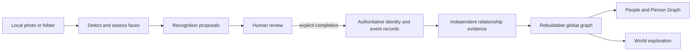
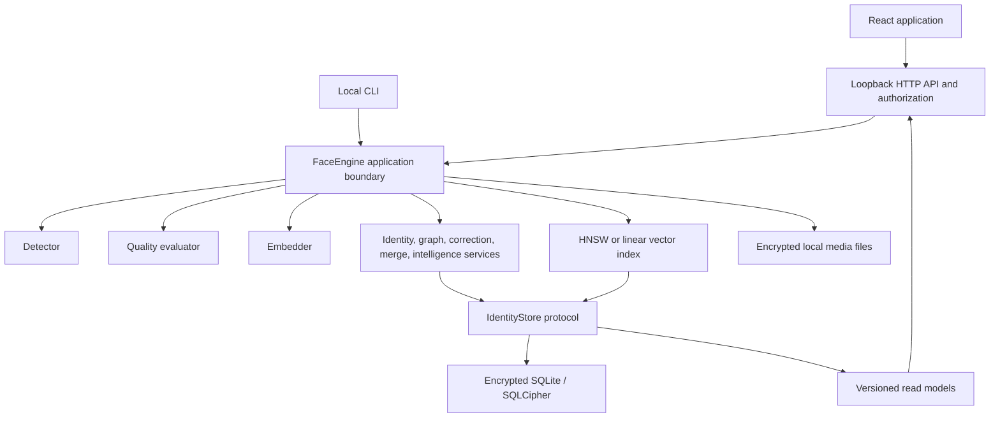

# SentriFace Edge: complete project guide

## Why this document exists

This is the broad, narrative introduction to SentriFace Edge. It is intended for
new contributors, reviewers, product stakeholders, and AI coding assistants that
need to understand the whole product before changing its code.

The other documents in this repository remain authoritative for their narrower
subjects:

- [`DOMAIN_MODEL.md`](DOMAIN_MODEL.md) defines exact identity, evidence, and graph semantics.
- [`ARCHITECTURE_STATE.md`](ARCHITECTURE_STATE.md) records the current implementation state.
- [`IMPLEMENTATION_PLAN.md`](IMPLEMENTATION_PLAN.md) records the ordered delivery phases.
- [`ARCHITECTURE_EXPLANATION.md`](ARCHITECTURE_EXPLANATION.md) preserves detailed design rationale and edge cases.
- [`AGENT_HANDOFF.md`](AGENT_HANDOFF.md) is the short operational handoff for active development.

This guide supplies the layer above them: what the product is, why it exists,
what a user can do with it, how the code realizes those capabilities, and which
ideas must remain stable as the software evolves.

---

## The project in one paragraph

SentriFace Edge is a CPU-first, fully offline face identification and identity
intelligence application for Windows, macOS, and Linux. It lets an authorized
operator process local photographs, find faces, compare them with a locally
managed gallery, review possible matches, build durable person and event
records, and explore evidence-backed connections between people. All models,
images, biometric embeddings, accounts, history, and backups remain under local
machine control. Recognition is deliberately treated as a suggestion, never as
truth: a human must finalize identity-affecting decisions before they enter the
authoritative record.

The shortest accurate description is:

> A private, local, human-reviewed identity system that uses face recognition
> to propose matches and uses an auditable evidence graph to preserve what the
> operator actually decided.

---

## What problem SentriFace solves

Face identification software commonly creates several related problems while
trying to solve the obvious one.

### 1. Identifying people in a large local photo collection is slow

A person may occur in many photographs, under different lighting, ages,
expressions, and camera conditions. Manually checking every image against every
known person does not scale. SentriFace uses local detection, quality checking,
embeddings, and vector search to narrow the work to plausible candidates.

### 2. A model score is not a trustworthy historical fact

A recognition model can be wrong. Its answer can also change after a model,
threshold, enrollment set, or index changes. If a similarity score directly
modified the identity database, uncertain machine output would silently become
permanent history.

SentriFace separates machine proposals from human decisions. Detection and
recognition prepare a review. Only explicit operator finalization may create or
change people, accepted event participants, evidence, or graph projections.

### 3. Identity history becomes complicated over time

Real collections contain duplicate people, wrongly assigned faces, renamed
profiles, archived identities, deleted identities, corrected event
participants, revised notes, and merged records. Rewriting old rows to make the
latest screen look simple destroys provenance.

SentriFace preserves the original history and layers the current interpretation
on top. It can therefore answer both:

- What was recorded at the time?
- What does that record mean now, after corrections and merges?

### 4. Relationships need evidence, not guesswork

Two people may be connected because they appeared in the same finalized event,
one was explicitly mentioned in a saved note about the other, or an operator
made a manual relationship assertion. These sources do not mean the same thing
and must not erase one another.

SentriFace stores each evidence item independently and derives graph edges from
the currently active evidence. If one supporting item is removed, an edge
remains when other evidence still supports it.

### 5. Sensitive biometric data should not require a cloud service

Face images, embeddings, names, notes, and event history are highly sensitive.
SentriFace is designed for installations that require local ownership,
predictable behavior, and operation without Internet access. It has no
telemetry, cloud recognition, model downloader, synchronization service, or
remote activation service.

### 6. Useful software must still run on ordinary machines

The target is not a GPU workstation. SentriFace is designed for CPU execution,
including lower-end i3-class systems. It loads models once, limits background
concurrency, resizes inputs, caches derived embeddings, selects a hardware
profile, and can fall back from HNSW search to a linear index without changing
identity semantics.

---

## Purpose and product philosophy

SentriFace is built around five ideas.

1. **Private by architecture.** Data and inference stay local. The HTTP server
   binds only to IPv4 loopback, application sockets are guarded, and production
   packages require an OS-level outbound network policy.
2. **Human decisions outrank model output.** Recognition proposes; an operator
   decides. No score may silently become identity truth.
3. **History is preserved.** Corrections, merges, lifecycle changes, notes,
   evidence, and important operations retain provenance instead of rewriting
   the past.
4. **Derived views are replaceable.** Search indexes, graph connections,
   analytics, clusters, rankings, and layouts can be rebuilt from authoritative
   records.
5. **Important changes are explainable and recoverable.** Graph-affecting writes
   are transactional and journaled; backups, integrity checks, guarded repairs,
   and narrow revert support make failure behavior part of the design.

This makes SentriFace more than a face-matching demo. The recognition pipeline
is one input into a larger local identity-record system.

---

## What SentriFace is—and is not

### It is

- a local desktop-style application served through a loopback-only web UI;
- a face detection, quality assessment, embedding, and matching pipeline;
- a human review system for single images and large batches;
- a durable people, observations, notes, evidence, and identity-history store;
- a rebuildable global identity graph with Person Graph and World projections;
- an encrypted, role-controlled, backup-aware application;
- a Python backend and React frontend designed to work as one local process.

### It is not

- a cloud service or multi-machine synchronization platform;
- an autonomous identification authority;
- a remote surveillance service;
- a social-network inference engine;
- a source of legal permission to process biometric data;
- a model distribution or model licensing service;
- a collection of independent local microservices;
- a system in which the frontend owns durable identity or relationship state.

The operator remains responsible for lawful use, suitable model rights, and the
accuracy of finalized decisions.

---

## User mental model

The easiest way to understand the product is to follow information from a photo
to the views that explain it.



The critical boundary is between **recognition proposals** and **authoritative
records**. Everything before that boundary helps the operator decide. Everything
after it represents a deliberate saved decision and must follow transaction,
provenance, and journal rules.

---

## User-facing capabilities

The application currently has five primary workspaces, plus account, model,
recovery, and licensing gates around them.

### Recognize

The Recognize workspace handles a photograph containing one or more faces.

For each face, SentriFace:

1. detects the face;
2. evaluates image quality;
3. creates a local face embedding;
4. searches the active enrollment index;
5. collapses duplicate embedding hits into unique person candidates;
6. presents likely people or an unknown result;
7. lets the operator accept an existing person, create a new person, or skip;
8. requires the multi-face review to be completed before graph-affecting event
   results are committed.

Recognition can also be entered from a person's profile to add another face to
that existing identity. The same review principles apply: the model supplies
evidence for a choice; it does not make the choice authoritative.

### Queue

Queue is the batch workflow for files and folders. It is useful when a large
collection must be organized rather than checked one image at a time.

The pipeline is:

```text
images or folders
→ detect faces
→ assess quality
→ create embeddings
→ cluster similar faces
→ review a group
→ accept as an existing person, create a person, skip, or discard
→ re-score remaining work against the updated gallery
```

Users can cancel active processing, resume skipped groups, reject a suggested
match, inspect a face gallery, select only part of a group, and return to saved
queue sessions. Unselected faces remain available rather than being consumed by
an unrelated decision.

### People

People is the identity-management workspace. It supports:

- browsing active and archived people;
- creating an identified person before any face is available;
- editing profile fields such as name, rank, country, importance, and tags;
- maintaining revisioned notes and explicit `@Person` references;
- viewing enrolled photos and choosing a representative photo;
- adding, moving, deleting, restoring, and eventually purging face enrollments;
- marking favorites;
- archiving and restoring people;
- tombstoning identities without erasing historical representation;
- previewing and completing identity merges;
- inspecting sightings, associations, changes, and operations;
- opening the Person Graph for evidence-backed local context.

People do not cease to exist merely because they have no face enrollment. A
person can own notes, participate in finalized observations, and remain in
history while having a `NO_FACE` biometric state.

### Person Graph

Person Graph is a focused view of the one global identity graph. It displays a
selected person's evidence-backed neighborhood using a backend-owned,
versioned read model.

The backend decides canonical identities, node and edge membership, lifecycle,
counts, evidence summaries, and permitted actions. The browser decides only how
to lay out, pan, zoom, hover, and select those objects. It does not infer that a
relationship exists.

### World

World is the broader intelligence and exploration workspace. It is not simply
a larger Person Graph. It is scope-first and progressively reveals different
semantic levels:

- a bounded world overview;
- ranked canonical people;
- deterministic, revision-bound clusters;
- measured data-quality patterns;
- typed relationship pages;
- a focused person view;
- finalized event detail;
- exact evidence provenance;
- bounded supporting media references.

World supports time, location, lifecycle, profile, evidence-type, frequency,
strength, and related scope controls. Its clusters, rankings, explanations, and
patterns are derived read objects, not new identity truth. Every deeper view is
loaded from the backend under a graph revision rather than expanded from an
incomplete browser preview.

### System, Debug, and recovery tools

Depending on the signed-in user's capabilities, the system area provides:

- machine and runtime profile information;
- recent redacted operational events;
- user and role administration;
- portable backup creation, export, import, restore, and deletion;
- disaster-recovery configuration;
- a support package export;
- local model bundle onboarding, activation, and rollback;
- offline license status and activation in packaged Windows builds;
- manual integrity checks;
- explicit graph projection rebuild;
- two tightly bounded structured repairs;
- one narrowly guarded merge revert.

Integrity and recovery actions are never automatic. The backend prepares an
exact action from a current finding, signs a short-lived precondition, displays
the plan, requires a reason and confirmation, then revalidates everything inside
the executing transaction.

---

## User roles and permissions

Authorization is enforced by the backend. UI visibility is convenience, not the
security boundary.

| Role | Intended access |
| --- | --- |
| Viewer | View people and run recognition. |
| Operator | Viewer access plus enrollment and queue/review changes. |
| Custodian | Operator access plus archive, delete, restore, and backup deletion. |
| Technician | View access plus logs, machine diagnostics, and backup creation/export. |
| Administrator | All capabilities, including accounts, licensing, recovery, and database restore. |

The first local account is an administrator. Passwords use Argon2id. Sessions
are local, time-bounded, idle-bounded, revocable, and carried by an HttpOnly
SameSite cookie. Repeated failed logins trigger persistent lockout, and account
activity is audited.

---

## Core domain concepts

### Person

A `Person` is a stable historical identity node. It is not the same as a face
embedding and is not required to have an enrolled photo.

Three dimensions are intentionally independent:

- **lifecycle:** active, archived, deleted, or merged;
- **identity status:** identified or unidentified;
- **biometric status:** enrolled or no face.

Keeping them separate prevents accidental rules such as “zero photos means no
person” or “deleted means erase all history.”

### Face and embedding

A detected face is an image region. An embedding is the normalized numerical
representation used for similarity search. Multiple embeddings may belong to
one person. Raw enrollment ownership remains historical provenance even if the
current effective owner changes through correction or canonical resolution.

The vector index is a derived acceleration structure. SQLite remains the source
of enrollment authority, and stale index candidates are regrouped through
current storage ownership before results are returned.

### Recognition proposal

A recognition result contains quality information and ranked candidate people.
It is transient decision support. It cannot, by itself, create a person,
participant, sighting, relationship, graph node, or durable identity fact.

### Observation or event

An observation is a real reviewed occurrence connected to source media. It may
have multiple detected faces and accepted participants. Only finalized
observations contribute graph-affecting co-observation evidence.

For a multi-face photo, all faces need a final decision before explicit review
completion. The finalized observation, accepted participants, face assignments,
relationship evidence, graph update, and operation journal commit atomically.

### Notes and mentions

Notes are revisioned records. A literal `@Name` string is not sufficient to
create a relationship. The saved revision contains explicit person references,
and active mention occurrences create independent `NOTE_REFERENCE` evidence.
Old revisions and retired occurrence/evidence history remain immutable.

### Relationship evidence

Relationships are supported by provenance-bearing evidence. Principal evidence
types are:

- co-observation in a finalized event;
- saved-note person reference;
- manual relationship assertion.

Evidence rows remain distinct. The graph aggregates active evidence by current
canonical endpoints, suppresses self-links, and never removes an edge while a
different active evidence item still supports it.

### Corrections

Corrections append a record that changes current interpretation without
rewriting the original participant or enrollment history. Reads apply the
relevant correction chain before terminal canonical resolution.

### Canonical identity and merge

Duplicate person records are resolved through canonical mapping. A merged
source remains a historical identity and points to a terminal active survivor.
Historical rows are not physically moved merely to make the latest view simple.

The normal current-view resolution is:

```text
raw historical identity
→ applicable correction
→ transitive canonical merge chain
→ terminal effective person
```

Reads deduplicate terminal people, and graph projection rejects self-links that
appear when two historical endpoints collapse to one survivor.

### Operation journal

Important mutations have an operation ID, actor snapshot, status history,
bounded context, affected entities, and result. The journal entry commits in
the same SQLite transaction as graph-affecting authoritative changes.

Operation IDs provide idempotence: retrying the same request returns the prior
result or safely resumes the defined operation instead of applying it twice.

### Authoritative records versus derived state

The authoritative identity story is limited to:

- persons and lifecycle/canonical state;
- observations/events and accepted participants;
- face assignments and identity corrections;
- saved notes, revisions, and explicit person mentions;
- manual relationship assertions and provenance-bearing evidence;
- merge history and operation history;
- biometric enrollment records and their explicit lifecycle history.

Derived or replaceable state includes:

- vector indexes;
- aggregate graph connections;
- sightings and analytics read models;
- Person Graph and World responses;
- clusters, rankings, patterns, and explanations;
- browser layout, selection, filters in progress, and animation state;
- recognition candidates and queue suggestions.

If derived state disagrees with authority, authority wins and the projection is
rebuilt or the mismatch is surfaced for explicit recovery.

---

## Architecture from a developer perspective

### System shape



The application is deliberately modular inside one local process. Components
are separated by Python protocols and service boundaries, not by networked
microservices.

### Backend layers

#### Domain models — `src/sentriface/models.py`

Frozen dataclasses and enums define the values exchanged between storage,
services, serialization, and tests: people, observations, notes, corrections,
evidence, graph objects, World objects, review decisions, quality reports, and
recognition results.

#### Contracts — `src/sentriface/contracts.py`

Protocols define the replaceable boundaries for face detection, embedding,
vector search, and identity storage. `IdentityStore` is deliberately broad
because durable SQL behavior stays behind one storage boundary.

#### Storage — `src/sentriface/storage/sqlite_store.py`

`SQLiteIdentityStore` owns schema creation, the contiguous migration chain,
SQL reads, transactional writes, canonical resolution, journal coupling,
projection queries, integrity fingerprints, and storage-level validation. The
current schema version is 28.

SQL writes belong here or behind a service that delegates to this boundary.
React components and API handlers must never become alternative persistence
engines.

#### Application engine — `src/sentriface/engine.py`

`FaceEngine` is the stable application boundary. It coordinates recognition,
queue processing, quality decisions, enrollment, indexes, cleanup, and domain
services. Runtime model activation swaps only recognition components; the
store, graph authority, recovery application, and identity services remain the
same objects.

#### Domain services

- `identity_service.py` owns identity-facing commands.
- `graph_service.py` owns evidence-to-projection semantics and rebuild.
- `graph_read_service.py` owns Person Graph and World read contracts.
- `intelligence_service.py` owns sightings and analytics reads.
- `correction_service.py` owns explicit identity corrections.
- `merge_service.py` owns merge preview, validation, and orchestration.
- `integrity.py` performs deterministic read-only invariant checking.
- `structured_repair_service.py` exposes only the frozen repair catalog.
- `revert_service.py` exposes the narrow supported merge revert.
- `backup_service.py` owns portable backup and staged restore behavior.

#### API — `src/sentriface/api_server.py`

The API server serves the built React application and versioned JSON endpoints
on loopback. It validates browser origin and host, authenticates local users,
maps routes to capabilities, derives the actor from the session, enforces model
and license gates, validates bounded inputs, serializes read models, and
coordinates shutdown.

The API is a local application boundary, not a public remote API. It must never
be made externally reachable for convenience.

#### Recognition components — `src/sentriface/components/`

Production uses ONNX Runtime CPU components for detection and embedding.
Deterministic development components exist only for explicit `--runtime dev`
use and produce synthetic, non-biometric results. Quality assessment checks
properties such as face size, blur, brightness, and landmark availability.

The search backend prefers HNSW when available and appropriate, with a
synchronized linear cosine-search fallback. Both are caches over database
enrollments and must produce the same domain meaning.

### Frontend layers

The React application lives in `frontend/src/`.

- `SentriFaceApp.jsx` composes authentication, model, recovery, licensing, and
  main-workspace gates.
- `hooks/useSentriFaceController.js` composes the feature controllers.
- `hooks/useApiClient.js` owns authenticated local API calls.
- controller hooks own workflow state and refresh/invalidation behavior.
- `views/` renders Recognize, Queue, People, World, and system experiences.
- `components/` contains reusable workflow and gate components.
- `utils/` contains display and layout helpers, including graph coordinates.

The frontend may own interaction state, draft form state, selected nodes,
camera position, and deterministic layout. It may not own identity resolution,
event participation, evidence membership, graph topology, ranking semantics,
pagination truth, lifecycle policy, or durable association state.

### Data placement

A normal installation keeps mutable authority in a per-user data directory:

```text
SentriFace/
├── sentriface.db          encrypted SQLCipher database
├── faces/                 encrypted source images and face crops
├── index/                 replaceable vector-index files
├── backups/               verified managed portable backups
├── logs/                  bounded encrypted logs
└── models/                server-owned model bundle authority
```

Default locations are `%LOCALAPPDATA%\SentriFace` on Windows,
`~/Library/Application Support/SentriFace` on macOS, and the XDG data location
or `~/.local/share/sentriface` on Linux.

The database stores structured records and filesystem references rather than
image blobs. A code-owned media registry defines which stable database bindings
belong in a complete portable backup.

---

## Recognition pipeline

Production recognition follows this conceptual path:

```text
load encrypted local image
→ decode and resize as configured
→ detect face boxes and landmarks
→ assess quality
→ align/crop face
→ generate a normalized 512-dimensional embedding
→ search the current vector index
→ resolve candidates through current storage ownership
→ collapse hits by unique effective person
→ classify and present ranked proposals
```

Quality can be `good`, `warn`, or `bad`. Bad-quality inputs are rejected by
default for enrollment because weak samples degrade later matching. Thresholds
and calibration are bound to the active local model bundle.

Recognition should be evaluated as candidate generation, not as guaranteed
identity classification. Product correctness therefore includes the review and
finalization workflow, not only model similarity.

---

## Graph and World semantics

SentriFace has exactly one global identity graph. People, Person Graph, and
World are different read projections of the same authority; none owns a private
association database.

The projection path is:

```text
finalized observations + accepted participants
saved note revisions + explicit mentions
manual relationship assertions
identity corrections
canonical merge state
→ active normalized relationship evidence
→ aggregate graph connections
→ Person Graph / World / analytics read models
```

Important consequences:

- an unfinalized photo cannot affect the graph;
- recognition similarity cannot create an edge;
- participants are deduplicated by canonical person within an event;
- canonical collapse never creates a self-edge;
- removing note evidence cannot remove independent co-observation evidence;
- archived and tombstoned people remain historically representable;
- World clusters and patterns are explanations of scoped records, not new
  durable entities;
- every graph projection must be reproducible from authoritative evidence.

---

## Privacy, security, and offline guarantees

Offline behavior is a product invariant, not a deployment preference.

### Network boundary

- The server binds only to IPv4 loopback.
- Foreign Host headers and non-local browser origins are rejected.
- Every API and media request carries a per-launch browser secret.
- A process-wide guard blocks non-loopback socket activity.
- Production ONNX startup fails closed unless an OS policy blocks outbound
  connections for the packaged application boundary.
- There is no telemetry, updater, cloud inference, remote asset, or model
  download path.

### Data protection

- The live database is encrypted with SQLCipher.
- Managed images, crops, backup assets, and logs use authenticated AES-256-GCM.
- A random installation master key is stored in the OS credential vault.
- Exported `.sfbackup.enc` archives use password-based authenticated encryption.
- Logs use centralized redaction and exclude paths, secrets, note content,
  embeddings, SQL, tokens, and raw payloads.

These controls protect copied files. They do not protect against malware or a
person already operating as the same unlocked OS user. Full-disk encryption,
OS account security, and careful physical access remain necessary.

### Models and licensing

SentriFace never downloads model weights. An administrator supplies local ONNX
files, and the server creates an immutable candidate with hashes, calibration,
usage declaration, compatibility metadata, and a strict manifest. Activation
is a prepare/confirm operation that verifies CPU compatibility and retains the
previous known-good bundle for explicit rollback.

Packaged Windows licensing is also offline. A signed license is verified against
an embedded public-key registry and a local machine fingerprint. Unlicensed
operation blocks ordinary product work but leaves authentication, licensing,
model prerequisites, backup/restore, integrity recovery, and support available.
License state is operational state, not identity-domain authority.

---

## Reliability and recovery model

### Schema migrations

SQLite migrations are contiguous and versioned. Existing databases receive a
verified pre-migration backup before change. The migration chain runs inside an
immediate transaction and validates before commit. Newer unknown schemas are
rejected instead of being opened under older semantics.

### Portable backups and restore

Current portable backups use format v3. They contain a consistent encrypted
database snapshot and the complete set of registry-recognized referenced media,
deduplicated and checksummed. Missing media makes a backup visibly incomplete
and non-restorable as a complete portable backup.

Restore is administrator-only and staged away from live paths. It:

1. verifies archive, manifest, key, schema, media, journal, and integrity state;
2. creates a complete safety backup of current live authority;
3. migrates only the staged database when needed;
4. rewrites media bindings through the server-owned registry;
5. rebuilds the derived graph and recognition index;
6. installs the restored database and files atomically as far as the platform
   boundaries allow;
7. rolls back to the safety backup if reload or validation fails.

### Integrity and repair

The read-only integrity checker examines one SQLite snapshot and reports bounded
factual findings across schema, foreign keys, canonical chains, corrections,
observations, evidence, graph equivalence, notes, merges, and journals. It does
not repair while reading.

Recovery is intentionally narrow:

- graph projection rebuild replaces only derived connections;
- R01 restores an otherwise-valid archived canonical survivor;
- R02 reconciles one precisely diagnosed note-reference drift shape through
  append/retire history;
- merge revert supports only a proven no-survivor-mutation,
  no-later-dependency shape.

Anything ambiguous refuses rather than guessing.

### Runtime lifecycle

One process owns a data directory through an instance lock. Startup validates
key access, managed roots, disk headroom, model authority, schema compatibility,
and required security policy. Shutdown stops new work, cancels queued work,
drains bounded in-flight operations, closes HTTP and storage, and releases the
lock. Startup does not silently rebuild or repair domain state.

---

## Repository map

```text
SentriFaceEdge/
├── src/sentriface/
│   ├── models.py                    domain/read-model dataclasses
│   ├── contracts.py                 component and storage protocols
│   ├── engine.py                    application and recognition boundary
│   ├── api_server.py                loopback API, authz, UI serving
│   ├── storage/sqlite_store.py      schema, migrations, SQL authority
│   ├── components/                  ONNX/dev/image/index components
│   ├── *_service.py                 domain, backup, recovery services
│   ├── auth.py                      local accounts, roles, sessions
│   ├── secure_storage.py            SQLCipher/key handling
│   ├── secure_files.py              protected local files
│   ├── offline_guard.py             in-process network denial
│   ├── os_network_policy.py         packaged OS policy verification
│   ├── model_bundle.py              immutable local model authority
│   └── licensing/                   offline license verification
├── frontend/
│   ├── src/SentriFaceApp.jsx        application shell
│   ├── src/hooks/                   controllers and API client
│   ├── src/views/                   primary workspaces
│   └── tests/                       frontend contract/UI tests
├── tests/                            Python domain and integration tests
├── docs/                             current, phase, and historical docs
├── models/                           declarations/calibration docs and dev inputs
├── packaging/                        OS packaging and policy assets
├── installer/                        Windows Inno Setup definition
├── scripts/                          release, benchmark, and model utilities
└── tools/                            explicit support/destructive utilities
```

Generated `src/sentriface/ui_static/` files come from the frontend build and
must not be edited by hand.

---

## Development modes and commands

SentriFace supports two conceptually different runtimes.

- `--runtime dev` uses deterministic placeholder components. It is suitable for
  UI, workflow, account, backup, and domain development, but its face results
  are synthetic.
- `--runtime onnx` uses locally activated production models and enforces the
  applicable offline security boundary.

On macOS, the typical product-isolated source setup is:

```bash
./run.sh       # synthetic development runtime
./run.sh onnx  # activated local ONNX bundle
```

The launcher keeps source state under
`~/Library/Application Support/SentriFace-Dev`; it does not use the installed
product's `~/Library/Application Support/SentriFace` authority. See the root
README for model onboarding and reset instructions.

Primary verification commands:

```bash
python -m pytest -q
npm --prefix frontend test
npm --prefix frontend run build
```

Optional HNSW acceleration is installed through the `index` extra. The linear
fallback is a supported behavior, not a separate identity mode.

Focused tests should be run while developing, followed by the full relevant
suites. Migration changes additionally require fresh-database, every-supported-
upgrade-path, rollback, idempotence, foreign-key, backup, and historical-state
coverage. Graph changes require evidence independence, canonical resolution,
participant deduplication, no-self-link, atomic finalization, rebuild
equivalence, and offline-operation coverage.

---

## Rules for changing the code safely

These are the non-negotiable design rules an AI assistant or developer should
check before implementing a change.

1. Recognition output is a proposal only. Never let it directly mutate person,
   participant, evidence, or graph authority.
2. A multi-face event becomes authoritative only after every face has a final
   decision and the operator explicitly completes review.
3. Commit a graph-affecting change, its evidence/projection effects, and its
   operation-journal record in one SQLite transaction.
4. Require stable operation IDs for important writes and make retries
   idempotent.
5. Keep raw history. Express corrections, retirement, lifecycle, and merge
   interpretation explicitly rather than rewriting old facts.
6. Resolve corrections before terminal canonical identity, then deduplicate.
7. Never create canonical self-links or duplicate event participants.
8. Preserve evidence independence. One evidence type cannot erase another.
9. Treat graph connections, indexes, analytics, clusters, and UI layout as
   derived state.
10. Keep SQL writes behind storage and service boundaries.
11. Keep domain semantics in the backend. The frontend sends intent and renders
    versioned read contracts.
12. Preserve loopback-only and zero-outbound behavior. Do not add telemetry,
    remote assets, model downloads, cloud fallbacks, or network filesystems.
13. Prefer additive versioned migrations and compatibility reads over broad
    schema rewrites.
14. Preserve encrypted storage, key-vault use, redaction, bounded inputs, and
    recovery behavior.
15. Do not turn startup into a repair action. Ambiguous state should stop or be
    presented through explicit guarded recovery.
16. Do not edit generated UI assets directly.

### A practical change checklist

Before coding:

- Identify whether the requested state is authoritative, derived, operational,
  or frontend-only.
- Read the matching domain and phase documentation.
- Find the existing service and storage boundary that owns the behavior.
- Decide whether the operation affects the graph, journal, backup closure,
  revision token, index, or recovery semantics.

While coding:

- Preserve operation IDs, actor derivation, transaction boundaries, and failure
  rollback.
- Invalidate and refetch backend read models after mutations instead of
  fabricating final client state.
- Add the smallest compatible schema/read-contract change.
- Keep errors factual and fail closed when authority is uncertain.

Before finishing:

- Test the success path, exact retry, stale request, authorization failure, and
  in-transaction failure.
- Test archived, deleted, merged, corrected, and no-face identities when they
  intersect the change.
- Verify that no non-loopback access or client-owned persistence was introduced.
- Update the appropriate current documentation, not only historical phase
  records.

---

## Common misunderstandings to avoid

### “The highest recognition score is the person's identity”

No. It is a ranked proposal. Identity becomes authoritative only through an
explicit supported operator workflow.

### “A person is just a collection of face vectors”

No. A person is a historical identity node that may have no biometric
enrollment and may own notes, events, evidence, and lifecycle history.

### “Merging people should move every row to the survivor”

No. Physical consolidation would destroy provenance. Raw ownership remains;
current reads resolve through canonical identity.

### “The graph can be rebuilt from recognition matches”

No. It is rebuilt from authoritative evidence created by finalized events,
saved note mentions, and manual assertions.

### “World is a frontend graph assembled from API fragments”

No. World is a bounded backend-owned read model. The frontend controls
presentation and navigation only.

### “Archived or deleted means absent from history”

No. Archive and tombstone are identity states. Historical representation and
provenance remain.

### “Offline means the app merely does not call an API today”

No. Offline is enforced at listener, request, socket, packaging, OS-policy,
model-onboarding, and product-design boundaries.

### “A repair can infer the most likely intended state”

No. Recovery supports only exact proven shapes. Ambiguity causes refusal.

---

## Current maturity and release status

The planned source architecture through P14 is implemented. The global identity
graph, normalized observations and evidence, corrections, merge orchestration,
intelligence reads, Person Graph, World v2 UI, integrity/recovery, portable
backup/restore, runtime hardening, local model authority, and offline Windows
licensing/packaging are present.

P10 through P13 are complete and frozen. P14 passed unsigned Windows 11 x64
acceptance. Production release acceptance still requires a clean build from the
exact intended release tag and trusted, timestamped Authenticode signatures.
The detailed live status belongs in [`ARCHITECTURE_STATE.md`](ARCHITECTURE_STATE.md)
and [`p14/P14_RELEASE_ACCEPTANCE.md`](p14/P14_RELEASE_ACCEPTANCE.md); this section
should remain a summary rather than a second release ledger.

---

## Recommended reading paths

### For a product or UX contributor

1. This guide.
2. The user workflows in the root [`README.md`](../README.md).
3. The privacy and security documents.
4. The Person Graph and World sections of [`DOMAIN_MODEL.md`](DOMAIN_MODEL.md).

### For a backend contributor

1. This guide.
2. [`AGENTS.md`](../AGENTS.md).
3. [`DOMAIN_MODEL.md`](DOMAIN_MODEL.md).
4. [`ARCHITECTURE_STATE.md`](ARCHITECTURE_STATE.md).
5. The relevant section of [`ARCHITECTURE_EXPLANATION.md`](ARCHITECTURE_EXPLANATION.md).
6. `models.py`, `contracts.py`, `engine.py`, and the owning service/storage code.

### For a frontend contributor

1. This guide.
2. The backend-authority rules in [`DOMAIN_MODEL.md`](DOMAIN_MODEL.md).
3. `frontend/src/SentriFaceApp.jsx`.
4. `frontend/src/hooks/useSentriFaceController.js` and the feature controller.
5. The corresponding view and frontend contract tests.

### For an AI coding assistant

1. Read this file to establish the complete mental model.
2. Read [`AGENTS.md`](../AGENTS.md) as mandatory repository instructions.
3. Read [`AGENT_HANDOFF.md`](AGENT_HANDOFF.md) and
   [`ARCHITECTURE_STATE.md`](ARCHITECTURE_STATE.md) for current boundaries.
4. Read the exact domain/phase document for the requested change.
5. Inspect implementation and tests before proposing edits.
6. State which authority category the change touches.
7. Preserve the sixteen safe-change rules above.
8. Run focused checks and then all relevant suites.

---

## Compact context block for a new ChatGPT session

When full repository access is unavailable, the following can be supplied as a
starting summary. It does not replace the repository instructions or normative
documents.

> SentriFace Edge is a CPU-first, fully offline local face identification and
> identity-intelligence application. Python provides a loopback-only API,
> recognition engine, domain services, encrypted SQLite storage, local model
> authority, backups, and recovery; React provides Recognize, Queue, People,
> Person Graph, World, and system views. Recognition output is proposal-only.
> Authoritative identity data comes from explicit operator-finalized people,
> observations, accepted participants, notes and mentions, manual assertions,
> corrections, enrollment history, merges, and journaled lifecycle operations.
> Multi-face events commit only after every face has a final decision and the
> operator completes review. Graph edges are rebuildable projections of
> independent evidence types. Corrections preserve raw history; merges preserve
> source identities and resolve reads to a terminal canonical survivor. Archive
> and delete are lifecycle states, not historical erasure. Important graph
> writes and their journal entries commit atomically with idempotent operation
> IDs. The frontend never owns durable identity or graph truth. Vector indexes,
> graph connections, analytics, clusters, and layouts are derived. Preserve
> loopback-only operation, outbound denial, encrypted local storage, explicit
> local model onboarding, guarded recovery, versioned migrations, and complete
> portable backups. Start with `AGENTS.md`, `docs/PROJECT_OVERVIEW.md`,
> `docs/AGENT_HANDOFF.md`, `docs/ARCHITECTURE_STATE.md`, and
> `docs/DOMAIN_MODEL.md` before changing code.

---

## Final perspective

SentriFace Edge is designed around a simple but demanding promise: help a human
organize and understand local identity evidence without surrendering privacy or
pretending that an algorithm's guess is historical truth.

Its face models make review faster. Its domain model makes decisions durable.
Its evidence graph makes relationships explainable. Its transaction, journal,
backup, integrity, and recovery systems make those records trustworthy over
time. Its offline and encryption boundaries keep control with the machine's
operator. Every feature should strengthen that combination rather than trading
one part away for convenience.
