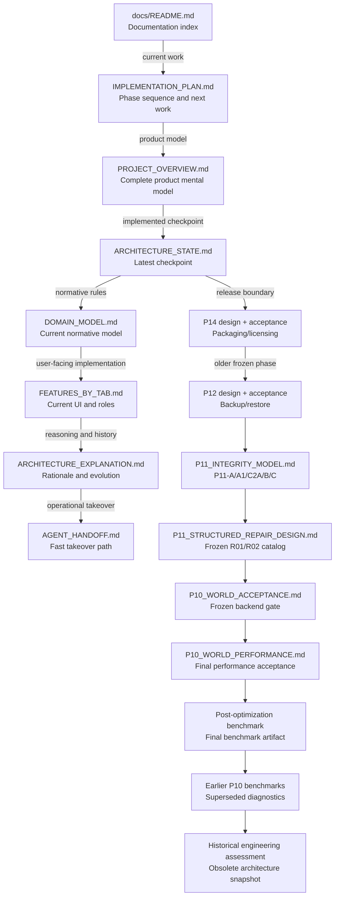

# SentriFace Edge documentation map

This directory separates the product overview and current architecture from frozen phase records, historical artifacts, and examples. `IMPLEMENTATION_PLAN.md` is the canonical current-work tracker.

## Current status

- Batch 3.6 repairs shared registered provenance, canonical standing-manual collisions and accepted recognition display. Complex real rebuild and fresh supported restore/restart are qualified; IMPLEMENTATION_PLAN owns exact results and limits. Batch 4 remains unimplemented.

- Batch 3.5 converges effective pair support, enrollment/decision contracts, mutation read reconciliation and operational completion/custody. `IMPLEMENTATION_PLAN.md` owns targeted qualification and final gates; the next three-phase clean-room reaudit remains separate.

- The 2026-10-01 correctness pass extends existing staging to schema v31 for durable pre-grouping media exclusion, unifies committed/active-draft recognition and duplicate prevention, and fixes stale group/form state. `IMPLEMENTATION_PLAN.md` owns current verification and remaining work. No new Encounter, media, note or recognition-index system is introduced.

- P0 through P14 source implementation is complete.
- P10 through P13 are complete and frozen, including all of P11-A through P11-E.
- Historical P14 unsigned Windows 11 x64 installer lifecycle acceptance passed
  for an earlier artifact. The current 2.0.0 unsigned pre-tag candidate passed
  source, build, inspection, and packaged runtime checks.
- Production P14 acceptance remains pending verified signatures, the current
  artifact's disposable-Windows installer and packaged model lifecycle, and a
  clean exact `rc-v2.0.0` or `release-v2.0.0` rebuild.
- The 2026-09-27 stabilization and pre-Batch-2 integration extend finalized observations with shared Encounter metadata, add embedding eligibility to schema v29, preserve no-face selection and face-origin provenance, and expose bounded read-only Events. The reduced managed upload is historical media. See `IMPLEMENTATION_PLAN.md` for verification and remaining risks.
- Batch 2 established serial durable Encounter drafts and explicit Relations decisions in schema v30; the current correction extends that staging to v31. Final completion remains the existing atomic observation/person/evidence/journal command. The canonical tracker records automated gates and the authenticated synthetic-media development walkthrough; production-model and full role walkthroughs remain separate. Do not treat this source checkpoint as release acceptance.

## Start here

1. Repository-root `AGENTS.md` — product and safety rules.
2. [`README.md`](README.md) — this map.
3. [`IMPLEMENTATION_PLAN.md`](IMPLEMENTATION_PLAN.md) — canonical tracker, current batch and next work.
4. [`PROJECT_OVERVIEW.md`](PROJECT_OVERVIEW.md) — complete product mental model.
5. [`ARCHITECTURE_STATE.md`](ARCHITECTURE_STATE.md) — implemented checkpoint.
6. [`DOMAIN_MODEL.md`](DOMAIN_MODEL.md) — current normative entities and authority.
7. [`FEATURES_BY_TAB.md`](FEATURES_BY_TAB.md) — current user-facing tabs, permissions and boundaries.
8. [`ARCHITECTURE_EXPLANATION.md`](ARCHITECTURE_EXPLANATION.md) — detailed rationale.
9. [`AGENT_HANDOFF.md`](AGENT_HANDOFF.md) — operational takeover and release boundary.

Human entry path: this map → `PROJECT_OVERVIEW.md` → `FEATURES_BY_TAB.md` → `DOMAIN_MODEL.md` → `ARCHITECTURE_EXPLANATION.md`. Both paths converge on the same authority.

These documents are complementary rather than successive revisions. `ARCHITECTURE_STATE.md` answers what is implemented now; `IMPLEMENTATION_PLAN.md` answers where that sits in the sequence; `DOMAIN_MODEL.md` defines the current rules; and `ARCHITECTURE_EXPLANATION.md` explains why those rules exist.

## Documentation relationship and implementation recency

In the phase-history chain below, arrows mean **newer represented implementation state → older represented implementation state**. The four core documents remain current together and therefore use reading/dependency arrows rather than age ordering.

The historical engineering assessment was written later in wall-clock time than some P10 records, but it describes a much older schema and implementation state. Its position reflects the state represented, not its file timestamp.

## Document catalog

| Category | Document | Contains |
| --- | --- | --- |
| Overview | [`PROJECT_OVERVIEW.md`](PROJECT_OVERVIEW.md) | Complete narrative introduction covering the product purpose, user workflows, architecture, domain concepts, security, reliability, repository map, development model, and AI-safe change rules. |
| Handoff | [`AGENT_HANDOFF.md`](AGENT_HANDOFF.md) | Fast takeover path, current checkpoint, code map, invariant summary, development commands, and release/support cautions. |
| Development | [`DEVELOPMENT_MODE.md`](DEVELOPMENT_MODE.md) | macOS and Windows source launch, local model onboarding, isolated authority, frontend build, and exact-scope development reset. |
| Current core | [`ARCHITECTURE_STATE.md`](ARCHITECTURE_STATE.md) | Concise stable implementation checkpoint, current authority sources, read behavior, frozen World state, and deferred work. |
| Current core | [`IMPLEMENTATION_PLAN.md`](IMPLEMENTATION_PLAN.md) | Ordered P0–P14 roadmap, completed phases, phase exit criteria, cross-phase gates, and next work. |
| Current core | [`DOMAIN_MODEL.md`](DOMAIN_MODEL.md) | Normative identity, observation, note, evidence, canonical, graph, Person Graph, and World domain rules. |
| Current core | [`FEATURES_BY_TAB.md`](FEATURES_BY_TAB.md) | Complete current tab and Person Profile sub-tab inventory, permissions, workflows, boundaries, and terminology. |
| Current core | [`ARCHITECTURE_EXPLANATION.md`](ARCHITECTURE_EXPLANATION.md) | Long-form architectural memory, design rationale, examples, rejected alternatives, performance decisions, safety stops, and future boundaries. |
| P11 | [`p11/P11_INTEGRITY_MODEL.md`](p11/P11_INTEGRITY_MODEL.md) | State-authority map, fixed invariant registry, read-only checker, note/evidence refreeze, deterministic rebuild, and completed P11 sequence. |
| P11 | [`p11/P11_STRUCTURED_REPAIR_DESIGN.md`](p11/P11_STRUCTURED_REPAIR_DESIGN.md) | Exact R01/R02 whitelist, finding-bound preconditions, execution/refusal rules, safety-stop history, tests, and P11-D boundary. |
| P12 | [`p12/P12_BACKUP_RESTORE_DESIGN.md`](p12/P12_BACKUP_RESTORE_DESIGN.md) | Format-v3 authority closure, registry-owned media, staged restore, failure recovery, and API boundary. |
| P12 | [`p12/P12_BACKUP_RESTORE_ACCEPTANCE.md`](p12/P12_BACKUP_RESTORE_ACCEPTANCE.md) | Frozen backup/restore verification matrix and acceptance result. |
| P14 | [`p14/P14_PACKAGING_LICENSING_DESIGN.md`](p14/P14_PACKAGING_LICENSING_DESIGN.md) | Offline license authority, Windows package layout, installer lifecycle, release versioning, and signing boundary. |
| P14 | [`p14/P14_RELEASE_ACCEPTANCE.md`](p14/P14_RELEASE_ACCEPTANCE.md) | Passed unsigned Windows acceptance and the remaining production release gates. |
| P10 | [`p10/P10_WORLD_ACCEPTANCE.md`](p10/P10_WORLD_ACCEPTANCE.md) | Frozen P10-E World backend PASS/FAIL gates, defect-resolution record, and acceptance decision. |
| P10 | [`p10/P10_WORLD_PERFORMANCE.md`](p10/P10_WORLD_PERFORMANCE.md) | Final performance method, before/after results, scale conclusions, and passing performance decision. |
| P10 benchmark | [`p10/benchmarks/P10_WORLD_BENCHMARK_RESULTS_POST_OPT.json`](p10/benchmarks/P10_WORLD_BENCHMARK_RESULTS_POST_OPT.json) | Authoritative machine-readable post-optimization benchmark matrix. |
| P10 benchmark | [`p10/benchmarks/P10_WORLD_BENCHMARK_RESULTS.md`](p10/benchmarks/P10_WORLD_BENCHMARK_RESULTS.md) | Superseded human-readable incomplete benchmark diagnostics retained for comparison. |
| P10 benchmark | [`p10/benchmarks/P10_WORLD_BENCHMARK_RESULTS.json`](p10/benchmarks/P10_WORLD_BENCHMARK_RESULTS.json) | Historical machine-readable failed/pre-optimization benchmark baseline. |
| Historical | [`historical/engineering_assessment_prepackaging_branch.md`](historical/engineering_assessment_prepackaging_branch.md) | Obsolete schema-v12 packaging/security assessment retained as a non-authoritative snapshot. |
| Examples | [`examples/model-onboarding/README.md`](examples/model-onboarding/README.md) | Instructions for the local model declaration and calibration examples. |
| Examples | `examples/model-onboarding/*.example.json` | Placeholder research, commercial, permissive-license, and calibration inputs. |

## Authority and maintenance rules

- Follow the reading order above. Keep `IMPLEMENTATION_PLAN.md` as the single current-work tracker.
- Update every affected canonical document in each implementation batch; revise obsolete current-state statements rather than layering contradictory patch notes.
- Use P11 documents for frozen integrity, rebuild, repair, revert, and recovery detail.
- Use P12 and P14 documents for backup/restore and Windows release acceptance detail.
- Use P10 documents for the frozen World acceptance and performance record.
- Historical and superseded artifacts are evidence of prior evaluation, not current architecture authority.
- Preserve safety-stop explanations, failed benchmark baselines, and historical decisions rather than rewriting them as if the final state had always existed.
- When a document moves, update repository references without changing runtime behavior or generated assets.
