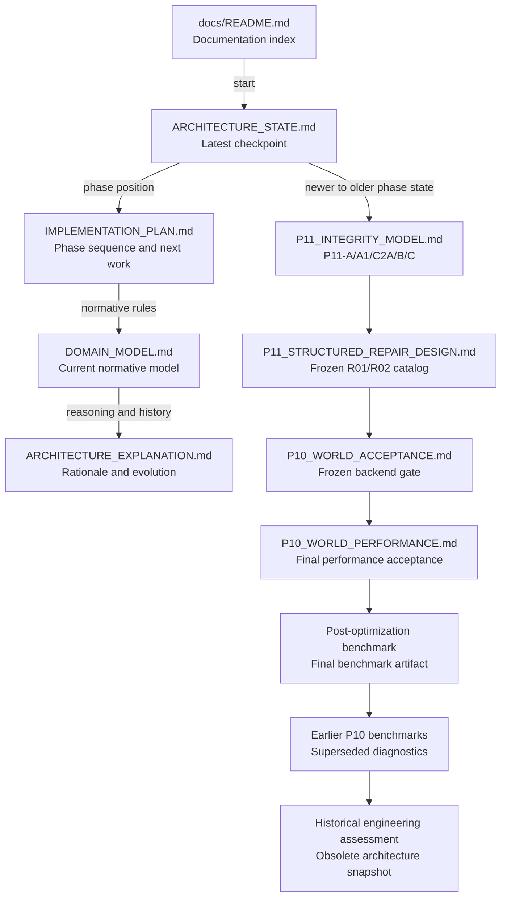

# SentriFace Edge documentation map

This directory separates the current architecture from frozen phase records, historical artifacts, and examples. For the current project position, read the four core documents in the order below.

## Current status

- P10 is complete and frozen.
- P11-A read-only integrity checking is complete.
- P11-B deterministic graph projection rebuild is complete.
- P11-C structured repair is complete and refrozen with exactly R01 and R02.
- P11-D guarded operation revert has not started and is the next design/audit phase.

## Start here

1. [`ARCHITECTURE_STATE.md`](ARCHITECTURE_STATE.md) — latest concise implementation checkpoint.
2. [`IMPLEMENTATION_PLAN.md`](IMPLEMENTATION_PLAN.md) — phase order, completion state, exit gates, and next work.
3. [`DOMAIN_MODEL.md`](DOMAIN_MODEL.md) — current normative entities, authority, lifecycle, evidence, graph, and World contracts.
4. [`ARCHITECTURE_EXPLANATION.md`](ARCHITECTURE_EXPLANATION.md) — detailed reasoning, examples, rejected alternatives, and preserved design evolution.

These documents are complementary rather than successive revisions. `ARCHITECTURE_STATE.md` answers what is implemented now; `IMPLEMENTATION_PLAN.md` answers where that sits in the sequence; `DOMAIN_MODEL.md` defines the current rules; and `ARCHITECTURE_EXPLANATION.md` explains why those rules exist.

## Documentation relationship and implementation recency

In the phase-history chain below, arrows mean **newer represented implementation state → older represented implementation state**. The four core documents remain current together and therefore use reading/dependency arrows rather than age ordering.

The historical engineering assessment was written later in wall-clock time than some P10 records, but it describes a much older schema and implementation state. Its position reflects the state represented, not its file timestamp.

## Document catalog

| Category | Document | Contains |
| --- | --- | --- |
| Current core | [`ARCHITECTURE_STATE.md`](ARCHITECTURE_STATE.md) | Concise stable implementation checkpoint, current authority sources, read behavior, frozen World state, and deferred work. |
| Current core | [`IMPLEMENTATION_PLAN.md`](IMPLEMENTATION_PLAN.md) | Ordered P0–P14 roadmap, completed phases, phase exit criteria, cross-phase gates, and next work. |
| Current core | [`DOMAIN_MODEL.md`](DOMAIN_MODEL.md) | Normative identity, observation, note, evidence, canonical, graph, Person Graph, and World domain rules. |
| Current core | [`ARCHITECTURE_EXPLANATION.md`](ARCHITECTURE_EXPLANATION.md) | Long-form architectural memory, design rationale, examples, rejected alternatives, performance decisions, safety stops, and future boundaries. |
| P11 | [`p11/P11_INTEGRITY_MODEL.md`](p11/P11_INTEGRITY_MODEL.md) | State-authority map, fixed invariant registry, read-only checker, note/evidence refreeze, deterministic rebuild, repair summary, and remaining P11 sequence. |
| P11 | [`p11/P11_STRUCTURED_REPAIR_DESIGN.md`](p11/P11_STRUCTURED_REPAIR_DESIGN.md) | Exact R01/R02 whitelist, finding-bound preconditions, execution/refusal rules, safety-stop history, tests, and P11-D boundary. |
| P10 | [`p10/P10_WORLD_ACCEPTANCE.md`](p10/P10_WORLD_ACCEPTANCE.md) | Frozen P10-E World backend PASS/FAIL gates, defect-resolution record, and acceptance decision. |
| P10 | [`p10/P10_WORLD_PERFORMANCE.md`](p10/P10_WORLD_PERFORMANCE.md) | Final performance method, before/after results, scale conclusions, and passing performance decision. |
| P10 benchmark | [`p10/benchmarks/P10_WORLD_BENCHMARK_RESULTS_POST_OPT.json`](p10/benchmarks/P10_WORLD_BENCHMARK_RESULTS_POST_OPT.json) | Authoritative machine-readable post-optimization benchmark matrix. |
| P10 benchmark | [`p10/benchmarks/P10_WORLD_BENCHMARK_RESULTS.md`](p10/benchmarks/P10_WORLD_BENCHMARK_RESULTS.md) | Superseded human-readable incomplete benchmark diagnostics retained for comparison. |
| P10 benchmark | [`p10/benchmarks/P10_WORLD_BENCHMARK_RESULTS.json`](p10/benchmarks/P10_WORLD_BENCHMARK_RESULTS.json) | Historical machine-readable failed/pre-optimization benchmark baseline. |
| Historical | [`historical/engineering_assessment_prepackaging_branch.md`](historical/engineering_assessment_prepackaging_branch.md) | Obsolete schema-v12 packaging/security assessment retained as a non-authoritative snapshot. |
| Examples | [`examples/model-onboarding/README.md`](examples/model-onboarding/README.md) | Instructions for the local model declaration and calibration examples. |
| Examples | `examples/model-onboarding/*.example.json` | Placeholder research, commercial, permissive-license, and calibration inputs. |

## Authority and maintenance rules

- Use the four current core documents for present architecture and project status.
- Use P11 documents for frozen integrity, rebuild, and structured-repair detail.
- Use P10 documents for the frozen World acceptance and performance record.
- Historical and superseded artifacts are evidence of prior evaluation, not current architecture authority.
- Preserve safety-stop explanations, failed benchmark baselines, and historical decisions rather than rewriting them as if the final state had always existed.
- When a document moves, update repository references without changing runtime behavior or generated assets.
