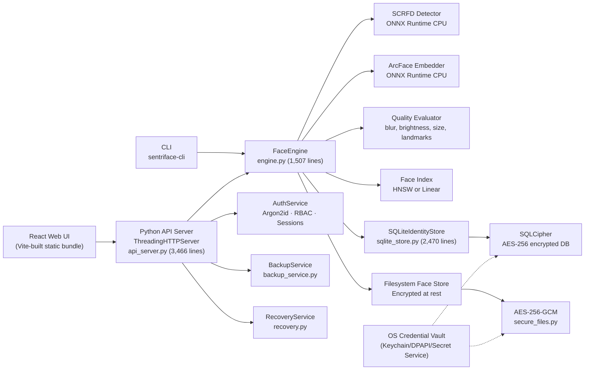
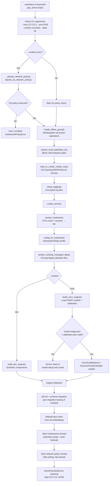
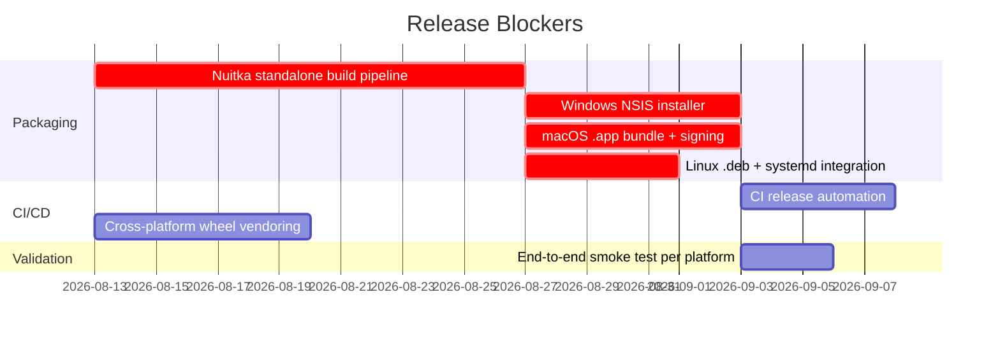

# SentriFace Edge Engineering Assessment

> **Historical, non-authoritative assessment (2026-08-12).** This snapshot predates the current schema-v28/P11-C state, contains links to a different local checkout, and includes test-count and CI claims that do not describe the current `pre-packaging` branch. Use `ARCHITECTURE_STATE.md`, `IMPLEMENTATION_PLAN.md`, and the P11 documents for current architecture and phase status.

**Assessment date:** 2026-08-12
**Assessor:** Principal Engineer / Security Architect / Release Engineer
**Repository:** `suraj-singh12/sentri-face-edge` (`pre-packaging` branch)
**Codebase size:** ~24,825 lines Python backend · ~13,067 lines React/JS/CSS frontend · 25 test files
**Version:** Dynamic from `sentriface.__version__` · Schema version 12

---

## 1. Architecture Overview

SentriFace Edge is a **CPU-first, fully offline face identification engine** designed for deployment on low-end Windows, macOS, and Linux machines (down to i3-class CPUs without a GPU). It implements a complete identity management system with face detection, embedding, recognition, quality evaluation, batch enrollment, disaster recovery, and encrypted storage — all running on a single machine without any network connectivity.

### System Topology



### Key Architectural Decisions

| Decision | Implementation | Evidence |
|----------|---------------|----------|
| **Zero network access** | Socket monkeypatch + OS firewall verification | [offline_guard.py](file:///Users/suraj-work/Documents/fresh/sentri-face-edge/src/sentriface/offline_guard.py), [os_network_policy.py](file:///Users/suraj-work/Documents/fresh/sentri-face-edge/src/sentriface/os_network_policy.py) |
| **CPU-only inference** | ONNX Runtime with `CPUExecutionProvider` only | [onnx_components.py:L26](file:///Users/suraj-work/Documents/fresh/sentri-face-edge/src/sentriface/components/onnx_components.py#L26) |
| **Encrypted at rest** | SQLCipher DB + AES-256-GCM files + OS vault master key | [secure_storage.py](file:///Users/suraj-work/Documents/fresh/sentri-face-edge/src/sentriface/secure_storage.py), [secure_files.py](file:///Users/suraj-work/Documents/fresh/sentri-face-edge/src/sentriface/secure_files.py) |
| **No model bundling** | Operator supplies models; SHA-256 bound usage declaration | [model_setup.py](file:///Users/suraj-work/Documents/fresh/sentri-face-edge/src/sentriface/model_setup.py) |
| **Protocol-based contracts** | `FaceDetector`, `FaceEmbedder`, `FaceIndex`, `IdentityStore` | [contracts.py](file:///Users/suraj-work/Documents/fresh/sentri-face-edge/src/sentriface/contracts.py) |
| **Dev/ONNX runtime switching** | Synthetic deterministic components for testing | [dev_components.py](file:///Users/suraj-work/Documents/fresh/sentri-face-edge/src/sentriface/components/dev_components.py) |

### Component Size Profile

| Component | File | Lines | Observation |
|-----------|------|-------|-------------|
| API Server | `api_server.py` | 3,466 | **Large monolith** — routes, handlers, helpers all in one file |
| Storage Layer | `sqlite_store.py` | 2,470 | Large but well-structured; contains all 12 migrations |
| Engine | `engine.py` | 1,507 | Core business logic; reasonable size |
| CLI | `cli.py` | ~1,000 | Comprehensive admin tool |
| PeopleView | `PeopleView.jsx` | ~2,300 | **Largest frontend file** |
| CSS | `sentriface-interface.css` | 3,194 | Single monolith stylesheet |

---

## 2. Runtime Execution Flow

### Startup Sequence (from `sentriface-ui` → operational server)



### Key Startup Properties

1. **Fail-closed on missing OS network policy** — ONNX runtime refuses to start without verified firewall ([api_server.py:L2556-2580](file:///Users/suraj-work/Documents/fresh/sentri-face-edge/src/sentriface/api_server.py#L2556-L2580))
2. **Fail-closed on missing/changed models** — server enters model-setup-only mode, rejecting inference endpoints ([api_server.py:L331-346](file:///Users/suraj-work/Documents/fresh/sentri-face-edge/src/sentriface/api_server.py#L331-L346))
3. **Fail-closed on keyring unavailable** — `StorageSecurityError` prevents startup ([secure_storage.py:L30](file:///Users/suraj-work/Documents/fresh/sentri-face-edge/src/sentriface/secure_storage.py#L30))
4. **Pre-migration backup** — schema upgrades create and verify a portable backup before changing the schema ([sqlite_store.py:L118-136](file:///Users/suraj-work/Documents/fresh/sentri-face-edge/src/sentriface/storage/sqlite_store.py#L118-L136))

### Request Processing Pipeline

Every HTTP request passes through this chain:

```
Request → request_semaphore(8) → Host validation → Origin validation →
Session token validation → Auth cookie → RBAC check → Model readiness check →
operation_gate(shared/exclusive) → inference_semaphore → Handler
```

The `OperationGate` implements a reader-writer lock pattern: normal operations take a shared lock; database restores take an exclusive lock that drains all active operations first ([api_server.py:L178-215](file:///Users/suraj-work/Documents/fresh/sentri-face-edge/src/sentriface/api_server.py#L178-L215)).

---

## 3. Data Model Understanding

### Authoritative State (SQLCipher DB)

| Table | Schema Version | Purpose |
|-------|---------------|---------|
| `persons` | v1/v4 | Identity records with optional `deleted_at` for archive |
| `embeddings` | v1/v10 | 512-D float vectors + source/crop paths + soft-delete (`deleted_at`, `purge_after`) |
| `pending_additions` | v1/v2 | Queue items awaiting human review |
| `init_sessions` | v3 | Batch scan session metadata |
| `init_faces` | v3 | Faces detected during batch scan, grouped by similarity |
| `init_groups` | v3 | Review group status tracking |
| `init_face_person_exclusions` | v8 | User-rejected match suggestions |
| `recognition_details` | v5/v6 | Sighting/visit records linked to embeddings |
| `person_change_history` | v7 | Audit trail of profile edits |
| `person_operations` | v9 | Idempotency records for destructive operations |
| `app_users` | v11 | Local account records (Argon2id hashes) |
| `auth_audit` | v11 | Authentication event log |
| `app_settings` | v12 | Application-wide settings (recovery acknowledgement) |

### Derived State (Rebuilt at startup)

| State | Source | Rebuild Trigger |
|-------|--------|----------------|
| **Face index** (HNSW/Linear) | All active embeddings | Engine initialization, post-restore, enrollment |
| **Upload object index** | SHA-256 hashes of upload files | Lazy-built on first queue deduplicate request |
| **Hardware profile** | CPU count + memory | Every startup |
| **Runtime config** | Hardware profile mapping | Every startup |

### Storage Layout

```
data/
├── sentriface.db          # SQLCipher-encrypted database
├── faces/
│   ├── {person_id}/       # Encrypted face crop files per person
│   ├── pending/           # Crops for pending review
│   └── init/              # Crops for batch scan sessions
├── uploads/               # Source images uploaded via browser
├── index/
│   └── face_index.bin     # Persisted HNSW index (if used)
├── backups/               # Portable backup archives
├── logs/                  # Encrypted persistent logs
└── recovery-settings.json # Disaster recovery configuration
```

All managed files (crops, uploads, backups, logs) are encrypted with AES-256-GCM using the master key from the OS vault. The custom [SENTRIFACE-PROTECTED-FILE format](file:///Users/suraj-work/Documents/fresh/sentri-face-edge/src/sentriface/secure_files.py#L13) includes AEAD-authenticated headers, per-file random nonces, and plaintext-size validation.

---

## 4. Security Assessment

### Strong Points

| Area | Implementation | Strength |
|------|---------------|----------|
| **Offline enforcement** | Two-layer: Python socket monkeypatching + OS-level firewall/sandbox verification | Fail-closed; continuous polling shuts down server if policy is lost |
| **Encryption at rest** | SQLCipher for DB + AES-256-GCM for every managed file | Per-file random nonces, AEAD authentication, size validation |
| **Master key protection** | OS credential vault (Keychain/DPAPI/Secret Service) | Never stored on filesystem; installation-specific |
| **Password handling** | Argon2id with strong parameters (time=3, memory=64MB, parallelism=4) | Auto-rehash on algorithm upgrade |
| **Session security** | `secrets.token_urlsafe(32)`, SHA-256 digest storage, HttpOnly+SameSite=Strict cookies | Idle timeout (30min) + absolute timeout (8hr) |
| **Timing-attack resistance** | Dummy Argon2id verification on unknown usernames | [auth.py:L139-141](file:///Users/suraj-work/Documents/fresh/sentri-face-edge/src/sentriface/auth.py#L139-L141) |
| **RBAC enforcement** | Backend-enforced capabilities, 5-role system | Every endpoint mapped to required capability |
| **Path traversal defense** | `translate_path` validates against STATIC_DIR root | [api_server.py:L692-700](file:///Users/suraj-work/Documents/fresh/sentri-face-edge/src/sentriface/api_server.py#L692-L700) |
| **SQL injection** | All queries use parameterized statements throughout | Verified across all 2,470 lines of sqlite_store.py |
| **DNS rebinding** | Host header + Origin header strict localhost validation | [api_server.py:L702-747](file:///Users/suraj-work/Documents/fresh/sentri-face-edge/src/sentriface/api_server.py#L702-L747) |
| **Browser headers** | CSP `default-src 'self'`, X-Frame-Options DENY, Permissions-Policy | Comprehensive defense-in-depth |
| **Backup integrity** | Checksummed portable backups; zip-bomb and symlink rejection | Rejects tampered ciphertexts, enforces minimum passphrase length |
| **Idempotent operations** | Operation IDs prevent duplicate destructive actions | [person_operations table](file:///Users/suraj-work/Documents/fresh/sentri-face-edge/src/sentriface/storage/sqlite_store.py#L2181-L2186) |
| **Pre-deletion backups** | Every archive/delete/merge/purge creates a verified backup first | [api_server.py:L589-602](file:///Users/suraj-work/Documents/fresh/sentri-face-edge/src/sentriface/api_server.py#L589-L602) |

### Weaknesses & Risks

| Severity | Finding | Evidence | Risk |
|----------|---------|----------|------|
| **MEDIUM** | In-memory session storage lost on restart | [auth.py:L104](file:///Users/suraj-work/Documents/fresh/sentri-face-edge/src/sentriface/auth.py#L104) | All users logged out on any restart; acceptable for single-machine but limits graceful restarts |
| **MEDIUM** | Model licensing is honor-based | [model_setup.py:L22-26](file:///Users/suraj-work/Documents/fresh/sentri-face-edge/src/sentriface/model_setup.py#L22-L26) | No cryptographic DRM; operator declares usage basis. Deliberate design choice — shifts liability to operator |
| **MEDIUM** | Recovery settings file is unencrypted JSON | [recovery.py:L157](file:///Users/suraj-work/Documents/fresh/sentri-face-edge/src/sentriface/recovery.py#L157) | Contains destination path; low sensitivity but inconsistent with encryption posture |
| **LOW** | Media session token in URL query parameters | [api_server.py:L751-752](file:///Users/suraj-work/Documents/fresh/sentri-face-edge/src/sentriface/api_server.py#L751-L752) | Per-launch ephemeral token; loopback-only mitigates browser-history risk |
| **LOW** | OpenCV image decoding of untrusted input | Operator-uploaded images decoded by `cv2.imdecode` | Buffer overflow potential in OpenCV; mitigated by local-only access + size caps |

### Attack Surface Analysis

| Attacker | Vector | Mitigation |
|----------|--------|------------|
| **Same machine, different OS user** | Cannot read encrypted DB or files without master key | OS vault access control; SECURITY.md explicitly declares this boundary |
| **Same machine, same OS user** | Full access to keyring → full DB access | Documented as out-of-scope; defense requires OS account isolation |
| **Local network** | Server bound to 127.0.0.1; no remote connections possible | Host header validation rejects non-loopback; socket guard blocks outbound |
| **Browser exploit** | CSP, X-Frame-Options, SameSite cookies limit XSS/CSRF | Origin validation prevents cross-origin API calls |
| **Stolen DB file** | SQLCipher encryption requires 256-bit key | Useless without the OS vault or recovery code |

---

## 5. Packaging Assessment

### Current State

| Component | Status | Evidence |
|-----------|--------|----------|
| **Python packaging** | ✅ Complete | [pyproject.toml](file:///Users/suraj-work/Documents/fresh/sentri-face-edge/pyproject.toml) — `setuptools` wheel with 4 console scripts |
| **Frontend build** | ✅ Complete | Vite builds to `src/sentriface/ui_static`, committed to repo, verified in CI |
| **CI pipeline** | ✅ Basic | [ci.yml](file:///Users/suraj-work/Documents/fresh/sentri-face-edge/.github/workflows/ci.yml) — 3 OS × 2 Python versions, tests + frontend build + smoke test |
| **OS network policy scripts** | ✅ Complete | Windows PowerShell, macOS entitlements, Linux systemd all implemented |
| **OS network policy verification** | ✅ Complete | `os_network_policy.py` verifies all three platforms at runtime |
| **Smoke test** | ✅ Complete | `scripts/smoke_installed_package.py` — spins up server, verifies HTML shell |
| **App icons** | ✅ Complete | 1024px PNG master + .ico + .icns exports |

### What's MISSING Before Release

| Component | Status | Blocker? |
|-----------|--------|----------|
| **Nuitka/PyInstaller standalone executable** | ❌ Not started | **YES** — `os_network_policy.py` [rejects python.exe](file:///Users/suraj-work/Documents/fresh/sentri-face-edge/src/sentriface/os_network_policy.py#L61-L62) as unsafe for firewall binding |
| **Windows NSIS installer** | ❌ Not started | **YES** — must install firewall rule + executable |
| **macOS .app bundle** | ❌ Not started | **YES** — required for App Sandbox entitlements |
| **macOS code signing + notarization** | ❌ Not started | **YES** — macOS blocks unsigned apps |
| **Linux DEB/RPM packaging** | ❌ Not started | **YES** — required for systemd service integration |
| **CI release automation** | ❌ Not started | HIGH — no automated build/sign/publish pipeline |
| **sqlcipher3 cross-platform wheel** | ⚠️ Risk | HIGH — pinned to 0.6.2; requires native compilation |
| **qhnswlib cross-platform wheel** | ⚠️ Conditional | Optional fallback exists; CI conditionally installs |

### The "Firewall Paradox"

> [!CAUTION]
> The application's security model creates a **circular dependency**: ONNX runtime requires OS-level firewall enforcement → firewall rules must be bound to a standalone executable → no standalone executable exists yet. Running from `python.exe` is explicitly rejected. This is the **primary release blocker**.

### Dependency Risk Matrix

| Dependency | Version | Risk | Notes |
|------------|---------|------|-------|
| `sqlcipher3` | `==0.6.2` (exact pin) | **HIGH** | Requires SQLite amalgamation + OpenSSL at build time; no pre-built wheels for all platforms |
| `onnxruntime` | `>=1.18,<2.0` | LOW | Well-maintained; CPU-only provider |
| `cryptography` | `>=42,<51` | LOW | Mature; OpenSSL-backed |
| `opencv-python-headless` | `>=4.9,<5.0` | LOW | Standard; headless avoids GUI deps |
| `keyring` | `>=25,<26` | MEDIUM | Platform-dependent backends; may require additional packages on Linux |
| `qhnswlib` | `>=0.8.6,<0.9` (optional) | LOW | Graceful fallback to linear index |

---

## 6. Production Readiness Score

| Dimension | Score | Rationale |
|-----------|-------|-----------|
| **Architecture** | **9/10** | Clean separation of concerns via Protocol contracts; hardware-adaptive; well-layered. The 3,466-line api_server.py monolith is the main concern. |
| **Security** | **9/10** | Defense-in-depth with dual-layer offline enforcement, full encryption at rest, Argon2id auth, RBAC, timing-attack resistance, and comprehensive browser security headers. Model licensing is honor-based by design. |
| **Reliability** | **8/10** | Idempotent operations, pre-deletion backups, atomic file writes, disaster recovery, fail-closed startup, continuous network policy monitoring. Missing: no health-check endpoint monitoring, no watchdog integration. |
| **Maintainability** | **7/10** | Good contracts and test coverage (25 test files). However, `api_server.py` (3,466 lines) and `sqlite_store.py` (2,470 lines) are large monoliths. CSS is a single 3,194-line file. |
| **Deployment** | **3/10** | Python wheel and CI exist, but **no standalone executables, no installers, no code signing, no release automation**. The security model's own firewall requirement makes source-only deployment impossible for production ONNX mode. |

### Overall Readiness: **7.2/10 for code quality, 3/10 for shippability**

The software is architecturally mature and security-hardened beyond typical edge applications. However, it cannot be deployed to customers without solving the packaging/installer gap.

---

## 7. Critical Findings

### BLOCKER

#### B1. No standalone executable — production ONNX mode cannot start

**Why it matters:** The application's own security policy (`os_network_policy.py:L61`) rejects `python.exe` / `pythonw.exe` / `py.exe` as firewall rule targets. Without a Nuitka or PyInstaller-compiled executable, ONNX mode is blocked on all three platforms.

**Evidence:**
```python
# os_network_policy.py:L61-66
if executable.name.casefold() in {"python.exe", "pythonw.exe", "py.exe"}:
    return OsNetworkPolicyStatus(
        False, "windows-firewall",
        "A standalone SentriFace executable is required; blocking a shared Python interpreter is unsafe",
    )
```

**Fix direction:** Implement Nuitka compilation pipeline in CI. The `packaging/` directory has the policy scripts ready; the missing piece is the build toolchain.

---

#### B2. No platform installers — no way to deliver to customers

**Why it matters:** Each platform requires an installer that: creates the executable, installs the firewall rule / systemd service, and sets up the application directory. None exist.

**Evidence:** `packaging/windows/Install-OfflinePolicy.ps1` exists but requires a `SentriFace.exe` that doesn't exist. No NSIS script. No macOS `pkgbuild`. No DEB/RPM spec.

**Fix direction:** Build platform-specific installers after solving B1. Windows: NSIS + PowerShell. macOS: `pkgbuild` + notarization. Linux: `.deb` + systemd integration.

---

### HIGH

#### H1. `api_server.py` is a 3,466-line monolith

**Why it matters:** A 152KB single file containing HTTP routing, auth middleware, all business endpoints, file upload handling, backup orchestration, recovery configuration, model onboarding, queue management, and server lifecycle creates maintainability risk. Any change risks unintended side effects.

**Evidence:** All route handling is in `do_GET` and `do_POST` methods of a single `SentriFaceApiHandler` class with ~60 endpoint branches.

**Fix direction:** Extract route handlers into separate modules (e.g., `routes/auth.py`, `routes/people.py`, `routes/queue.py`, `routes/backups.py`). The existing `_required_capability` mapping already provides a natural decomposition boundary.

---

#### H2. `sqlcipher3==0.6.2` exact pin is a distribution risk

**Why it matters:** Exact pin on a niche package requiring native compilation. If this version becomes unavailable or doesn't compile on a target platform, the entire application is blocked.

**Evidence:** [pyproject.toml:L21](file:///Users/suraj-work/Documents/fresh/sentri-face-edge/pyproject.toml#L21) — `"sqlcipher3==0.6.2"`. No fallback; encryption is mandatory.

**Fix direction:** Test with a version range (`>=0.6,<0.7`). Pre-build and vendor wheels for target platforms. Consider `pysqlcipher3` as an alternative.

---

#### H3. No release automation or CI/CD pipeline for production builds

**Why it matters:** Manual builds for three platforms × two Python versions are error-prone and unsustainable.

**Evidence:** `.github/workflows/ci.yml` only runs tests and builds Python wheels. No native compilation, signing, packaging, or release artifact upload steps.

**Fix direction:** Extend CI with: Nuitka compilation per platform → code signing → installer creation → GitHub Release artifact upload. Consider matrix builds across Windows/macOS/Linux.

---

### MEDIUM

#### M1. Sessions are in-memory only — all users logged out on restart

**Why it matters:** Server restart (crash, update, maintenance) forces all users to re-authenticate. For a single-machine app with few users, this is acceptable but inconvenient.

**Evidence:** [auth.py:L104](file:///Users/suraj-work/Documents/fresh/sentri-face-edge/src/sentriface/auth.py#L104) — `self._sessions: dict[str, _Session] = {}`

**Fix direction:** Acceptable trade-off for security (no session persistence means no session theft from disk). Document as intentional. Consider session persistence in the encrypted DB if user experience demands it.

---

#### M2. Large frontend view files

**Why it matters:** `PeopleView.jsx` (89KB/~2,300 lines) and `QueueView.jsx` (49KB) are difficult to review and maintain.

**Evidence:** File sizes from directory listing.

**Fix direction:** Extract reusable sub-components (person card, embedding grid, confirmation dialogs) into separate files.

---

#### M3. Recovery settings stored as unencrypted JSON

**Why it matters:** Inconsistent with the "everything encrypted" posture. Contains the external backup destination path.

**Evidence:** [recovery.py:L157-160](file:///Users/suraj-work/Documents/fresh/sentri-face-edge/src/sentriface/recovery.py#L157-L160) — plain `json.loads` from filesystem.

**Fix direction:** Migrate recovery settings into the encrypted `app_settings` DB table or encrypt the JSON file with the master key.

---

#### M4. No structured API documentation

**Why it matters:** The frontend-backend contract is implicit. Frontend hooks call specific endpoints, but there's no OpenAPI spec or typed contract.

**Evidence:** Endpoint inventory is spread across `_required_capability()` mapping and individual handler branches in `do_GET`/`do_POST`.

**Fix direction:** Generate an endpoint catalog from the capability mapping. Consider adding a JSON schema or lightweight contract file.

---

### LOW

#### L1. No GPU acceleration path

**Why it matters:** CPU-only is a deliberate design choice, but future customers with GPUs may want acceleration.

**Evidence:** [onnx_components.py:L26](file:///Users/suraj-work/Documents/fresh/sentri-face-edge/src/sentriface/components/onnx_components.py#L26) — hardcoded `providers=["CPUExecutionProvider"]`.

**Fix direction:** Accept `CUDAExecutionProvider` as an optional runtime flag; hardware assessment can detect GPU presence.

---

#### L2. No rate limiting beyond auth lockout

**Why it matters:** A local user could spam the API with recognition requests, saturating CPU.

**Evidence:** The `inference_semaphore` limits concurrent inference, but queued requests wait rather than being rejected.

**Fix direction:** The bounded semaphore with 0.25s timeout ([api_server.py:L583-584](file:///Users/suraj-work/Documents/fresh/sentri-face-edge/src/sentriface/api_server.py#L583-L584)) already provides backpressure. For a localhost app, this is sufficient.

---

#### L3. No internationalization (i18n)

**Why it matters:** All UI text is hardcoded in English in JSX files.

**Evidence:** Throughout frontend source files.

**Fix direction:** Extract strings to a message catalog if multi-language support is needed for international deployment.

---

## 8. Recommended Roadmap

### Phase 1: Before First Customer Release (Blockers)



| Priority | Task | Effort |
|----------|------|--------|
| **P0** | Implement Nuitka/PyInstaller standalone compilation | 2 weeks |
| **P0** | Windows NSIS installer + firewall rule | 1 week |
| **P0** | macOS .app bundle + code signing + notarization | 1 week |
| **P0** | Linux .deb packaging + systemd service install | 3-5 days |
| **P0** | CI release pipeline (build → sign → package → upload) | 1 week |
| **P0** | Pre-build and vendor `sqlcipher3` wheels for all targets | 1 week |
| **P1** | End-to-end installation + smoke test on each platform | 3 days |

### Phase 2: After First Release (Hardening)

| Priority | Task | Rationale |
|----------|------|-----------|
| **P1** | Split `api_server.py` into route modules | Maintainability |
| **P1** | Encrypt recovery settings file | Consistency |
| **P1** | Add structured error codes to all API responses | Frontend contract stability |
| **P2** | Extract large frontend views into sub-components | Maintainability |
| **P2** | Generate API endpoint documentation | Developer onboarding |
| **P2** | Add watchdog/health-check integration | Operational reliability |

### Phase 3: Future Improvements

| Priority | Task | Rationale |
|----------|------|-----------|
| **P3** | Optional GPU acceleration (CUDA provider) | Performance for equipped machines |
| **P3** | Internationalization framework | International deployment |
| **P3** | Automated model-combination testing in CI | Recognition quality validation |
| **P3** | Performance benchmark regression tests | Prevent CPU regression |
| **P3** | CSS modularization (CSS modules or scoped styles) | Frontend maintainability |

---

> [!IMPORTANT]
> **Bottom line:** SentriFace Edge demonstrates **unusually mature engineering** for a pre-release product. The security model is genuinely defense-in-depth, the data lifecycle management is thorough, and the codebase reflects deliberate architectural thinking. The **single critical gap is packaging** — the security model's own fail-closed requirements mean the software literally cannot run in production mode until standalone executables and platform installers are built. All other findings are optimization or maintainability items, not safety concerns.
